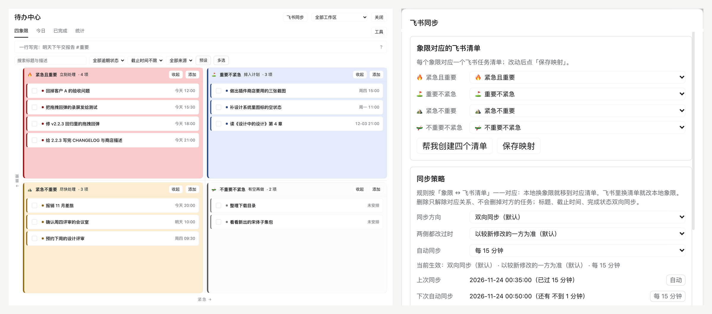

# 🧭 dsh-4quadrant-todo · 四象限待办 —— DeepSeek Harness 插件

<p>
  <a href="https://github.com/ShenpingDD/dsh-4quadrant-todo/releases/latest"></a>
  <a href="LICENSE"></a>
  <a href="package.json"></a>
  <a href="https://awesome-dsh-plugin.com/p/ShenpingDD/dsh-4quadrant-todo/"></a>
</p>

> Four-quadrant (Eisenhower Matrix) todos living in the DeepSeek Harness sidebar, two-way synced with Feishu / Lark Tasks, and able to turn a conversation's pending confirmations into real todos.
>
> DeepSeek Harness 侧栏里的四象限待办中心：与飞书任务清单双向同步，并且能把会话里还没确认的事项直接变成待办。



## 🧩 这是什么

这是一个 **DeepSeek Harness（DSH）插件**，不是独立应用。它以 *web profile bundle* 的形式发布——一个普通的 npm 包，由 DSH 装进某个 profile、每次启动自动加载，往你已经在用的界面里补上四块东西：

| 落点（槽位） | 是什么 |
|---|---|
| `sidebar.panellist` | 侧栏里的「待办中心」面板 —— 四象限看板本体 |
| `main` | 面板展开后的主区域视图 |
| `conversation.input.dock` | 输入框上方的**待确认条**：会话里待确认的事项，点一下变成待办 |
| `shell.overlay` | 悬浮层（提醒气泡等） |

宿主端（`lib/index.js`）在 harness 的 `webServer` 上注册 JSON 路由，负责待办读写、导入导出、提醒与飞书同步；数据落在一个本地 JSON 文件里。除此之外不碰任何东西：不开新窗口、不起独立服务，卸载这个包，面板与待办条一起消失。

> 前提是你已经有一个可用的 DSH 环境（本次发布验证在 **0.2.2-rc.5**）。还没装 DSH 的话请先装它——单独装这个包不会有任何效果。

## 🚀 快速开始

已收录于 [awesome-dsh-plugin](https://awesome-dsh-plugin.com/p/ShenpingDD/dsh-4quadrant-todo/) 注册表，DSH 桌面端的插件市场可以直接搜到并安装。命令行方式（`<profile>` 换成你实际在跑的那个）：

```bash
# web 端
dsh plugin --profile web add github:ShenpingDD/dsh-4quadrant-todo

# 桌面端（DSH.app 自己管理 profile，也可在 App 的「插件市场 / 安装本地插件」里装）
dsh plugin --profile desktop add github:ShenpingDD/dsh-4quadrant-todo

# 本地目录（开发时用，改客户端代码刷新页面即可）
dsh plugin --profile web add "link:/path/to/dsh-4quadrant-todo"

# 重启后侧栏出现「待办中心」
```

卸载：`dsh plugin --profile <profile> remove dsh-4quadrant-todo`。

UI 自动化脚本（`tests/cdp-harness.mjs`）默认指向最初开发用的 Windows 路径，换机器用环境变量覆盖即可：`DSH_TEST_BROWSER`（Edge/Chrome 可执行文件）、`DSH_TEST_ORIGIN`（宿主地址，桌面端多为 `http://127.0.0.1:54916`）、`DSH_WEB_LOG`（写着访问地址的宿主日志）。

## ✨ 功能

- **四象限面板**：每格纵向单列卡片，44 像素行高，标题在左、倒计时贴右边缘齐平；拖拽可跨象限移动。
- **时间压力可读**：倒计时分七档 —— 未安排、逾期（按分、时、天三档精度）、今天、明天、周X、同年月日、跨年；逾期文字与错误文字用 88% 混色。
- **飞书任务清单双向同步**：四个清单对应四个象限，本地与飞书任一侧的增删改、完成、换象限都会在下一轮同步中带到另一侧。同步方向（双向 / 只推送 / 只拉取）、两侧都改过时的取舍（较新 / 本地 / 飞书）与自动同步间隔都在面板「同步策略」里可见可改，结果写入 `sync.log`。
- **会话确认即待办**：DSH 会话里提问卡片的待确认项、工具执行前的审批，会出现在输入框上方的待确认条，点确认就写成待办，象限与截止时间可直接继承。
- **一句话录入**：输入「明天下午交报告 #重要」，解析日期、时段与象限标记，先给预览再确认。
- **完成留痕与复盘**：记下实际完成时间，已完成清单可按今天、本周、本月、自定义、全部查看，统计页给新增与完成数量、象限分布、完成率。
- **本地优先**：数据就是一个 JSON 文件，导出导入都在本机，导入前自动备份并支持撤销；没有账号体系。
- **零运行时依赖**：客户端只依赖 React，Host 只用 Node 内置模块；颜色全部走 DSH 主题令牌，深浅色自适应，系统开启「减少动态效果」时动效归零。

## 📸 界面


实机截图（DeepSeek Harness 0.2.2-rc.5）：左边是四象限面板，右边是「飞书同步」——四个象限各对应一个飞书任务清单，同步方向、两侧都改过时怎么取、自动同步间隔都在这里改，改完下一轮同步就按新规则跑。


四象限面板、与飞书任务清单双向同步、把会话里没确认的事变成待办——这三件事通常散在不同工具里，这里接成一条链路：象限不是贴在任务上的标签，而是飞书清单本身，卡片拖动换象限就等于把它挪进另一个清单，反过来在飞书里换了清单，本地象限也跟着变。待办数据仍是一个本地 JSON 文件，没有账号，也不要求把清单托管到别处；会话里冒出来的待确认项，点确认的那一刻就进入待办列表，象限与截止时间顺着上下文带过来。

## 🔄 飞书同步怎么配

在面板右上角点「飞书同步」：那里能看到 `lark-cli` 装没装、飞书账号登没登、四个象限各对应哪个飞书清单，也能直接生成一次性的飞书授权链接（浏览器确认或飞书扫码，窗口会自动检测结果）。四象限用四个飞书任务清单承载：一个象限对应一个清单，在飞书里把任务拖进/拖出清单，下一轮同步就会把象限变化带回本地。

前置条件（一次就好）：

1. 本机装 `lark-cli` 并登录出用户身份（`lark-cli auth status` 里 `user` 为 ready）。
2. 授权范围含 `task:task:read`、`task:task:write`、`task:tasklist:read`、`task:tasklist:write`；缺哪个面板里会直接写出来。

面板里的顺序：点「生成飞书授权链接」→ 在浏览器完成确认 → 状态变「可用」→ 点「帮我创建四个清单」（默认 `🔥 紧急且重要`、`⛰️ 紧急不重要`、`⛳ 重要不紧急`、`🛶 不重要不紧急`；也可以自己在飞书建好后在下拉里选）→「保存映射」→ 先「立即预演」看统计，再「立即同步」。

命令行等价物（不给 `--api` 时默认 `http://127.0.0.1:3080/plugins/dsh-4quadrant-todo`；桌面端端口每次可能不同，从面板触发最省事）：

```bash
node scripts/feishu-sync.mjs --list-tasklists          # 列出账号下的清单名与 guid
node scripts/feishu-sync.mjs --dry-run                 # 预演：只统计不写入
node scripts/feishu-sync.mjs                           # 真同步
node scripts/feishu-sync.mjs --api http://127.0.0.1:54916/plugins/dsh-4quadrant-todo
```

数据目录默认 `~/.dsh/four-quadrant-todo`（`DSH_HOME` 覆盖一层，`--data-dir` 再覆盖一层）；`LARK_CLI` 环境变量可指向非 PATH 里的 lark-cli。

策略：面板第三段「同步策略」把当前生效的规则摊开写清楚，并且可以直接改——

- **同步方向**：`双向同步`（默认）/ `只推送：本地 → 飞书` / `只拉取：飞书 → 本地`。单向模式下，另一侧的变化不动、计入「跳过」。
- **两侧都改过时**：`以较新修改的一方为准`（默认）/ `以本地为准` / `以飞书为准`。注意是整条覆盖，不做字段级合并。
- **自动同步**：`关闭 / 每 5 / 15 / 30 / 60 分钟`。由桌面端宿主每分钟检查一次、到点跑一轮真同步（DSH 桌面端开着才跑；身份过期或四个象限没配齐时静默跳过）。
- **看得见的时间**：策略段直接显示「上次同步 2026-11-21 19:56:46（已过 12 分钟）· 自动/手动」和「下次自动同步 2026-11-21 20:11:46（还有 3 分钟）」；对话框开着时每 20 秒刷新一次，倒计时自己走。
- 段末一行「当前生效：双向同步 · 以较新修改的一方为准 · 每 15 分钟」是保存后实际执行的那套规则，改完点「保存策略」立即生效。

删除的语义是固定的，不受上面的策略影响：本地删除只把任务移出对应清单，飞书里的任务保留；飞书侧移出清单或删除，本地只解除对应关系。

同步规则：`urgent-important` 等四个键与插件内部的象限标识一一对应；飞书侧不在四个清单里的任务（例如你放进「其他」的）不参与同步；两侧都改过的按面板里选的冲突策略整条覆盖，结果写进 `sync.log`。

## 💾 数据位置与隐私

- 待办：`<DSH_HOME>/four-quadrant-todo/todos.json`，`DSH_HOME` 默认 `~/.dsh`
- 同步配置：`<DSH_HOME>/four-quadrant-todo/sync-config.json`
- 同步映射：`sync-state.json`；同步日志：`sync.log`
- 导入前备份：`todos.before-import-<时间戳>.json`

格式版本为 2；1.0 数据会只读展示并提供升级按钮，文件损坏时阻止加载并报错，不做自动迁移。除你主动开启的飞书同步外，插件不向外发请求，也没有遥测。

## 🧱 兼容性

| DSH | 插件 | 结论 |
| --- | --- | --- |
| 0.2.2-rc.1 | 2.0.0 | 已验证（Host 路由 19 条、界面套件全绿） |
| 0.2.2-rc.5 | 2.0.1 | 已验证（macOS 14 + 桌面端 profile：snapshot 200、41/41 API、39/39 规则、9/9 静态守卫，侧栏「待办中心」已注册） |
| 0.2.2-rc.5 | 2.2.3 | 已验证（26 条路由补上宿主访问检查；macOS 14 上静态守卫与规则套件全绿） |

其他要求：Node.js `>=20`（`package.json` 声明 `engines.dsh = >=0.2.2-rc.1 <0.3.0-0`），profile 装你实际跑的那个。

## 🛠 开发

```bash
node --check lib/index.js
node --check lib/client.js
node --check scripts/feishu-sync.mjs

node tests/host-rules/verify-api-v2.mjs
node tests/host-rules/verify-host-rules.mjs
node tests/host-rules/audit-static.mjs
node tests/ui-check-cards.mjs
node tests/ui-check-edit.mjs
node tests/ui-check-drag.mjs
```

前三个套件自带宿主（真实 `node:http` + 临时数据目录 `tests/host-rules/.run`），不需要 DSH 在跑，任何平台都能直接执行：macOS 14 上 `verify-api-v2` 63/63、`verify-host-rules` 39/39、`audit-static` 9/9 全绿（2026-11-21 复验，DSH 0.2.2-rc.5；同步接口用 `tests/host-rules/stub-lark-cli.mjs` 假 CLI，不会碰真实飞书账号）。

浏览器套件用无头 Edge 通过 CDP 打开界面，需要宿主在跑（默认 `http://127.0.0.1:3080`，桌面端用 `DSH_TEST_ORIGIN` 指向它自己的端口）；会清空待办再恢复的套件在运行前把完整数据写到 `tests/.run/backups`，中断后用 `node tests/restore-backup.mjs <备份文件>` 导回。

## 📚 文档与版本历史

- [docs/PRD-v2.md](docs/PRD-v2.md) · [docs/api-v2.md](docs/api-v2.md) · [docs/architecture-v2.md](docs/architecture-v2.md) · [docs/ui-spec-v2.md](docs/ui-spec-v2.md)
- 早期版本：[docs/PRD.md](docs/PRD.md) · [docs/api.md](docs/api.md) · [docs/architecture.md](docs/architecture.md) · [docs/ui-spec.md](docs/ui-spec.md)
- 变更记录：[CHANGELOG.md](CHANGELOG.md)

## ⚖️ License

MIT，见 [LICENSE](LICENSE)。界面与交互未复制其他项目的代码。
