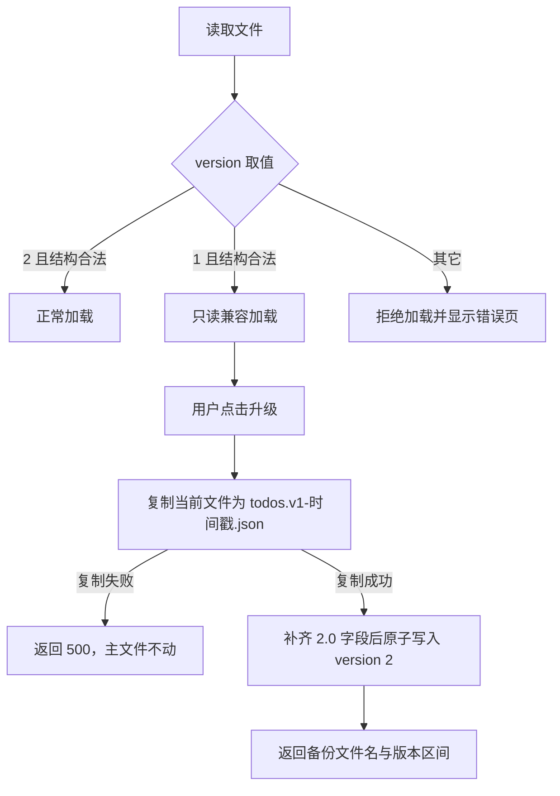

# 待办中心 2.0 产品需求文档

| 项 | 内容 |
| --- | --- |
| 文档版本 | 2.0 |
| 日期 | 2026-11-03 |
| 需求方 | 用户本人（单人本机使用） |
| 基线文档 | `docs/PRD.md` v1.1（验收 1 至 38 条） |
| 需求状态 | 8 个功能已由需求方确认为 2.0 范围，待开发 |
| 适用范围 | v1.1 交付完成并通过 1 至 38 条之后的下一个大版本 |

本文是 `docs/PRD.md` 的增量文档。本文没有写到的条目沿用 `docs/PRD.md` 的原文，包括第 4 节名词、第 5 至 11 节页面与交互、第 12 节存储规则、第 13 节非功能要求、第 14 节技术方案、第 15 节验收 1 至 38 条。本文与 `docs/PRD.md` 冲突时，以本文第 2 节的裁定为准。

## 1. 版本结论

2.0 交付 8 个功能，分三批，共 9 个工作项。数据文件版本从 1 升到 2，升级由用户显式确认。

| 批次 | 主题 | 功能 | 任务号 | 进入该批的理由 |
| --- | --- | --- | --- | --- |
| 批一 | 数据底座与日常录入 | 数据模型 2.0、快速录入、今日视图、标签与自定义筛选 | T21、T22、T23、T24 | 四项共用同一份数据模型与同一套筛选控件，先行交付可以让后续三项直接复用 |
| 批二 | 自动化 | 重复待办、到期提醒 | T25、T26 | 两项都依赖新字段与 Host 侧常驻调度，且都与「完成」动作相连，同批实现一次改完完成流程 |
| 批三 | 洞察与对外连接 | 统计与复盘、与对话双向打通、数据备份与恢复 | T27、T28、T29 | 统计依赖前两批积累的完成时间与截止时间；双向打通依赖平台接口核实；备份与恢复需要数据模型冻结 |

三个批次的顺序由「使用频次 × 失效代价」决定：

| 功能 | 每日使用次数（估） | 失效代价 | 结论 |
| --- | --- | --- | --- |
| 快速录入 | 3 至 10 | 录入成本翻倍，用户绕开这个入口 | 最先 |
| 今日视图 | 2 至 5 | 逾期条目被埋进方格，漏办 | 最先 |
| 标签与筛选 | 每次查找 | 条目超过 200 条后无法定位 | 最先 |
| 重复待办 | 每周 2 至 5 | 周期性事项需要手工重建 | 第二批 |
| 到期提醒 | 被动触发 | 到点无人知晓，提醒是唯一主动信号 | 第二批 |
| 统计与复盘 | 每周 1 次 | 缺少反馈，无法判断分配是否合理 | 第三批 |
| 与对话双向打通 | 每次新任务 | 上下文切换时丢信息 | 第三批 |
| 备份与恢复 | 每月 1 次 | 误操作或换机时数据无法挽回 | 第三批，排在批三第一个 |

## 2. 与 v1.1 既有条目的冲突裁定

| 编号 | v1.1 位置 | 原文要求 | 2.0 裁定 |
| --- | --- | --- | --- |
| C1 | `docs/PRD.md:30`（第 3 节范围） | 本期不包含「系统级通知推送、项目分组层、优先级数值与标签字段、Markdown 渲染、收件箱暂存区、回收站、自动清理、图表统计、全局快捷键」 | 删除「系统级通知推送」「标签字段」「图表统计」三项；保留「项目分组层」「优先级数值」「Markdown 渲染」「收件箱暂存区」「回收站」「自动清理」「全局快捷键」「多人协作」「共享」「云同步」。系统级通知在 2.0 只作为提醒事件的附加呈现，不进入验收 |
| C2 | `docs/PRD.md:341-343`（12.5 迁移） | 「不提供全量导入导出」 | 由 F8 取代。12.5 改写为「备份与恢复见本文 F8」 |
| C3 | `docs/PRD.md:331-333`（12.3 版本校验） | 版本号不认识时拒绝加载，不做自动迁移 | 保留拒绝加载与不做自动迁移；增加「version 1 为已知版本，按只读兼容加载，用户确认后升级为 version 2」。详见第 3 节 |
| C4 | `docs/PRD.md:145-155`（6.8 多选与批量操作） | 「多选入口位于卡片左侧，悬停时出现」 | 6.8 已按 v1.1 交付改写为：卡片左侧固定一个 20×20 控件位（浏览态为完成框，多选态为选择框），多选入口为工具栏开关，Esc 先退出多选。2.0 在该开关旁增加「全选当前筛选结果」动作，复用同一多选状态；验收 31 的判定口径按改写后的 6.8 执行 |
| C5 | `docs/PRD.md:472`（验收 29） | 「方格边界与相邻方格之间的非文字对比度不低于 3:1」 | 判定对象明确为「方格左强调条对相邻方格底」；方格底自身对相邻方格底不单独判定。验收 29 文本改为这一口径 |
| C6 | `docs/PRD.md:52`（5.1） | 「左侧栏收成窄条时只显示图标，文字进入悬停提示」 | 限定为侧栏展开状态。侧栏收起时 DSH 隐藏面板列表，插件不额外处理；验收 28 的三种状态都在侧栏展开下判定 |
| C7 | `docs/PRD.md:119`（6.5 卡片内容） | 操作入口为「编辑、改象限、删除」 | 增加「发起会话」与「复制重复设置」，共五项。子待办卡片只有「编辑、删除」 |
| C8 | `docs/PRD.md:155-175`（第 7 节任务字段）与 `docs/PRD.md:129-133`（6.6 校验） | 描述上限 20000 字 | 保持 20000 字，与 `docs/api.md:60` 与 `lib/index.js:16` 的现行实现一致。验收 33 按 20000 字判定 |
| C9 | `docs/PRD.md:335-337`（12.4 规模） | 未完成 1000 条、已完成 1 万条以内，永久保留 | 已完成上限改为 2 万条。2.0 增加统计与重复链，历史容量需求上升；上限之外的条目仍不删除，只在达到上限时拒绝新建重复实例并提示用户先导出 |
| C10 | `docs/PRD.md:556`（19.2 版本记录） | 新增验收 28 至 38 条 | 保持。第 15.7 节现有 38 条，16.4 的 T20 引用验收 38，2.0 新增 39 至 75 条 |

C4 的裁定理由：6.8 的正文以 v1.1 交付的交互为准。单一控件位在两种状态下都存在，键盘可达由该控件与工具栏开关共同满足，验收 31 因此可以继续作为回归项。2.0 只增加一个「全选当前筛选结果」的批量入口。

## 3. 数据模型 2.0 与版本兼容

### 3.1 文件结构

```json
{
  "version": 2,
  "todos": [],
  "collapsed": {},
  "filters": [],
  "settings": {
    "reminderLeadMinutes": 30,
    "statsRange": "week"
  },
  "meta": {
    "upgradedAt": null,
    "upgradedFrom": null
  }
}
```

### 3.2 待办条目

沿用 `docs/api.md:57-70` 的 `TodoItem`，增加六个字段：

```ts
interface Reminder {
  leadMinutes: 0 | 5 | 15 | 30 | 60 | 1440
  snoozeUntil: string | null
}

interface Recurrence {
  freq: 'daily' | 'weekly' | 'monthly'
  interval: number          // 1..12
  until: string | null      // 最后一条实例的截止时间上限
}

interface TodoItemV2 {
  // 以下六项为 2.0 新增
  tags: string[]                    // 0..10 项，每项 1..20 字，同一条内不重复
  recurrence: Recurrence | null     // 非空表示该条完成后生成下一条
  seriesId: string | null           // 重复链标识，同一链全部条目共享
  generatedFromId: string | null    // 由哪条待办生成，链首为 null
  reminder: Reminder | null         // 空表示不提醒
  remindedAt: string | null         // 已发出的提醒时间，空表示未提醒
  startedSessionId: string | null   // 由该待办发起的会话标识
  startedAt: string | null          // 发起会话的时间
}
```

`source` 与 `sourceKey` 的规则不变。重复实例的 `source` 为 `{ kind: 'manual' }`，`sourceKey` 为 `null`，来源用 `generatedFromId` 追溯到链首。

### 3.3 筛选预设

```ts
interface FilterConditions {
  tags: string[]                    // 0..10 项，匹配口径见 F5
  quadrants: Quadrant[]             // 空数组表示不限
  dueState: 'all' | 'overdue' | 'notOverdue' | 'noDue'
  dueRange: { kind: 'any' | 'today' | 'week' | 'range', from: string | null, to: string | null }
  source: 'all' | 'manual' | 'conversation'
  keyword: string                    // 空字符串表示不限
}

interface FilterPreset {
  id: string                        // f_<uuid>
  name: string                      // 1..40 字，同一条数据文件内不重名
  conditions: FilterConditions
  createdAt: string
  updatedAt: string
}
```

预设不记录工作区与标签页，工作区切换器独立生效。

### 3.4 版本兼容矩阵

| 文件状态 | 读取 | 写入 | 界面 |
| --- | --- | --- | --- |
| 文件不存在 | 建立 version 2 空结构 | 允许 | 正常 |
| `version` 为 1，结构校验通过 | 按只读兼容加载，缺失字段以缺省值补齐（`tags: []`、`recurrence: null`、`seriesId: null`、`generatedFromId: null`、`reminder: null`、`remindedAt: null`、`startedSessionId: null`、`startedAt: null`、`filters: []`、`settings` 取默认） | 拒绝，直到用户确认升级 | 顶部横幅「数据格式为 1.0，升级后可用 2.0 功能」，带「升级」按钮；全部写操作按钮禁用并显示原因 |
| `version` 为 2，结构校验通过 | 正常加载 | 允许 | 正常 |
| `version` 缺失、为其它整数、JSON 解析失败、结构校验失败 | 拒绝加载 | 拒绝 | 错误页沿用 `docs/PRD.md:331-333`，写明文件路径、实际版本值、允许的版本为 1 或 2，以及第一条校验失败原因 |

### 3.5 升级流程



规则：

1. 未经用户点击升级，任何写请求都返回 400，错误文本为「数据格式为 1.0，请先升级」。这一条是「不做自动迁移」的具体执行方式。
2. 升级备份文件名形如 `todos.v1-20261103-1730.json`，与主文件同目录。
3. 升级只补齐字段，不改变任何既有条目的取值。
4. 降级由用户手工完成：把备份文件复制为 `todos.json`。2.0 不提供界面降级按钮。1.x 只认 version 1，因此降级后 1.x 可以正常读取。
5. 结构校验对 version 2 只校验已定义字段的类型与取值范围；未识别的键原样保留并写回，避免跨版本丢数据。

### 3.6 可观察验收

70. 把 `version` 为 1 的数据文件放入数据目录后打开面板：列表正常显示，顶部出现升级横幅，新建与完成按钮禁用并显示「数据格式为 1.0，请先升级」。
71. 点击升级：数据目录内出现 `todos.v1-<时间戳>.json`，主文件 `version` 变为 2，条目的标题、象限、截止时间、完成状态逐条与升级前一致，升级横幅消失，写操作恢复可用。
72. 把 `version` 改为 3 后打开面板：显示错误页，写明路径、实际版本 3、允许的版本 1 或 2；此时数据文件的修改时间不变，内容字节不变。

## 4. 功能需求

### F1 快速录入

#### 需求条目

1. 「四象限」与「今日」两个页面的顶部各有一条快速录入输入行，宽度与内容列一致，占位文字为「一行写完：明天下午交报告 #重要」。
2. 输入、回车后在本行下方就地展开解析预览区，显示解析出的标题、截止时间、象限、标签四项。
3. 预览区四个字段都可修改：标题用文本输入，截止时间用日期时间选择器，象限用下拉，标签用可增删的标记。
4. 用户确认（点「添加」或再次回车）后才写入数据；写入成功后清空输入行、收起预览区，新卡片高亮 2 秒。
5. 解析在本机按固定规则完成，不调用模型，不发网络请求；同一输入在任何时刻得到同一结果。
6. 悬停输入行右侧的问号显示语法说明：日期词、时刻词、象限标记、标签标记各一组示例。

#### 解析规则

日期部分：

| 写法 | 解析结果 | 备注 |
| --- | --- | --- |
| 今天、今日 | 当天 | |
| 明天、明日 | 当天 +1 日 | |
| 后天 | 当天 +2 日 | |
| 大后天 | 当天 +3 日 | |
| 周X、星期X、礼拜X | 本周内尚未过去的那一天；已经过去则取下一周同一天 | X 为一至日 |
| 下周X | 下一个自然周的第 X 天 | 自然周从周一起算 |
| `2026-11-05`、`11-05`、`11/5`、`11月5日` | 该日期 | 省略年份时取当前年份，日期已过也不顺延到下一年 |

时刻部分：

| 写法 | 解析结果 |
| --- | --- |
| `14:00`、`14点`、`14点30`、`下午3点半` | 对应时刻 |
| 只有时段词：上午 09:00，中午 12:00，下午 14:00，傍晚 18:00，晚上 20:00 | 该时段的默认时刻 |
| 有日期无时刻 | 当日 23:59 |
| 只有时刻无日期 | 今天该时刻；该时刻已过则取明天 |
| 无任何时间片段 | 截止时间为空 |

象限标记与标签：

| 写法 | 结果 |
| --- | --- |
| `#紧急重要`、`#重要紧急` | 紧急且重要 |
| `#重要` | 重要不紧急 |
| `#紧急` | 紧急不重要 |
| `#一般`、`#不紧急不重要` | 不重要不紧急 |
| 未写象限标记 | 紧急且重要 |
| 其它 `#` 开头的片段 | 作为标签，标签内容为去掉 `#` 后的连续非空白字符 |

标题为去掉全部已识别片段后的剩余文本，去除首尾空白。

#### 字段与数据结构

解析结果使用一个内存对象，不写入数据文件：

```ts
interface QuickParseResult {
  title: string
  dueAt: string | null          // 本机时区换算后转成带时区标识的 ISO 8601
  quadrant: Quadrant
  tags: string[]
  matched: string[]             // 被识别并移除的原文片段，用于预览区高亮
}
```

写入时使用 `POST /create`，携带 `title`、`quadrant`、`dueAt`、`tags`、`description`（空字符串）、`workspaceId`（取当前工作区筛选值；该值为「全部工作区」时写入 `null`）。

#### 接口

| 路由 | 用途 | 请求字段 | 响应 |
| --- | --- | --- | --- |
| 无新增路由 | 解析在客户端完成 | — | — |
| `POST /create` | 写入解析结果 | `title, quadrant, dueAt, tags, description?, workspaceId?` | `WriteResult & { focusId }`，字段定义见 `docs/api-v2.md` |

#### 界面与交互

| 元素 | 规格 |
| --- | --- |
| 输入行 | 高 36 像素，单行，左内边距 12 像素，字号 14 像素，底色 `--dsw-alias-bg-layer-1`，边框 `--dsw-alias-border-l1`，聚焦时边框取 `--dsw-focus-ring-color` |
| 预览区 | 输入行下方 8 像素处展开，四行字段标签与控件，右侧靠外一个「添加」主按钮与一个「取消」次按钮 |
| 高亮 | 新卡片边框取 `--dsw-alias-state-business-primary`，2 秒后恢复 |
| 键盘 | 输入行按回车展开预览；预览区内 Tab 在四个字段与两个按钮之间移动；在预览区按 Esc 收起预览并保留输入行原文；在任何位置按 Ctrl+Enter 提交 |

#### 边界与异常

1. 标题为空（输入只有时间词与标记）：拒绝写入，预览区标题字段下方显示「标题不能为空」，输入行原文保留。
2. 输入超过 200 字：输入行拒绝继续输入，并在右侧显示剩余字数。
3. 同一行出现两个时间片段：取第一个，其余文本保留在标题中。预览区显示「已取第一个时间」。
4. 无法识别的时间表达（例如「改天」「尽快」）：不作为时间处理，全部保留在标题中，截止时间为空，预览区显示「未识别截止时间」。
5. `11/5` 与 `11-05` 同时可能被理解为刻度或编号时，按日期处理，并在预览区给出可改的截止时间，用户可以清空。
6. 象限标记与标签重名（例如用户想创建一个名为「重要」的标签）：四个象限标记关键字保留，不能作为标签。标签输入在同一行写 `#重要` 会被识别为象限。
7. 标签超过 10 个或单项超过 20 字：预览区提示「标签最多 10 个，每个最多 20 字」，禁止提交，直到用户删减。
8. 写入失败（文件不可写、版本未升级）：预览区保留，就地显示服务端返回的错误文本，允许重试。

#### 可观察验收

39. 在输入行输入「明天下午交报告 #重要」并回车：预览区标题为「交报告」、截止时间为次日 14:00、象限为「重要不紧急」、标签为空；点「添加」后右上方格出现标题为「交报告」的卡片，计划截止时间为次日 14:00，输入行清空。
40. 输入「下周三 开会 14点 #紧急」：截止时间为下一个自然周的周三 14:00，象限为「紧急不重要」，标题为「开会」。
41. 输入「#紧急 修水管 #家里」：象限为「紧急不重要」，标签为「家里」，截止时间为空，标题为「修水管」。
42. 输入「明天下午」并回车：预览区标题为空并显示「标题不能为空」，点「添加」不产生任何待办，数据文件的修改时间不变。

#### 风险

R1、R2、R9。

### F2 今日视图

#### 需求条目

1. 页面标签从两个增加到四个，顺序为「四象限」「今日」「已完成」「统计」。默认选中「四象限」，`docs/PRD.md:66` 的默认标签规则不变。
2. 「今日」页把当前工作区筛选下的未完成顶层待办分成五个分区：已逾期、今天到期、未来 7 天、更晚、未安排。
3. 分区定义：已逾期为计划截止时间早于当前时刻；今天到期为计划截止时间在今天 00:00 至 23:59 之间且未逾期；未来 7 天为明天 00:00 至第 7 天 23:59；更晚为第 7 天之后的截止时间；未安排为计划截止时间为空。
4. 每个分区有标题与计数，形如「今天到期 · 3 项」。
5. 分区内排序沿用 `docs/PRD.md:101-109` 的规则。
6. 已逾期、今天到期、未来 7 天与未安排默认展开；「更晚」默认折叠。五个分区都可折叠，折叠状态在本次会话内保持，不写入数据文件。
7. 分区为空时显示一行「暂无」，不显示添加按钮。
8. 面板保持打开时，每 60 秒重新计算分区归属；跨过 00:00 后，原来属于「未来 7 天」的条目自动进入「今天到期」。
9. 今日页的卡片提供完成勾选框与操作入口（编辑、改象限、删除、发起会话），不提供拖拽改象限。
10. 今日页顶部同样有快速录入输入行（F1），顺序在分区之上。

#### 字段与数据结构

无新增字段。分区由 `dueAt`、`status`、当前时刻计算得到：

```ts
type TodaySection = 'overdue' | 'today' | 'next7' | 'unscheduled'

interface TodayGroup {
  section: TodaySection
  todos: TodoItemV2[]           // 已按 6.3 规则排序
  count: number
}
```

#### 接口

无新增路由，使用 `GET /snapshot` 的全量数据在客户端分组。

#### 界面与交互

| 元素 | 规格 |
| --- | --- |
| 分区标题 | 字号 13.5 像素、字重 500，右侧计数取 `--dsw-alias-label-secondary`，整行可点击折叠 |
| 分区容器 | 分区之间间距 16 像素，每个分区顶部 0.5 像素分隔线取 `--dsw-alias-border-l2` |
| 卡片 | 密度与四象限页一致，`docs/ui-spec-v2.md` 给出最终规格 |
| 滚动 | 整页滚动，不分格滚动；内容列与四象限页同宽，铺满核心画布，窄于 900 像素时四个象限改为纵向堆叠 |
| 键盘 | 分区标题是按钮，回车或空格切换折叠；Tab 顺序为分区标题、分区内卡片、卡片内操作 |

#### 边界与异常

1. 待办的计划截止时间恰好等于当前分钟：按未逾期处理，归入「今天到期」。
2. 计划截止时间在第 7 天之后：归入「更晚」分区。「更晚」默认折叠，不再切分。
3. 时区变化（系统时区被修改）：分区按本机时区重新计算，重新打开面板后生效。
4. 子待办不出现在今日页。
5. 已完成条目不出现在今日页。
6. 数据为空：五个分区的标题与「暂无」都显示，页面不出现错误。

#### 可观察验收

43. 构造五条待办：截止时间为昨天、今天 18:00、5 天后、30 天后、无截止时间。打开今日页：「已逾期」1 项含昨天那条，「今天到期」1 项含今天 18:00 那条，「未来 7 天」1 项含 5 天后那条，「更晚」1 项含 30 天后那条，「未安排」1 项含无截止时间那条，各分区计数与卡片一致。
44. 把系统时间跨过 00:00（或把某条截止时间改为明天 00:30 后等到次日）：该条从「未来 7 天」移动到「今天到期」，无需刷新页面，等待 60 秒内完成移动。
45. 折叠「未来 7 天」后切换到四象限页再切回今日页：该分区仍为折叠状态；关闭面板再打开：恢复为展开状态。

#### 风险

R2、R10。

### F3 到期提醒

#### 需求条目

1. 每条顶层待办可设置提醒：提前 0、5、15、30、60、1440 分钟，或者不提醒。默认取设置项的 30 分钟。
2. 提醒由 Host 半常驻调度，面板未打开时同样生效。调度不依赖页面挂载。
3. 到达提醒时间后 60 秒内，界面出现提醒信号：侧栏入口图标右上角出现提醒标记，标记数等于待提醒条数；面板内「今日」页顶部出现提醒区，逐条列出已提醒且未完成的待办。
4. 提醒区的每条待办带「完成」与「稍后 10 分钟」两个动作。
5. 提醒只发一次：同一条待办在同一个截止时间下重复进入检查周期不重复提醒。
6. 修改截止时间后清除已提醒记录，按新时间重新计一次提醒。
7. 待办完成、删除、撤销后不再提醒；撤销已完成待办时清除已提醒记录，若此时已过提醒时间则立即补发一次。
8. 子待办不单独提醒。
9. 提醒区全部处理后，侧栏提醒标记消失。
10. 页内浮层与系统通知是同一提醒事件的附加呈现，由 `docs/architecture-v2.md` 按平台能力决定，不进入验收。

#### 字段与数据结构

`reminder`、`remindedAt` 见 3.2。提醒判定：

```ts
function reminderDue(todo: TodoItemV2, now: Date): boolean {
  if (todo.status !== 'open') return false
  if (todo.dueAt === null || todo.reminder === null) return false
  if (todo.remindedAt !== null) return false
  const fireAt = Date.parse(todo.dueAt) - todo.reminder.leadMinutes * 60_000
  const snoozeAt = todo.reminder.snoozeUntil === null ? 0 : Date.parse(todo.reminder.snoozeUntil)
  return now.getTime() >= Math.max(fireAt, snoozeAt)
}
```

「待提醒」条目为 `remindedAt !== null && status === 'open'`。

#### 接口

| 路由 | 用途 | 请求字段 | 响应 |
| --- | --- | --- | --- |
| `POST /update` | 设置或清除提醒 | `id, reminder: { leadMinutes } \| null` | `WriteResult` |
| `POST /snooze` | 稍后 10 分钟 | `id, minutes` | `WriteResult` |
| `GET /snapshot` | 读取 `remindedAt` 与 `reminder` | — | 全量数据 |
| `GET /reminders` | 取待提醒条目与计数 | — | `{ count, todos, at }` |
| Host 定时器 | 每 30 秒扫描一次，命中即写 `remindedAt` | — | 写入后由下一次 `GET /reminders` 获知 |

客户端在页面存活期间每 30 秒请求一次 `GET /reminders`，返回已提醒且未完成的条目与计数。侧栏提醒标记与今日页提醒区共用这一份数据；面板关闭时照常请求，因为侧栏标记要在面板关闭状态下出现（验收 46）。

#### 界面与交互

| 元素 | 规格 |
| --- | --- |
| 侧栏提醒标记 | 位于角标位置上方 2 像素处，直径 8 像素，底色 `--dsw-alias-state-warn-primary`，无文字；悬停提示「N 条待办已到提醒时间」 |
| 提醒区 | 今日页顶部，底色取 `--dsw-alias-bg-layer-1` 与 `--dsw-alias-state-warn-primary` 的 8% 混合，左边框 3 像素取警告色；区内每条一行，行尾两个按钮 |
| 稍后 10 分钟 | 点击后该条从提醒区消失，10 分钟后重新出现 |
| 完成 | 点击后该条完成，从提醒区与今日页分区中移出 |

#### 边界与异常

1. 提醒时间早于当前时刻但从未提醒（例如 DSH 关闭了几天）：启动后 60 秒内补发一次，标记与提醒区同时出现。
2. 提醒时间等于当前时刻：本次检查周期内触发。
3. 已完成但在提醒时间之前完成：不提醒。
4. 待办在提醒发出后被删除：提醒区在下一次拉取时移除该条，标记数同步。
5. 修改截止时间到过去：清除已提醒记录后立即补发一次，可能出现短时间内两次提醒。这一条在界面上以「已改为更早的时间」提示说明。
6. 定时器写入失败（文件不可写）：不写 `remindedAt`，不产生提醒，控制台打印错误并保留下一次重试机会。界面在下次拉取时仍显示该条未提醒。
7. 系统时钟回拨：`remindedAt` 已写的条目不重复提醒；未写的条目按回拨后的时间重新判定。

#### 可观察验收

46. 新建一条待办，截止时间为 2 分钟后，提醒设为提前 0 分钟；关闭面板等待 60 秒：侧栏图标出现提醒标记，标记数为 1。
47. 打开面板进入今日页：提醒区列出该条，带「完成」与「稍后 10 分钟」；点「完成」后该条进入已完成清单，提醒区与侧栏标记同时消失。
48. 对另一条截止时间为 2 分钟后的待办重复第 46 步，再点「稍后 10 分钟」：该条立即从提醒区消失，侧栏标记消失；10 分钟后（±30 秒）该条重新出现在提醒区，标记重新出现。
49. 把一条已提醒但未完成的待办的截止时间改为 3 分钟后：已提醒记录被清除，60 秒后再次出现提醒；同一条在同一个截止时间下等待两个检查周期，提醒只出现一次。

#### 风险

R4、R11。

### F4 重复待办

#### 需求条目

1. 顶层待办可设置重复：按天、按周、按月，间隔为 1 至 12 个周期，可选终止时间。
2. 设置入口在添加面板与编辑面板的「重复」行；重复为选填项。
3. 完成一条带重复的待办时，在同一个写入操作内生成下一条实例：标题、描述、象限、工作区、标签、提醒设置、重复设置、子待办内容一致，状态为未完成，截止时间按周期推进。
4. 只生成下一条，不预生成未来的多条。
5. 生成的下一条与已完成的那条共享 `seriesId`；链首的 `seriesId` 在第一次完成时写入，已完成的那条同时补写 `seriesId`。
6. 达到终止时间的下一条不生成；此时链结束，已完成记录保留。
7. 撤销完成不删除已生成的下一条；再次完成同一条时按去重规则不重复生成。
8. 新实例的子待办复制全部子待办标题，状态重置为未完成，完成时间为空。
9. 新实例的 `source` 为 `{ kind: 'manual' }`，`sourceKey` 为 `null`，`generatedFromId` 指向刚完成的条目。
10. 同一 `seriesId` 与同一截止时间只允许存在一条未删除的顶层条目。

#### 字段与数据结构

见 3.2 的 `Recurrence`、`seriesId`、`generatedFromId`。截止时间推进规则：

| 频率 | 推进方式 | 示例 |
| --- | --- | --- |
| 按天 | 原截止时间加 `interval` 个自然日，保留时分 | 11-03 14:00、间隔 1 → 11-04 14:00 |
| 按周 | 原截止时间加 `interval × 7` 个自然日，保留时分 | 11-03 14:00、间隔 2 → 11-17 14:00 |
| 按月 | 原截止时间加 `interval` 个自然月，日期超出当月最后一天时取当月最后一天，保留时分 | 01-31 09:00、间隔 1 → 02-28 09:00 |
| 原截止时间为空 | 以完成时刻为基准按上表推进 | 完成于 11-03 16:20、按天间隔 1 → 11-04 16:20 |

#### 接口

| 路由 | 用途 | 请求字段 | 说明 |
| --- | --- | --- | --- |
| `POST /create` | 创建时设置重复 | `recurrence?: Recurrence` | 服务端分配 `seriesId` |
| `POST /update` | 修改重复设置 | `id, recurrence: Recurrence \| null` | 清除重复时保留 `seriesId`（历史记录仍可追溯） |
| `POST /complete` | 完成并生成下一条 | 不变 | 响应 `WriteResult` 同时包含原条与新建实例 |
| `POST /duplicateRecurrence` | 把一条待办的重复设置复制到另一条 | `sourceId, targetId` | C7 的「复制重复设置」入口 |

#### 界面与交互

| 元素 | 规格 |
| --- | --- |
| 重复行 | 添加与编辑面板内，三个控件：频率下拉（不重复、按天、按周、按月）、间隔数字输入（1 至 12）、终止日期选择器（可空） |
| 卡片标记 | 带重复的卡片标题右侧显示一个循环图标，悬停提示「每 N 天重复，到 <日期> 结束」 |
| 生成后的表现 | 完成后原条从方格移出，新实例立即出现在同一方格，位置按排序规则决定；新实例边框高亮 2 秒 |
| 键盘 | 重复行三个控件按 Tab 顺序可编辑；循环图标仅为装饰，不进入 Tab 顺序 |

#### 边界与异常

1. 按月重复遇 31 日：2 月取 28 日或 29 日，4、6、9、11 月取 30 日。
2. 终止时间早于下一条的截止时间：不生成，且把原条的 `recurrence` 置为 `null` 并在卡片上提示「重复已结束」。
3. 终止时间等于下一条的截止时间：生成该条，此后不再生成。
4. 完成一条子待办不触发任何生成。
5. 已完成条目被删除：链中其它条目不受影响。
6. 同一条被快速连点两次完成：第二次请求命中「已经完成的条目跳过」规则，不生成第二条。
7. 生成的新实例使已完成条数达到 `docs/PRD.md:335-337` 的上限（2 万条）：不生成，提示「已完成记录已达上限，请先导出备份」，原条目的完成状态保留。
8. 修改已完成的条目的重复设置：允许，但不补生成历史实例。
9. 复制重复设置时目标条目已有重复设置：覆盖，并在确认对话框写明。

#### 可观察验收

50. 创建一条截止时间为 2026-11-05 09:00、按天间隔 1、终止时间为 2026-11-08 的待办，勾选完成：方格里出现新实例，标题、象限、标签、子待办数量与原条一致，截止时间为 2026-11-06 09:00，状态为未完成；新实例的 `generatedFromId` 等于原条标识（在导出文件中查看）。
51. 连续完成同一链上 3 条：数据文件里出现 4 条同 `seriesId` 的条目，每条截止时间依次为 11-05、11-06、11-07、11-08 的 09:00，没有重复的同截止时间条目。
52. 把一条 2026-01-31 09:00 的按月重复待办完成：新实例截止时间为 2026-02-28 09:00。
53. 对终止时间为 2026-11-08 的链完成第 4 条（截止时间 11-08）：不生成新实例，原条卡片提示「重复已结束」；撤销该条的完成后再完成一次，条目总数不增加。

#### 风险

R3、R10。

### F5 标签与自定义筛选

#### 需求条目

1. 待办可带 0 至 10 个标签，每个标签 1 至 20 字，同一条内不重复。
2. 标签在添加面板与编辑面板的「标签」行编辑：输入框加回车即添加一个标记，标记右侧有删除按钮；输入框下方列出已有标签供点选，按使用次数从多到少排列，最多显示 20 个。
3. 标签集合由全部待办的标签取并集得到，不单独存储，不单独维护。
4. 四象限页、今日页、已完成页的筛选区增加标签筛选：可多选，选中多个时按「同时含有全部选中标签」匹配。
5. 筛选区的其余条件沿用 `docs/PRD.md:303` 的三项（逾期状态、计划截止时间范围、来源），2.0 增加关键词搜索的同一位置复用 `docs/PRD.md:301` 的搜索框。
6. 当前筛选条件可保存为预设：名称 1 至 40 字，同一份数据文件内不重名，最多 20 个预设。
7. 预设列表显示在筛选区右侧的下拉中；选中一个预设即把该预设的条件写入当前筛选控件。
8. 修改任一条件后，预设下拉显示「已修改」；用户可「更新当前预设」或「另存为新预设」。
9. 预设可删除，删除前有确认对话框。
10. 预设不记录工作区与标签页。

#### 字段与数据结构

见 3.3 的 `FilterPreset` 与 `FilterConditions`。匹配口径：

| 条件 | 匹配规则 |
| --- | --- |
| `tags` | `tags` 非空时，待办的标签集合必须包含全部选中标签 |
| `quadrants` | 空数组不限；非空时待办象限在其中 |
| `dueState` | `overdue` 为未完成且截止时间早于现在；`notOverdue` 为完成或截止时间不早于现在；`noDue` 为截止时间为空 |
| `dueRange` | `today` 为今天 00:00 至 23:59；`week` 为本周一 00:00 至本周日 23:59；`range` 使用 `from` 与 `to`，两端都含 |
| `source` | `manual` 为 `source.kind` 为 `manual`；`conversation` 为 `conversation` |
| `keyword` | 匹配标题或描述，不区分大小写 |

#### 接口

| 路由 | 用途 | 请求字段 | 响应 |
| --- | --- | --- | --- |
| `POST /filterSave` | 新建或更新预设 | `preset: { id?, name, conditions }` | `{ preset, filters }` |
| `POST /filterRemove` | 删除预设 | `id` | `{ filters }` |
| `GET /snapshot` | 返回全部预设 | — | `filters` 字段 |
| `POST /create`、`POST /update` | 写入标签 | `tags: string[]` | `WriteResult` |

#### 界面与交互

| 元素 | 规格 |
| --- | --- |
| 标签标记 | 高 20 像素，圆角 4 像素，左右内边距 6 像素，底色为 `--dsw-alias-label-secondary` 的 12% 混合，文字取 `--dsw-alias-label-secondary` |
| 筛选区 | 与搜索框同一行，右侧依次为标签多选、逾期状态、截止范围、来源、预设下拉 |
| 预设下拉 | 每行左侧名称、右侧删除图标；底部一行「保存当前条件」 |
| 已修改状态 | 预设名称后追加「（已修改）」，下拉内出现「更新当前预设」与「另存为新预设」两项 |

#### 边界与异常

1. 预设引用的标签在数据里已不存在：应用后显示 0 条，并在筛选区下方提示「以下标签已无匹配：<标签名>」，预设本身不删除。
2. 标签被删除后，包含该标签的条目保留其它标签。
3. 预设重名：保存时提示「已存在同名预设」，不写入。
4. 预设超过 20 个：保存按钮禁用并提示「最多保存 20 个筛选条件」。
5. 标签总数超过 200：标签选择器改为带搜索框的滚动列表，输入即过滤。
6. 标签内容含空格：允许，一个标签就是一个标记；前后空白被去除。
7. 同一个标签在不同条目的大小写不同：视为两个不同标签（本项目界面为中文，不做大小写折叠）。
8. 关键词搜索与标签筛选同时生效：取交集。

#### 可观察验收

54. 给三条待办分别加标签「工作」「家里」「工作 家里」：选中标签「工作」时列出两条；同时选中「工作」与「家里」时只列出第三条。
55. 把「逾期 + 标签 工作 + 本周」保存为预设「本周遗留」：清空筛选后从预设下拉选中它，四个控件回到该组合，列表结果与保存前一致。
56. 删除标签「家里」的全部使用后应用预设「工作 家里」：列表为 0 条，筛选区下方显示「以下标签已无匹配：家里」，预设仍在列表中。
57. 保存第 21 个预设：保存按钮禁用并显示「最多保存 20 个筛选条件」；把名称改为已存在的名称：提示「已存在同名预设」，预设数量不变。

#### 风险

R9。

### F6 统计与复盘

#### 需求条目

1. 页面标签增加「统计」，位于「已完成」之后。
2. 统计页顶部为区间选择：本周、本月、近 90 天、自定义起止日期。默认取设置项的 `statsRange`，缺省为本周。
3. 统计页展示四项指标：区间完成数、区间逾期比、当前未完成待办的象限分布、区间完成的象限分布。
4. 统计页展示最近 8 个自然周的完成数柱状图。
5. 全部统计只计入顶层待办，子待办不计入，页面上有一行说明。
6. 逾期比的分母为区间内完成且有计划截止时间的待办数，分子为其中完成时间晚于计划截止时间的条数；分母为 0 时显示「—」。
7. 区间按本机时区的自然日、自然周、自然月边界计算；`completedAt` 为 UTC 字符串，先换算到本机时区再归入区间。
8. 统计只读，不提供导出图片与保存报表。
9. 统计页的数据由客户端用全量快照计算，Host 不提供聚合接口。

#### 字段与数据结构

统计结果为一个内存对象，不写入数据文件：

```ts
interface StatsResult {
  range: { from: string, to: string }
  doneCount: number
  overdueRatio: { numerator: number, denominator: number } | null
  openByQuadrant: Record<Quadrant, number>
  doneByQuadrant: Record<Quadrant, number>
  weeklyDone: { weekStart: string, count: number }[]   // 8 项，含本周
  openOverdueCount: number
}
```

#### 接口

无新增路由。使用 `GET /snapshot` 的全量数据计算。

#### 界面与交互

| 元素 | 规格 |
| --- | --- |
| 区间选择 | 四个单选按钮，选中项底色取 `--dsw-alias-bg-layer-1`，文字取 `--dsw-alias-label-primary` |
| 指标卡 | 两列网格，卡片内数字字号 20 像素、字重 500，说明文字 13 像素取 `--dsw-alias-label-secondary` |
| 象限分布 | 四条水平条，条长按占比，颜色取本象限的强调色令牌；条右侧显示计数与百分比 |
| 每周柱状图 | 8 根柱，柱高按最大值归一，柱顶显示计数，横轴为周一日期（月-日） |
| 空态 | 区间内无完成记录时，指标卡显示 0，柱状图为空的基线，并显示一行「该区间没有完成记录」 |
| 键盘 | 区间选择可用方向键切换；图表本身不可聚焦，数值以文本形式同时提供 |

#### 边界与异常

1. 数据只有未完成条目：完成数为 0，逾期比显示「—」，象限分布照常显示未完成部分。
2. 待办的完成时间早于创建时间（手工改过数据文件）：照常计入区间，不做修正。
3. 跨月的周：本周一的日期作为该周的标签，区间筛选按自然日切分，一周可能被区间边界切成两段，此时该周只计入区间内的部分。
4. 自定义区间起点晚于终点：拒绝计算，区间选择下方显示「开始日期不能晚于结束日期」。
5. 数据规模 2 万条时统计计算超过 300 毫秒：显示一次「正在统计」占位，计算完成后替换为结果。

#### 可观察验收

58. 本周完成 3 条，其中 1 条完成时间晚于计划截止时间，另外 2 条无计划截止时间：区间完成数为 3，逾期比为 1/1（分母只计有截止时间的那 1 条），页面显示「100%」。
59. 当前未完成待办为 4 条，分布在四个象限各 1 条：未完成象限分布四条各显示 1 与 25%；本周完成分布只统计本周完成的条目。
60. 连续完成 9 周的数据各 1 条（可用导入构造）：柱状图显示 8 根柱，最右侧为本周，计数与导入数据一致。
61. 选择自定义区间，开始日期晚于结束日期：不显示任何数字，显示「开始日期不能晚于结束日期」；把系统时区从东八区改为东九区后重开面板：原先在 23:30 完成的条目改归入次日，完成数按新时区重新计算。

#### 风险

R8、R10。

### F7 与对话双向打通

#### 需求条目

1. 顶层待办卡片操作增加「发起会话」：点击后新建一个会话，首条用户消息内容为待办标题；描述非空时，首条消息为标题、一个空行、描述。
2. 新会话所属工作区取待办的 `workspaceId`；该值为空时使用当前默认工作区。
3. 发起成功后写入 `startedSessionId` 与 `startedAt`，卡片显示「已发起会话」标记；点击标记打开该会话。
4. 同一待办再次发起会话：创建新的会话并覆盖 `startedSessionId`，确认对话框写明「已有会话，将新建一个会话并替换标记」。
5. 会话一侧的加入入口沿用 `docs/PRD.md:264-270` 与 10.3 至 10.6；2.0 增加加入时可选标签。
6. 发起会话是从待办到对话的唯一入口；待办的完成状态不回写对话（沿用 `docs/PRD.md:289-293`）。
7. 会话的创建与首条消息的发送通过 DSH 客户端服务完成，不经过插件自建的 HTTP 路由。

#### 字段与数据结构

见 3.2 的 `startedSessionId`、`startedAt`。首条消息内容：

```ts
function firstMessageOf(todo: TodoItemV2): string {
  const title = todo.title
  const description = todo.description.trim()
  return description === '' ? title : `${title}\n\n${description}`
}
```

#### 接口

| 接口 | 用途 | 说明 |
| --- | --- | --- |
| `uiWorkspace.openSession(sessionId)` | 打开已有会话 | 服务由 `dsh-client-ui-workspace` 提供，`dsh-client-ui-workspace/lib/client.js:1471` |
| 新建会话 | 创建会话并取得会话标识 | 同一服务提供 `openWorkspaceSession` 与 `connectBlank`（`dsh-client-ui-workspace/lib/client.js:1477-1491`） |
| 发送首条消息 | 把首条消息作为用户消息发出 | 需要核实平台接口，见 R7 |
| `POST /update` | 写入 `startedSessionId` 与 `startedAt` | 新增两个可写字段 |
| `POST /fromConversation` | 会话侧加入待办 | 增加 `tags?: string[]` |

#### 界面与交互

| 元素 | 规格 |
| --- | --- |
| 发起会话 | 卡片操作行内的图标按钮，带可读标签「发起会话」 |
| 已发起标记 | 卡片来源行左侧，一个会话图标加文字「已发起会话」，点击打开会话 |
| 失败呈现 | 卡片下方就地显示一行错误文本，取 `--dsw-alias-state-error-primary`，不弹窗 |
| 确认对话框 | 再次发起时出现，按钮为「新建会话」与「取消」 |

#### 边界与异常

1. 无任何工作区：新会话创建到默认工作区；创建失败时就地显示原因，不写 `startedSessionId`。
2. 首条消息长度：标题最长 200 字、描述最长 20000 字，拼接后直接发送，不截断。
3. 会话已被删除：点击标记打开失败时就地显示「会话不存在」，保留 `startedSessionId` 供用户确认后手动清除；卡片操作行提供「清除会话标记」。
4. 待办被删除：会话不受影响。
5. 子待办不提供发起会话。
6. 平台不支持发送首条消息：见 R7，降级口径由需求方裁定后写入本节。

#### 可观察验收

62. 对标题为「季度复盘」、描述为「整理三项指标」的待办点击「发起会话」：进入一个新会话，首条用户消息为两行内容，第一行为「季度复盘」，空一行后为「整理三项指标」；返回待办中心，该卡片显示「已发起会话」。
63. 点击「已发起会话」标记：切到该会话，标题与首条消息与第 62 条一致。
64. 在会话操作条点「加入待办中心」，选择象限「重要不紧急」并输入标签「复盘」：待办中心出现该条，象限正确，标签为「复盘」；再次点击加入入口显示「已在待办中心」。

#### 风险

R7。

### F8 数据备份与恢复

#### 需求条目

1. 页面提供「导出全部数据」：把当前数据文件内容导出为 JSON 文件下载到本机，文件名形如 `todo-center-backup-20261103-1730.json`。
2. 导出内容为完整数据文件（`version`、`todos`、`collapsed`、`filters`、`settings`、`meta`），不含插件清单与备份文件本身。
3. 导出不改变数据文件；导出失败时在页面上显示原因。
4. 页面提供「导入数据」：选择一个 JSON 文件后，先做二次确认，确认文案写明「将替换当前全部 N 条待办，替换后可在本次会话内撤销」。
5. 导入为整份替换，不做合并。
6. 导入前 Host 侧全量校验：JSON 可解析、`version` 为 1 或 2、结构与字段类型、`id` 唯一、`parentId` 指向存在的顶层待办、时间格式、标题与描述长度、标签与重复与提醒的取值、`sourceKey` 唯一、条目总数不超过 20000、请求体不超过 32 MiB。任一项不通过返回 400，错误文本含条目序号与字段名，数据文件不变。
7. 校验通过后：先把当前文件复制为 `todos.before-import-<时间戳>.json`，再原子写入导入内容。备份失败时中止导入，主文件不变。
8. 导入完成后页面显示「已导入 N 条，原数据已备份为 <文件名>」，并提供「撤销导入」按钮，仅在本次会话内有效。
9. 「撤销导入」把备份文件写回主文件；备份文件在校验中被改动或不存在时就地报错，主文件不变。
10. 导入 version 1 的文件：按其字段补齐 2.0 缺省值后写入 version 2，与 3.5 的升级规则一致。

#### 字段与数据结构

| 文件 | 内容 |
| --- | --- |
| `todo-center-backup-<时间戳>.json` | 与主文件同结构，version 为 2 |
| `todos.before-import-<时间戳>.json` | 导入前的主文件原样副本 |

#### 接口

| 路由 | 用途 | 请求 | 响应 |
| --- | --- | --- | --- |
| `GET /export` | 取完整数据 | — | 完整数据文件对象 |
| `POST /import` | 整份替换 | `{ payload: object, fileName: string }`，请求体上限 32 MiB | `{ importedCount, fromVersion, backupFile }` |
| `POST /import/undo` | 撤销导入 | `{ backupFile: string }` | `{ restoredCount, restoredAt }` |

`POST /import` 与 `POST /import/undo` 必须带写入标记 `x-dsh-todo: 1`。备份文件名限制在数据目录内且必须匹配 `todos.before-import-<数字-数字>.json`，不接受任意路径。

#### 界面与交互

| 元素 | 规格 |
| --- | --- |
| 入口位置 | 「统计」标签右侧的工具菜单内，两项：「导出全部数据」「导入数据」 |
| 导入确认 | 对话框列出待导入文件的名称、条目数、版本、创建时间，按钮为「替换」与「取消」 |
| 撤销横幅 | 导入成功后页面顶部横幅，右侧「撤销导入」按钮，切换标签后仍保留，关闭面板后消失 |
| 错误呈现 | 校验失败时对话框内列出第一条错误与总错误数，文件不写入 |

#### 边界与异常

1. 导入文件含 0 条待办：允许，确认文案改为「将清空当前全部数据」。
2. 导入文件超过 32 MiB 或超过 20000 条：拒绝，提示上限。
3. 导入文件 `version` 为 3：拒绝，提示允许的版本。
4. 导入文件里 `parentId` 指向不存在的条目：拒绝，指出条目序号。
5. 备份文件被删除后点「撤销导入」：提示「备份文件不存在」，主文件不变。
6. 同一会话内连续导入两次：第二次导入覆盖第一次的撤销目标，撤销只能回到第一次导入前的状态。横幅文案始终显示最近一次备份文件名。
7. 导出时数据文件不可读：显示错误，不生成任何文件。
8. 浏览器阻止下载：显示「下载被浏览器阻止」，并提供「复制 JSON」按钮把内容放入剪贴板。

#### 可观察验收

65. 点「导出全部数据」：下载文件名匹配 `todo-center-backup-<日期>-<时刻>.json`，文件内 `version` 为 2，`todos` 条数与页面显示一致，`filters` 与 `settings` 存在。
66. 构造 8 类非法导入文件（`version` 为 3、`id` 重复、`parentId` 悬空、标题超长、时间格式错误、`tags` 含空字符串、条目数 20001、JSON 语法错误）：每类都被拒绝，对话框显示对应错误，主文件字节不变（用文件哈希比对）。
67. 导入一个合法文件（`todos` 为 5 条）：页面显示「已导入 5 条，原数据已备份为 todos.before-import-<时间戳>.json」，列表为 5 条；点「撤销导入」后恢复为导入前的条数与内容。
68. 导入一个 version 1 的合法文件：导入后主文件 `version` 为 2，条目的标题与象限与文件一致，新增字段取缺省值（标签为空、重复为空、提醒为空）。
69. 导入 0 条的文件：确认文案为「将清空当前全部数据」，导入后列表为空并显示空态；撤销后恢复。

#### 风险

R5、R6、R12。

### F9 卡片行与添加抽屉（UX 3.0）

需求方诉求：每格的待办单列排列、全部从左边起排、从顶部起排；每张卡片行高一致；倒计时放在卡片最右侧、右边缘齐平；点方格「添加」与顶部快速入口之外的添加入口时，用右侧抽屉承载表单，表单完整可视，不挤压卡片区。方案已确认并冻结，条文见 `docs/PRD.md` 的 6.4、6.5、6.5.1 与 6.6。

#### 需求条目

1. 方格内容区与今日页分区体改为单列纵向排列，卡片占满内容区宽度，间距统一由容器 gap 提供。视口宽度 1720 像素以上的双列卡片规则取消。
2. 卡片固定 44 像素高，三列网格：24 像素勾选列、标题列、104 像素倒计时列，列间距 10 像素，卡片左右内边距 10 像素。
3. 标题列内容为象限色点、标题、行内标记。标题单行省略；行内标记按「标签（最多 2 个加超出计数）、描述标记、子待办进度 n/m、重复标记、来自会话、已发起会话」排列，宽度不足时从右向左依次收起。
4. 倒计时列贴右，等宽数字，右边缘与卡片内容右边缘齐平；文案按 6.5.1 的七类取值。
5. 悬浮或键盘聚焦时，操作浮层覆盖倒计时列，卡片高度、宽度、列位置不变，倒计时文字暂时隐藏。卡片悬浮时位置上移量为 0。触摸设备不出现悬浮浮层。
6. 方格内联添加表单取消。添加与编辑共用右侧抽屉：遮罩加贴右面板，宽 420 像素，视口小于 1024 像素取 92vw，占满视口高度，左侧圆角，标题栏与底部操作条固定，字段区滚动。
7. 抽屉根节点带 `data-tc-drawer` 为 `create` 或 `edit`；抽屉同时保留 `.tc-modal`、`.tc-modal-mask`、`.tc-modal-title`、`.tc-modal-actions` 类名，另加 `.tc-drawer`、`.tc-drawer-mask`、`.tc-drawer-title`、`.tc-drawer-foot` 供新套件定位。
8. 描述正文与子待办清单移入抽屉；子待办进度标记可点击打开该待办的编辑抽屉。
9. 会话错误提示存在时卡片加高，加 `tc-card-has-error` 类，错误消除后恢复 44 像素。
10. 内容区滚动时顶部出现 1 像素内阴影提示，四象限格头固定不动。
11. 抽屉打开期间焦点在抽屉内循环；关闭后焦点回到打开它的按钮；抽屉打开期间页面不跟随滚动。

#### 字段与数据结构

无新增数据字段。新增的面板状态为客户端状态：`drawerMode` 取 `create` 或 `edit`，`drawerQuadrant` 为打开时的方格，`drawerReturnFocus` 记录触发元素的引用。倒计时判定函数输入为待办与当前时刻，输出文案字符串，不写入数据。

#### 接口

无新增路由。添加走 `POST /create`，编辑走 `POST /update`，两者字段沿用 F1 与第 3 节的数据模型。

#### 界面与交互

| 元素 | 规格 |
| --- | --- |
| 卡片 | 高度固定 44 像素，圆角 `--dsw-radius-sm`，左侧 3 像素象限强调条，底色 `--dsw-alias-bg-layer-2` |
| 倒计时列 | 宽 104 像素，字号 12 像素，`font-variant-numeric: tabular-nums`，颜色 `--dsw-alias-label-secondary`；逾期时取 `--dsw-alias-state-error-primary` |
| 勾选列 | 24 像素控件位，内含 16 像素勾选框，点击区域为整个 24 像素 |
| 操作浮层 | 绝对定位于倒计时列上方，右边缘贴齐，底色由透明渐变到卡片底色，两个图标按钮 |
| 抽屉 | 宽 420 像素（视口小于 1024 像素时 92vw），贴右侧，左侧两个圆角，`--dsw-shadow-lv3` |
| 抽屉标题栏 | 高 48 像素，左侧标题文字，右侧关闭按钮，底部分隔线 0.5 像素 |
| 抽屉底部操作条 | 固定在底部，靠右排列主按钮「添加」或「保存」与次按钮「取消」，上边框 0.5 像素 |
| 顶部内阴影 | 内容区滚动位置大于 0 时出现，插入式阴影，不改变行高 |

#### 边界与异常

1. 标题列宽度不足 120 像素（例如视口 900 像素加窄工作区）时，行内标记按顺序收起，只保留子待办进度与标签；标签收起后标题仍须保留至少 8 个字符的可视宽度。
2. 行内标记总宽超过标题列宽度时，末位标记截断并加省略号，不出现横向滚动条。
3. 倒计时文案「逾期 N 分钟」在逾期不足 1 分钟时取 1 分钟，不出现「逾期 0 分钟」。
4. 计划截止时间与当前时刻在同一分钟内：不算逾期，显示「今天 HH:mm」。
5. 计划截止时间为当天 23:59：显示「今天 23:59」，跨过 00:00 后按新的一天重新判定。
6. 已完成的待办不出现在方格与今日页的卡片行；若因撤销或同步短暂出现，倒计时列显示「已完成」。
7. 触摸设备（`hover: none`）：不出现悬浮浮层，倒计时文字始终可见，操作入口由编辑抽屉与多选批量条承担。
8. 抽屉打开时再次点击其它方格的添加按钮：先关闭当前抽屉（不保存），再以新方格打开。
9. 抽屉打开时按 Esc：若抽屉内还有打开的浮层（标签选择、重复确认）先关闭浮层；否则关闭抽屉。保存进行中按 Esc 不关闭。
10. 抽屉宽度在 1024 像素视口切换时按 92vw 计算，遮罩始终保留至少 40 像素的可点击宽度。
11. 内容区没有可滚动内容时不出现顶部内阴影。

#### 可观察验收

76. 视口 1920 像素时，四个方格内各自只有一列卡片；同一方格内所有卡片的左边缘 x 坐标相同，相邻卡片顶边间距等于卡片高度加容器 gap；卡片右边缘与方格内容区右边缘的差值不超过 1 像素。
77. 任取三条标题长度不同的待办：三张卡片的高度都是 44 像素（误差 0.5 像素以内），勾选列宽 24 像素、倒计时列宽 104 像素，误差 1 像素以内。
78. 卡片倒计时文字的右边缘与卡片内容区右边缘齐平，误差 1 像素以内；倒计时文字的计算样式包含 `tabular-nums`（`font-variant-numeric` 为 `tabular-nums`）。
79. 造七条待办覆盖七类文案（无截止；昨天 09:00；今天 18:00；明天 09:30；3 天后 14:00；40 天后 10:00；明年 1 月 5 日 09:00）：倒计时列依次显示「未安排」「逾期 1 天」「今天 18:00」「明天 09:30」「周X 14:00」「MM-DD 10:00」「YYYY-MM-DD」。
80. 造一条截止时间为当前时刻前 30 分钟、一条前 90 分钟、一条前 25 小时：倒计时列依次显示「逾期 30 分钟」「逾期 1 小时」「逾期 1 天」。
81. 造一条截止时间与当前时刻同一分钟：不显示逾期文案，显示「今天 HH:mm」，卡片不出现 1 像素强调色描边；把系统时间推进 1 分钟，文案变为「逾期 1 分钟」，描边出现。
82. 卡片行内标记按顺序出现：带 3 个标签、有描述、有 2 个子待办、有重复设置、来自会话的待办显示 2 个标签加「+1」、描述标记、「0/2」、重复标记与「来自会话」；把内容列压到 900 像素视口时部分标记收起，顺序与第 3 条一致。
83. 鼠标移入卡片：出现操作浮层覆盖倒计时列，倒计时文字不可见；卡片高度仍为 44 像素，勾选列与标题列的 x 坐标与移入前一致；移出后倒计时文字恢复。
84. 用键盘 Tab 聚焦卡片内的完成勾选框：操作浮层出现，卡片高度不变；Tab 顺序依次为完成勾选框、标题按钮、浮层内按钮。
85. 会话错误提示出现时，卡片高度大于 44 像素并带 `tc-card-has-error` 类；错误消除后回到 44 像素。
86. 方格内滚动内容区：格头位置不变（滚动前后 y 坐标一致），内容区顶部出现内阴影；滚回顶部后内阴影消失。
87. 点方格标题行添加按钮：右侧出现抽屉，根节点 `data-tc-drawer` 为 `create`；抽屉宽度 420 像素（视口 1920 像素），顶边与底边贴合视口，左侧两个圆角，标题栏与底部操作条在滚动字段区时位置不变。
88. 视口宽 900 像素时点同一按钮：抽屉宽度为 0.92 倍视口宽度（误差 2 像素），遮罩可点击宽度不小于 40 像素。
89. 抽屉打开后连续按 Tab 20 次：焦点始终停留在抽屉内；按 Shift+Tab 同样不逸出。按 Esc 关闭抽屉后，焦点回到打开抽屉的按钮。
90. 保存进行中按 Esc 与点击遮罩：抽屉都不关闭；保存完成后抽屉关闭，表格与方格区不滚动（记录关闭前后的内容区 scrollTop 相同）。
91. 点击卡片标题打开抽屉：`data-tc-drawer` 为 `edit`，标题栏文字为「编辑待办」，描述正文与子待办清单在抽屉内可见可编辑，卡片上不出现描述正文。
92. 在抽屉里点「添加一行」出现 1 行子待办输入并自动获得焦点，点行尾「移除」后回到 0 行；不填子待办直接保存后卡片行内标记不出现 n/m。
93. 浅色与深色主题下，卡片标题、倒计时文字、行内标记文字与卡片底色的对比度都不低于 4.5:1；勾选框边框、象限强调条、标记边框与卡片底色的非文字对比度不低于 3:1。
94. 页面中检索不到 `.tc-editor` 作为方格内容区子节点的用例：方格内不再出现内联添加表单；卡片不出现描述正文区块与子待办清单区块。
95. 卡片按 Esc 只关闭最上层浮层：卡片菜单打开时按 Esc 关闭菜单，再按一次进入 6.8 的多选退出与面板关闭序列。

#### 风险

R13、R14、R15、R16、R17。

## 5. 跨功能规则

### 5.1 时间与时区

1. 全部时间在数据文件内为带时区标识的 ISO 8601 字符串，沿用 `docs/api.md:78`。
2. 「今天」「本周」「本月」的边界按本机时区的自然日、自然周（周一起）、自然月计算。
3. 界面上的时间显示分两类：卡片倒计时列按 F9 的七类文案；其它位置（编辑抽屉、已完成清单、导入确认）用 `YYYY-MM-DD HH:mm`。
4. 系统时区改变后，重新打开面板即按新时区计算分区与统计；不写回任何数据。

### 5.2 逾期口径

逾期只在未完成且计划截止时间早于当前时刻时成立，沿用 `docs/PRD.md:111-115`。2.0 增加三处使用同一口径：今日视图分区、提醒的补发判定、统计的逾期比分子。

### 5.3 写入与并发

1. 全部写操作经 Host 串行队列，沿用 `docs/api.md:167`。
2. 一个写请求内允许产生多条 upserted（完成带重复的待办时同时返回原条与新建实例），客户端按 `id` 覆盖。
3. 客户端不做乐观更新；批量完成时按一次请求提交。

### 5.4 错误呈现

| 情形 | 呈现位置 | 文案要点 |
| --- | --- | --- |
| 数据文件版本不支持 | 页面级错误页 | 路径、实际版本、允许的版本、第一条校验失败原因 |
| 版本为 1 未升级 | 页面顶部横幅 | 「数据格式为 1.0，升级后可用 2.0 功能」 |
| 写入失败 | 触发操作的控件旁边 | 服务端返回的错误文本原样显示 |
| 导入校验失败 | 导入对话框内 | 第一条错误加总错误数 |
| 发起会话失败 | 卡片下方，卡片临时加高（`tc-card-has-error`） | 失败原因 |
| 提醒写入失败 | 控制台 | 不在界面弹窗，下一次拉取仍显示未提醒 |

## 6. 非功能要求增量

| 类别 | 2.0 要求 |
| --- | --- |
| 性能 | 1000 条未完成与 1 万条已完成下，打开面板到内容可见不超过 300 毫秒，沿用 `docs/PRD.md:349`；2 万条已完成下不超过 800 毫秒；统计页 2 万条数据计算到结果可见不超过 800 毫秒 |
| 写放大 | 单次写操作耗时不超过 500 毫秒（2 万条数据） |
| 提醒时效 | 提醒时间到达后 60 秒内产生界面信号 |
| 文件规模 | 单文件不超过 30 MiB；超过时导入与导出照常工作，界面提示条目数 |
| 视觉 | 继续只用 DSH 主题令牌，不出现固定颜色字面量；新增图表与标记的颜色全部取自 `--dsw-alias-state-*` 与本象限强调色 |
| 无障碍 | 新增的标签标记、筛选控件、区间选择、提醒区按钮都可用键盘操作；图表数值同时以文本提供 |
| 语言 | 界面中文；新增文案写入同一份中文常量集合，英文语言资源仍只覆盖插件标题与描述，口径沿用 `docs/PRD.md:352` |

## 7. 验收标准

2.0 的验收编号从 39 起，与 `docs/PRD.md` 的 1 至 38 衔接。发布判定：1 至 38 条回归全部通过，39 至 95 条全部通过，`plugin_manager` 返回 `application: applied`。

| 编号 | 功能 | 判定要点 |
| --- | --- | --- |
| 39 至 42 | 快速录入 | 解析结果、字段可改、标签与象限并存的写法、标题为空的拒绝 |
| 43 至 45 | 今日视图 | 五个分区的归属与计数、跨过 00:00 的重新分区、折叠状态的会话内保持 |
| 46 至 49 | 到期提醒 | 面板关闭时的提醒信号、稍后 10 分钟、改期后的重新提醒、不重复提醒 |
| 50 至 53 | 重复待办 | 下一条的字段与截止时间、去重、月末与终止时间 |
| 54 至 57 | 标签与筛选 | 标签匹配口径、预设的保存与应用、失效标签的提示、上限与重名 |
| 58 至 61 | 统计 | 完成数与逾期比的分母、两种象限分布、8 周柱状图、时区边界 |
| 62 至 64 | 对话双向 | 首条消息内容、已发起标记、会话侧加入的可选标签 |
| 65 至 69 | 备份与恢复 | 导出文件名与内容、8 类非法导入的拒绝与文件不变、撤销、version 1 导入、空数据导入 |
| 70 至 72 | 数据版本 | 只读兼容与横幅、确认升级后的备份与写入、未知版本拒绝 |
| 73 至 75 | 通用界面 | 标签顺序与默认标签、今日页键盘路径、统计页空态 |
| 76 至 95 | 卡片行与添加抽屉 | 单列与固定行高三列、倒计时七类与边界、浮层不改行高、行内标记顺序、抽屉尺寸与三段结构、焦点循环与返回、Esc 与遮罩层级、滚动锁、对比度、内联表单已移除 |

73. 页面标签顺序为「四象限」「今日」「已完成」「统计」，首次打开时选中「四象限」；切换标签不改变工作区切换器的取值，也不改变页面高度。
74. 在今日页不使用鼠标，从页面标题条开始按 Tab 键，可以依次到达：页头关闭按钮、四个标签、快速录入输入行、分区折叠按钮、卡片完成勾选框、卡片操作按钮；每一步都有可见焦点环。
75. 在没有任何完成记录的数据上打开统计页：四项指标显示 0 或「—」，柱状图为基线，页面显示一行「该区间没有完成记录」，不出现报错与空白区域。

## 8. 交付批次与任务分解

| 任务号 | 任务 | 归属批次 | 依赖 | 对应验收 |
| --- | --- | --- | --- | --- |
| T21 | 数据模型 2.0、版本兼容与升级流程、导入导出的原子写入与校验 | 批一 | 无 | 70 至 72（导入导出的界面判定在 T29） |
| T22 | 快速录入的解析与预览 | 批一 | T21 | 39 至 42 |
| T23 | 今日视图与五个分区 | 批一 | T21 | 43 至 45、73、74 |
| T24 | 标签字段、筛选区与筛选预设 | 批一 | T21 | 54 至 57 |
| T25 | 重复待办与生成规则 | 批二 | T21、T24（标签复制） | 50 至 53 |
| T26 | 提醒调度、侧栏标记与提醒区 | 批二 | T21、T23（提醒区位于今日页） | 46 至 49 |
| T27 | 统计页与四项指标 | 批三 | T21 | 58 至 61、75 |
| T28 | 发起会话与会话标记 | 批三 | T21、平台接口核实（R7） | 62 至 64 |
| T29 | 备份与恢复界面、导入校验与撤销 | 批三 | T21 | 65 至 69 |

依赖说明：T29 的接口部分与 T21 一起交付，界面部分在批三；T26 的 Host 调度不依赖界面，可以先于提醒区完成。

## 9. 不做什么与改变条件

| 不做的事 | 依据 | 改变条件 |
| --- | --- | --- |
| 多人协作、任务指派、任务共享、云端同步、多设备同步 | `docs/PRD.md:30`，单人本机约束 | 出现第二个使用者，或 DSH 开放远程访问 |
| 项目分组层 | 四象限已承担分类；再加一层会让「改象限」与「改分组」重复 | 单工作区未完成待办超过 500 条，且四象限分布长期失衡 |
| 优先级数值 | 象限已表达优先级，数值会与象限冲突 | 需求方明确要求按数值排序 |
| Markdown 渲染 | `docs/PRD.md:30` | 描述里实际出现代码块或表格的需求成为常态 |
| 收件箱暂存区、回收站、自动清理 | `docs/PRD.md:30` | 删除误操作每周出现 1 次以上 |
| 全局快捷键 | DSH 未提供全局快捷键注册面 | 平台提供注册接口 |
| 子待办重复与子待办提醒 | 子待办是执行项，重复与提醒属于顶层语义 | 出现「子待办也需要提醒」的具体用例 |
| 标签层级、标签颜色、标签批量重命名 | 标签用于筛选，层级与颜色会引入第二套分类 | 标签总数超过 50 个 |
| 统计导出图片、报表保存 | 统计用于复盘，报告由用户自行整理 | 需要每周固定输出一份复盘材料 |
| 导入合并模式 | 合并的冲突规则无法用可观察的方式验证 | 出现两处数据需要合成的具体场景 |
| 手动排序 | `docs/PRD.md:109` 明确排序不接受手动调整 | 需求方要求固定几条置顶 |
| 提醒的系统级托盘与桌面通知 | 依赖平台能力，2.0 只保证界面内提醒信号 | 平台提供系统通知接口并允许插件调用 |
| 快速录入调用模型解析 | 解析必须是可复现的本地规则 | 出现大量无法用固定规则覆盖的表达，且需求方接受联网解析 |

## 10. 风险登记

| 编号 | 位置 | 触发条件 | 影响 | 验证方式 |
| --- | --- | --- | --- | --- |
| R1 | 本文 F1 解析规则表 | 省略年份的日期已过、`周X` 跨年、两个时间片段并存 | 截止时间与用户预期相差一年或一天 | 用 20 条固定输入与预期输出的对照表逐条比对，其中包含 12-31 与 01-01 的交界 |
| R2 | 本文 F2 第 8 条、F6 第 7 条 | 系统时区被修改、跨过 00:00 | 分区归属与统计区间错位 | 把系统时区从东八区改为东九区后重开面板，核对边界条目；把系统时间改为 23:59 后等待跨日 |
| R3 | 本文 F4 第 3 至 6 条 | 长期按天重复，每次完成生成一条 | 已完成记录增长，数据文件变大 | 连续完成 30 次后核对条目数与 `seriesId`；在 2 万条数据下测量写操作耗时 |
| R4 | 本文 F3 第 5 条与 Host 定时器 | 定时器与写请求同时进行、DSH 关闭多日后启动 | 同一条重复提醒或永不提醒 | 构造并发完成与提醒；手工把 `remindedAt` 置空后重启，确认补发一次且只一次 |
| R5 | 本文 F8 第 6 条 | 导入文件校验不足 | 坏数据覆盖主文件，历史全部丢失 | 8 类非法输入各一次，比对主文件哈希；合法输入后比对条数与字段 |
| R6 | 本文 F8 第 7 条 | 备份复制失败仍继续写主文件 | 导入不可撤销 | 把数据目录设为只读后导入，确认返回 500 且主文件哈希不变 |
| R7 | 本文 F7 第 7 条 | 平台不提供可编程的「发送首条消息」能力 | 首条消息只能预填输入框，验收 62 无法执行 | 由 `docs/architecture-v2.md` 给出接口核实结论；核实为不支持时，本条需求与验收 62 由需求方重新裁定 |
| R8 | 本文 F6 第 7 条 | 跨 00:00 完成的条目、跨月周 | 完成数归入错误的日期或周 | 构造 23:59 与 00:01 各一条完成记录，核对归属；构造跨月周核对柱状图标签 |
| R9 | 本文 F5 第 5 条与第 7 条 | 标签数量增长到 200、同名不同大小写 | 标签选择器不可用，筛选结果与预期不符 | 造 200 个标签后打开选择器，确认搜索与滚动可用；造「Work」与「work」两个标签确认分别列出 |
| R10 | 本文第 6 节性能行 | 条目达到 2 万条 | 打开面板、统计、写操作超时 | 用导入构造 2 万条数据，逐项测量打开耗时、统计耗时、单次完成耗时，记录实测值 |
| R11 | 本文 F3 第 6 条与第 7 条 | 系统时钟回拨、提醒写入失败 | 重复提醒或界面长期显示未提醒 | 回拨系统时钟 10 分钟后观察；把数据目录设为只读后到点，确认控制台打印错误且下次拉取仍显示未提醒 |
| R12 | 本文 F8 第 9 条 | 备份文件被篡改或删除 | 撤销导入失败或恢复出错误数据 | 删除备份文件后点撤销；手工修改备份文件内容后点撤销，确认校验拒绝且主文件不变 |
| R13 | 本文 F9 第 3 条与边界第 1 条 | 标题列宽度不足、标记总宽超过列宽 | 标记溢出到倒计时列或把标题挤成 1 至 2 个字符 | 在 1920、1180、900 三个视口下各量一次：卡片右边缘位置、倒计时列左边界、标题可视宽度，三处都不重叠 |
| R14 | 本文 F9 第 4 条与 6.5.1 判定顺序 | 截止时间与当前时刻同一分钟、跨年、系统时区改变 | 文案取错类别，「今天」与「逾期」互换 | 用固定时刻回放：当前时间 23:59 与截止 00:01、当前 01-01 与截止 12-31、同分钟三种情形各一条；比对倒计时文字与 `docs/PRD.md` 6.5.1 的类别 |
| R15 | 本文 F9 第 11 条与边界第 11 条 | 抽屉打开期间按 Tab、点击遮罩、保存中按 Esc | 焦点逃逸到背后卡片、背景跟随滚动、保存中被关闭 | 连按 Tab 20 次记录 `document.activeElement` 是否始终在抽屉内；关闭前后比对内容区 `scrollTop`；保存中断言抽屉仍在 |
| R16 | 本文 F9 验收 93 | 11 至 12 像素的次级文字、逾期红色文字与卡片底色 | 浅色主题下对比度不足 4.5:1，文字难辨 | 取计算样式里的前景与背景，按 WCAG 相对亮度公式算对比度，浅色与深色主题各算一次，四个单元格卡片各一条 |
| R17 | 本文 F9 的界面改动 | 断言仍按 `.tc-editor`、卡片内描述与子待办、1720 像素双列定位 | 既有套件假失败或假通过，真实行为无覆盖 | 逐条核对 `tests/ui-check.mjs`、`tests/ui-check-v11.mjs`、`tests/ui-check-edit.mjs`、`tests/ui-check-v2.mjs`、`tests/ui-layout.mjs`、`tests/tools/measure-layout.mjs` 中对上述选择器与几何的断言 |

## 11. 裁定记录

以下六项已裁定，结论作为开发依据，与正文其余条目同等有效。

| 编号 | 问题 | 裁定 | 依据 |
| --- | --- | --- | --- |
| Q1 | 平台是否提供可编程的「新建会话并发送首条用户消息」能力（R7） | 按 `ctx.sessions.create` 创建会话、`binding.session.beginSubmission` 与 `prompt` 发送首条消息实现。T28 开工前先用一个真实会话验证首条消息、会话标题与消息数量；验证不通过时 F7 第 1 条改为「新会话创建后把标题与描述预填到输入框并聚焦，由用户按回车发送」，验收 62 改为判定输入框内容与聚焦状态 | 已安装客户端的服务声明里存在 `create`、`using`、`beginSubmission`、`prompt`，浏览器行为未验证；核实结论见 `docs/architecture-v2.md` 第 8.5 节 |
| Q2 | 已完成记录上限从 1 万提高到 2 万（C9） | 采纳 2 万。达到上限时不再生成新的重复实例，返回 400 并提示「已完成记录已达上限，请先导出备份」；不自动删除任何条目 | 与 F4 边界第 7 条一致；历史容量需求随统计与重复链上升 |
| Q3 | 提醒的界面承载是否接受「侧栏标记 + 今日页提醒区」作为唯一验收对象（F3 第 3 条与第 10 条） | 采纳。`shell.overlay` 浮层作为附加呈现，不改变验收 46 至 49；系统通知不进 2.0 | 平台没有通知服务，`shell.overlay` 是唯一可用的跨列浮动层 |
| Q4 | 标签多选时的匹配口径取「同时含有全部」（F5 第 4 条） | 采纳。需要「任选其一」时由需求方提出，作为新增条件写入预设 | 与 F5 的匹配规则表一致 |
| Q5 | 面板关闭后客户端是否继续请求 `GET /reminders` | 继续。插件激活期间每 30 秒请求一次，不随面板卸载停止 | 验收 46 要求在面板关闭时侧栏出现提醒标记 |
| Q6 | 导入请求体上限取 8 MiB 还是 32 MiB（F8 第 6 条） | 取 32 MiB，与条目上限 20000、文件规模提示阈值 30 MiB 三者同时成立 | 2 万条带描述的导出文件通常在 8 MiB 以上，8 MiB 会让合法备份无法导入 |

## 12. 版本记录

### 12.1 v1.0 与 v1.1

见 `docs/PRD.md` 第 19 节，共 38 条验收。

### 12.2 v2.0（2026-11-03）

| 变更位置 | 变更内容 |
| --- | --- |
| 第 2 节 | 与 v1.1 的 10 项冲突裁定，其中 C1、C9 属于范围与上限变更，C2、C3、C5、C6、C8、C10 属于口径澄清，C4、C7 属于既有条目扩展 |
| 第 3 节 | 数据文件版本 2 的结构、待办六个新增字段、筛选预设结构、版本兼容矩阵与升级流程 |
| 第 4 节 | 8 个功能的完整需求、字段、接口、界面、边界、验收与风险 |
| 第 5 节 | 时间与时区、逾期口径、写入与并发、错误呈现的跨功能规则 |
| 第 6 节 | 性能、写放大、提醒时效、文件规模、视觉、无障碍、语言的增量要求 |
| 第 7 节 | 验收 39 至 75 条 |
| 第 8 节 | 三个交付批次与 T21 至 T29 的任务分解 |
| 第 9 节 | 13 项不做的事与各自的改变条件 |
| 第 10 节 | 12 项风险的位置、触发条件、影响与验证方式 |

2.0 发布判定条件：`docs/PRD.md` 的 1 至 38 条回归通过，本文 39 至 75 条全部通过，`plugin_manager` 返回 `application: applied`，第 11 节的六项裁定已写入本文。

### 12.3 UX 3.0（2026-11-09）

卡片与添加交互改版，方案由需求方确认并冻结。条文按冻结后的交互写入，`docs/PRD.md` 的 6.4、6.5、6.5.1、6.6 与 15.1 第 4 条、15.2 第 8 条同步改写，版本记为 v1.2。

| 变更位置 | 变更内容 |
| --- | --- |
| F9 新增 | 单列纵向排列与卡片占满宽度、固定 44 像素三列行、倒计时列贴右、行内标记与收起顺序、操作浮层、编辑抽屉、会话错误时卡片加高、顶部内阴影与格头固定、焦点循环与焦点返回 |
| 第 5 节 5.1 第 3 条 | 时间显示分为两类：卡片倒计时列按 F9 的七类文案，其它位置用 `YYYY-MM-DD HH:mm` |
| 第 5 节 5.4 | 发起会话失败的呈现补上「卡片临时加高」 |
| 第 7 节 | 验收增加到 95 条，新增 76 至 95 |
| 第 10 节 | 增加 R13 至 R17：标题列宽度与标记溢出、倒计时类别判定、抽屉焦点与滚动锁、11 至 12 像素文字的对比度、既有断言与选择器的同步 |
| 批一 | 卡片行与抽屉属于既有界面的改版，并入 T23 与 T24 完成，不新增任务号 |

UX 3.0 的发布判定条件：`docs/PRD.md` 的 1 至 38 条回归通过，本文 39 至 95 条全部通过，既有套件按 R17 的清单同步后零失败，`plugin_manager` 返回 `application: applied`。
