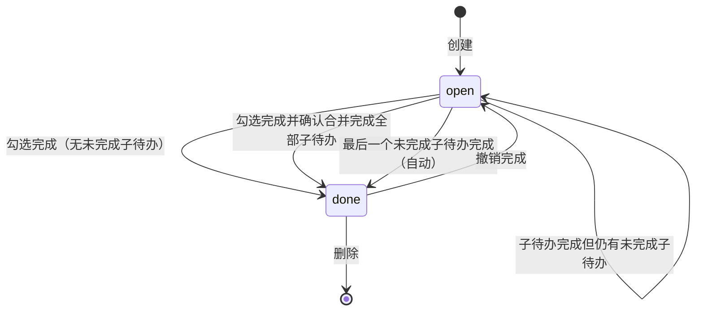

# 待办中心（todo-center）产品需求文档

| 项 | 内容 |
| --- | --- |
| 文档版本 | 1.1 |
| 日期 | 2026-11-03 |
| 需求方 | 用户本人（单人本机使用） |
| 产品标识 | 中文「待办中心」，英文 `todo-center` |
| 交付形态 | DSH Web GUI 插件（Host 半 + Client 半），随客户端常驻 |
| 需求状态 | v1.0 已交付并安装生效；v1.1 变更已确认，待开发 |
| 版本说明 | v1.1 的变更范围与验收补充见第 19 节，第 15 节 1 至 27 条文本保持原样 |

## 1. 背景

用户在 DSH 里同时推进多个工作区的会话。待办信息目前分散在三处：模型用 `todo_write` 维护的会话内计划列表、对话里等待用户回答的提问、工具执行前的审批请求。这三处都绑定在单个会话内，用户没有一份跨会话、跨工作区、按优先级排布的待办清单，也没有完成情况的历史记录。

待办中心提供这份清单，并把对话里需要用户确认处理的条目收进同一个入口。

## 2. 目标

1. 在 DSH 左侧提供一个常驻导航入口，点开即为四象限待办页面。
2. 每条待办承载标题、计划截止时间、描述、子待办四类信息，可标记完成并记录真实完成时间。
3. 提供独立的已完成清单，按标题、开始时间、计划截止时间、完成时间记录全部已完成任务。
4. 把 DSH 工作区内等待用户处理的提问与审批，由用户手动加入待办中心。

## 3. 范围

**本期包含**：上面四项目标覆盖的全部功能、本机持久化、中文界面、跟随 DSH 明暗主题。

**本期不包含**：多人协作与任务指派、任务共享、云端同步与多设备同步、系统级通知推送、项目分组层、优先级数值与标签字段、Markdown 渲染、收件箱暂存区、回收站、自动清理、图表统计、全局快捷键。

**与 `todo_write` 的关系**：两者完全独立，互不同步，互不覆盖。会话内计划列表仍由模型维护，待办中心不读取它，也不向它写入。

## 4. 名词定义

| 名词 | 含义 |
| --- | --- |
| 待办 | 一条任务记录，是待办中心的最小数据单位 |
| 顶层待办 | 没有父待办的待办，四象限与已完成清单都只列顶层待办 |
| 子待办 | 隶属于某条顶层待办的子任务，只支持一层 |
| 象限 | 紧急且重要、紧急不重要、重要不紧急、不重要不紧急四类之一 |
| 开始时间 | 待办的创建时间，创建时写入，之后不可修改 |
| 计划截止时间 | 用户填写的计划到期时间，可为空 |
| 完成时间 | 用户勾选完成或系统自动完成时写入的真实时间 |
| 逾期 | 未完成且计划截止时间早于当前时间 |
| 工作区标识 | DSH 的工作区唯一标识，允许为空（表示不属于任何工作区的个人待办） |

## 5. 页面与导航

### 5.1 左侧入口

入口位于 DSH 左侧栏的全局面板图标区，与「对话」同级，图标加文字「待办中心」。左侧栏收成窄条时只显示图标，文字进入悬停提示。

入口右侧显示角标：数值为全部未完成顶层待办的数量，数量为 0 时不显示角标。存在逾期任务时角标改用强调色。

角标以图标为定位基准，固定在图标右上角，带底色。角标的尺寸、位置与底色在三种状态下完全一致：面板打开、面板关闭、鼠标移入其它板块。角标所依赖的样式随图标组件自身装载，不依赖主面板是否挂载。

### 5.2 主面板

点击入口后，中间主区域切换到待办中心页面，占满中间整块可用区域，与插件页、设置页同级。再次点击「对话」可返回会话，两者互不遮挡。

页面顶部为标题条：左侧标题文字「待办中心」，中部工作区切换器，右侧关闭按钮。关闭按钮回到对话页面。

### 5.3 标签

标题条下方是两个平级标签：「四象限」（默认选中）、「已完成」。标签切换不改变页面宽度与高度，也不重置工作区切换器的取值。

### 5.4 工作区切换器

取值三项：「全部工作区」（默认）、「个人待办」、以及每个已注册的工作区名称。

「全部工作区」下显示全部待办，每张卡片带上所属工作区的名称标记。「个人待办」下只显示工作区标识为空的待办。选中某个工作区时，只显示该工作区的待办加上个人待办。

已完成清单遵守同一口径。

## 6. 四象限视图

### 6.1 布局

两行两列四个方格同时展开，每格独立滚动，不出现整页滚动。四个方格的高度均分可用区域。

| 位置 | 象限 |
| --- | --- |
| 左上 | 紧急且重要 |
| 右上 | 重要不紧急 |
| 左下 | 紧急不重要 |
| 右下 | 不重要不紧急 |

### 6.2 方格结构

每个方格自上而下为：标题行、任务列表区。

标题行包含：象限名称、任务计数（形如「重要不紧急 · 5 项」）、折叠按钮、添加按钮。

折叠按钮收起该方格的列表区，方格只保留标题行。折叠状态按工作区分别记住，重启后保持。折叠不改变计数。

任务列表为空时显示「暂无任务，点击添加」，整块区域可点击触发添加。

每个方格以本象限的颜色标示归属：方格底色或标题行色带取该象限的颜色令牌，四个方格并排时可直接区分。着色不改变方格内卡片的层级：卡片标题与正文的文字对比度不低于 4.5:1，方格边界与相邻方格之间、角标与图标之间的非文字对比度不低于 3:1，浅色与深色主题各自满足。颜色只能取自第 13 节允许的主题令牌。

### 6.3 排序

方格内按以下顺序排列：

1. 有计划截止时间的待办排在前面，按计划截止时间从早到晚。
2. 计划截止时间相同的，按开始时间从早到晚。
3. 没有计划截止时间的待办排在后面，按开始时间从早到晚。

排序不接受手动调整，卡片顺序始终由上述规则决定。

### 6.4 逾期表现

逾期视为一种展示状态，不改变待办所属象限。逾期卡片以 1 像素强调色描边，倒计时列的文字改取强调色。倒计时文案按 6.5 的七类规则取值，逾期类别下按精度分别显示分钟、小时、天。

逾期判定按分钟比较：计划截止时间所在分钟早于当前分钟即逾期，同一分钟内不算逾期。判定在打开面板时执行一次；面板保持打开期间每分钟重新判定一次。面板关闭后停止计时。

### 6.5 卡片内容

每张卡片固定 44 像素高、单行三列：24 像素勾选列、标题列、104 像素倒计时列。卡片占满所在方格内容区宽度，同一方格内单列纵向排列，从顶部起排。

标题列内依次为象限色点、标题、行内标记。标题单行显示，超出部分省略。行内标记按以下顺序排列，宽度不足时从右向左依次收起：标签（最多 2 个，其余合并为「+N」）、描述标记、子待办进度 n/m、重复标记、来自会话、已发起会话。子待办进度可点击，打开该待办的编辑抽屉。

倒计时列贴右排列，取值见 6.5.1，文字使用等宽数字，右边缘与卡片内容右边缘齐平。

悬浮或键盘聚焦时，操作浮层覆盖在倒计时列之上，浮层内的按钮为编辑、复制重复设置、删除与发起会话。浮层出现时卡片高度、宽度与三列位置保持不变，倒计时文字在此期间隐藏。卡片悬浮时位置上移量为 0。触摸设备上不出现悬浮浮层，倒计时文字保持可见，操作入口由编辑抽屉与多选批量条承担。

描述正文与子待办清单在编辑抽屉内展示与编辑，卡片不显示描述正文。点击标题打开编辑抽屉。

同一张卡片上只出现一个复选框，它就是完成勾选框（见 9.1）。多选入口使用独立的位置与独立的外观，不带勾选框形状，悬停时出现，键盘聚焦时同样可见。编辑、改象限、删除三个操作都提供不依赖鼠标拖拽的键盘可达入口。

存在会话错误提示时，卡片加高一行以显示该提示，错误消除后恢复 44 像素。

#### 6.5.1 倒计时文案

倒计时列按当前时刻与计划截止时间的关系取下列七类文案之一：

| 类别 | 条件 | 文案 |
| --- | --- | --- |
| 未安排 | 计划截止时间为空 | 「未安排」 |
| 逾期 | 已逾期 | 不足 1 小时「逾期 N 分钟」，不足 24 小时「逾期 N 小时」，否则「逾期 N 天」 |
| 今天 | 截止时间在今天 | 「今天 HH:mm」 |
| 明天 | 截止时间在明天 | 「明天 HH:mm」 |
| 七天内 | 截止时间在明天之后、今天起算的第 7 天以内 | 「周X HH:mm」 |
| 今年内 | 截止时间在今年，且在七天内之外 | 「MM-DD HH:mm」 |
| 跨年 | 截止时间的年份与当前年份不同 | 「YYYY-MM-DD」 |

判定顺序自上而下，先命中先生效。分钟取整方式：逾期不足 1 小时按分钟向下取整且不小于 1；小时与天同样向下取整。

### 6.6 添加待办

点击方格标题行的添加按钮，或点击空方格的空白区，打开右侧抽屉。新待办的象限即该方格。

抽屉宽 420 像素，视口宽度小于 1024 像素时取 92vw；占满视口高度，贴右侧边缘，左侧两个圆角，标题栏与底部操作条固定，中间的字段区滚动。标题栏右侧有关闭按钮。

抽屉字段：象限（选填，默认取当前方格）、标题（必填）、计划截止时间（选填）、描述（选填）、子待办（选填，可连续添加多条标题）、标签（选填）、重复（选填）、提醒（选填）。编辑既有待办时打开同一个抽屉，字段相同，标题栏文字为「编辑待办」。

抽屉打开时子待办输入区初始为 0 行，先呈现标题、计划截止时间与描述三个字段。点击「添加一行」出现 1 行输入，可重复点击增加多行，每行可单独移除。

保存时校验：标题去除首尾空白后不得为空，最长 200 字；描述最长 20000 字。校验失败就地显示原因并保留已填内容。保存成功后新待办立即出现在该方格中。

按 Esc 或点击遮罩关闭抽屉，已填写内容不保留。保存进行中按 Esc 与点击遮罩都不关闭。抽屉打开期间焦点在抽屉内循环，关闭后焦点回到打开它的按钮。

### 6.7 拖拽改象限

卡片可拖拽到同一方格内的其他位置（不改变顺序，松手回到原位置），也可拖到其他方格内。拖到其他方格即改变该待办的象限并立即保存，不需要二次确认。

有子待办的顶层待办被拖动时，子待办随父任务进入新象限；子待办的象限始终跟随父任务，不可单独修改。

「全部工作区」视图下拖拽改象限同样生效，改的是象限而非工作区。

### 6.8 多选与批量操作

卡片左侧固定一个 20×20 的控件位，始终可见。浏览状态下它是完成勾选框；多选状态下它换成选择框。两种状态都只有一个控件，不存在两个控件重叠的情形。

多选入口是工具栏上的一个开关按钮，带按下状态与可读标签（「多选」与「退出多选」）。开关打开后，卡片标题的点击用于选择，拖拽与行内操作按钮停用，页面底部出现批量操作条，显示已选数量与两个操作：批量完成、批量改象限。按 Esc 先退出多选，再按一次才关闭面板。

批量完成对已选顶层待办执行完成；其中若存在仍有未完成子待办的父任务，先弹出「同时完成全部子待办吗」确认，一次确认作用于全部。

批量改象限把已选待办移动到目标象限。

批量操作完成后退出多选状态。本期不提供批量删除与批量改计划截止时间。

## 7. 任务字段

| 字段 | 标识 | 必填 | 规则 |
| --- | --- | --- | --- |
| 唯一标识 | `id` | 是 | 系统生成，创建后不变 |
| 标题 | `title` | 是 | 1 至 200 字，去除首尾空白后非空 |
| 描述 | `description` | 否 | 0 至 20000 字，纯文本，保留换行，不渲染 Markdown |
| 象限 | `quadrant` | 是 | 四选一，取值见 6.1 |
| 计划截止时间 | `dueAt` | 否 | 精确到分钟；只选日期时按当天 23:59 记录 |
| 父待办 | `parentId` | 否 | 空表示顶层待办；有值时必须指向一条存在的顶层待办，不允许出现第二层 |
| 状态 | `status` | 是 | `open` 未完成，`done` 已完成 |
| 开始时间 | `createdAt` | 是 | 创建时写入，不可修改 |
| 完成时间 | `completedAt` | 否 | 完成时写入，撤销完成时清空 |
| 工作区标识 | `workspaceId` | 否 | 空表示个人待办 |
| 来源 | `source` | 是 | 手动创建，或来自会话（附会话标识、来源条目标识、来源类型） |
| 来源去重键 | `sourceKey` | 否 | 来自会话时生成，格式为「会话标识:来源条目标识:来源类型」，用于去重 |

本期不增加优先级数值、标签、指派人三个字段。象限本身承担优先级表达。

时间显示格式统一为 `YYYY-MM-DD HH:mm`，只选日期时显示 `YYYY-MM-DD`。全部时间按本机时区显示与判定，不做跨时区换算。

## 8. 子待办与父子联动

### 8.1 子待办

子待办只支持一层，不允许在子待办下再建子待办。

子待办的字段与顶层待办相同，另外满足：象限跟随父任务，不可单独修改；计划截止时间默认为空，可单独设置；工作区标识与父任务相同；来源与父任务相同。

子待办不能提升为顶层待办，也不能转移到其他父任务下。

顶层待办的子待办明细在卡片展开后显示，每条子待办可勾选完成、可编辑标题与计划截止时间、可删除。

### 8.2 完成联动

状态迁移规则：



具体规则：

1. 无子待办的顶层待办，勾选即完成，完成时间取勾选时刻。
2. 有子待办且尚有未完成子待办的顶层待办，勾选时弹出「同时完成全部子待办吗」。确认后父任务与全部子待办一并完成，完成时间取同一时刻；取消则不改变任何状态。
3. 子待办完成时若已是最后一个未完成子待办，父任务自动完成，父任务的完成时间取该子待办的完成时间。
4. 自动完成只在子待办由未完成变为已完成的那一刻触发。撤销父任务完成后，即使全部子待办仍处于已完成，父任务保持未完成，不再自动完成。
5. 撤销父任务完成不撤销任何子待办的完成状态。

### 8.3 删除联动

删除顶层待办时级联删除其全部子待办。二次确认的提示文字写明将一并删除的子待办数量。

## 9. 完成、撤销与已完成清单

### 9.1 完成与撤销

完成操作为单击勾选框，不需要填写备注或耗时。

撤销完成可在已完成清单中对该条执行，也可在四象限视图中对已完成但未移出的待办执行。撤销后待办回到原象限，完成时间清空，已完成清单中该条同步移除。

撤销不设时间限制。

### 9.2 已完成清单

已完成清单是页面第二个标签，列出全部顶层已完成任务，不收录子待办。子待办的完成记录随父任务保存，展开父任务可以看到。

清单列为：标题、象限、开始时间、计划截止时间、完成时间。行内另有来源标记与两个操作：撤销完成、删除。

排序按完成时间从新到旧。数据永久保留，不自动清理。

清单行不展开描述与子待办明细。

### 9.3 筛选

清单顶部提供三个筛选条件，可组合：

1. 时间范围：本周（默认）、本月、自定义起止日期。起止日期按完成时间比较。
2. 来源：全部（默认）、手动创建、来自会话。
3. 搜索：匹配标题与描述，限定在当前标签页的已筛选结果内。

筛选结果为空时显示「该范围内没有已完成的待办」。

### 9.4 导出

清单顶部提供「导出 CSV」按钮，导出当前筛选结果为 CSV 文件，由浏览器直接下载，不写入 DSH 数据目录。列为标题、象限、开始时间、计划截止时间、完成时间、来源，首行为列名。

### 9.5 删除

已完成清单中的删除与四象限视图中的删除行为一致：二次确认后永久删除，同时移除该条的子待办记录。本期不提供「清空全部」，不设回收站。

## 10. 与对话确认事项的同步

### 10.1 来源范围

只处理两类有结构化数据的确认事项：

1. 模型通过 `ask_user_question` 向用户提出的选择题或确认题。
2. 工具执行前的审批请求。

模型在回答正文里用文字写出的「请确认……」不在范围内，因为这类文字没有可依赖的结构化字段。

### 10.2 加入方式

采用手动加入，不自动生成。待办中心不主动从会话里抓取条目；未处理的提问与审批不会自动变成待办。

入口为输入框上方的操作条：当前会话存在待回答的提问或待处理的审批时，操作条显示「本会话有 N 个待确认事项 · 加入待办中心」，点击后逐条写入待办中心。

提问卡片、审批卡片与提问后的补充视图都由 DSH 官方插件渲染，其中审批详情插槽只允许一个注册项且已被官方占用，注册进去会整体替换官方界面，因此这三处都不挂按钮，只在操作条上提供入口。

### 10.3 生成时的字段

| 字段 | 取值 |
| --- | --- |
| 标题 | 取提问或审批的标题 |
| 描述 | 完整问题文本与全部选项，或审批请求的完整描述 |
| 象限 | 默认「紧急且重要」，加入时可在弹层中改为其他象限 |
| 计划截止时间 | 留空，生成后可修改 |
| 工作区标识 | 留空，归入个人待办 |
| 来源 | 来自会话，记录会话标识、来源条目标识、来源类型 |

生成后该条与手动创建的待办完全等价，可编辑、可完成、可删除。

### 10.4 去重

以来源去重键判定。已经加入过的条目再次点击时提示「已存在」，并直接把用户带到那条待办所在位置。

### 10.5 完成后是否回写对话

不回写。待办完成后不在会话里插入任何消息，也不代替用户回答问题或批准审批。回答与批准仍在对话里完成。

用户处理完对话后，那条待办不会自动完成，需要用户在待办中心手动完成。

### 10.6 来源展示与跳转

来自会话的待办显示「来自会话」标记。点击标记打开对应会话。

## 11. 检索、筛选与批量操作

四象限标签顶部提供搜索框，匹配标题与描述，范围限定在当前标签页与当前工作区筛选之下。搜索不改变象限归属。

四象限标签的筛选条件：逾期状态（全部、仅逾期、仅未逾期）、计划截止时间范围（不限、今天、本周、自定义起止日期）、来源（全部、手动创建、来自会话）。三个条件可组合。

批量操作见 6.8。键盘操作：Esc 关闭最上层浮层；面板打开时 Esc 关闭面板并回到对话。

## 12. 数据存储

### 12.1 位置与格式

数据保存在本机配置文件目录下的一个 JSON 文件：`%DSH_HOME%\todo-center\todos.json`，本机即 `C:\Users\21039291\.dsh\todo-center\todos.json`。目录不存在时由插件创建。

文件结构：

```json
{
  "version": 1,
  "todos": [],
  "collapsed": {}
}
```

`collapsed` 按工作区记录四个方格的折叠状态，键为工作区标识或 `all`，值为四个象限标识到布尔值的映射。

### 12.2 读写规则

每次请求都读取一次文件并做结构校验，不保留进程内的数据副本。外部把文件改坏后，下一次请求立即报错，不需要重启客户端。

每次写操作立即把整份数据写入同目录下的临时文件，再用替换操作覆盖正式文件，保证文件不会出现写到一半的状态。写入失败就地报错，错误信息连同文件路径回传到客户端显示，界面不做重试，也不改动内存数据之外的任何内容。

### 12.3 版本校验

读取时校验 `version`。版本号不认识、JSON 解析失败、结构校验不通过时：面板显示错误页，写明文件路径与具体原因，不加载任何待办数据，不写入文件，不执行任何自动迁移。用户可自行备份或删除该文件后重新打开。

### 12.4 规模与保留

按未完成待办 1000 条、已完成记录 1 万条以内设计。已完成记录永久保留。

插件卸载不影响数据文件。

### 12.5 迁移

不提供全量导入导出。换机器时复制 `todos.json` 即可，格式校验规则同上。已完成清单的 CSV 导出只用于查看与分析。

## 13. 非功能要求

| 类别 | 要求 |
| --- | --- |
| 性能 | 1000 条未完成待办下，方格滚动与拖拽流畅；打开面板到内容可见在 300 毫秒内 |
| 已完成清单渲染 | 按可视区域虚拟滚动，只渲染可见行与少量缓冲行，1 万条记录下列表滚动流畅 |
| 视觉 | 只使用 DSH 主题令牌：`--dsw-alias-*` 系列全部令牌与 `--dsw-specific-sidebar-fill`。需要淡色底时以令牌与令牌混合（例如 `color-mix`）得到，不出现任何固定颜色字面量，十六进制、`rgba` 与 `hsl` 一律不写。明暗主题各自成立。文字对比度不低于 4.5:1，方格边界、角标、图标等非文字元素对比度不低于 3:1。排版与间距沿用 DSH 现有列表页的规格 |
| 语言 | 界面中文；同时提供英文语言资源，供 DSH 语言切换后使用 |
| 无障碍 | 全部操作可用键盘完成；勾选框使用真实复选框语义；图标按钮带可读标签；折叠按钮带展开/收起状态 |
| 错误处理 | 数据文件问题、写入失败、Remote 调用失败都在页面内就地显示原因，不静默吞掉，不做自动降级 |

## 14. 技术方案

### 14.1 包与安装

一个工作区内的插件包 `@local/dsh-todo-center`，`package.json` 声明 `dsh.bundle.patch` 指向 `cordis.patch.yml`，声明 `dsh.client` 段的 `platform: web`（`immediately` 与 `inject` 按需声明），并声明 `./client` 导出。

`cordis.patch.yml` 插入一行插件，行标识 `todo-center`，包名 `@local/dsh-todo-center`。

导出显示资源：`./locale/*.json` 与 `./icon`，`locale/zh.json` 与 `locale/en.json` 内提供 `meta.title`、`meta.description`；`icon.svg` 为原创的清单样式图标，不超过 256 KiB。

安装通过 `plugin_manager` 的 `install_bundle` 完成，目标为插件包目录，不由手工写入 profile 目录。

### 14.2 Host 半

`index.js` 导出 `apply(ctx, config)` 形式的插件，声明 `inject: ['webServer']`。

Host 半在 `webServer` 上注册以 `/plugins/dsh-todo-center` 为前缀的 exact 路由，客户端以同源 `fetch` 调用，请求体与响应体的字段见 `api.md`：

| 路由 | 用途 |
| --- | --- |
| `GET /snapshot` | 返回 `{ version, todos, collapsed }` |
| `POST /create` | 新建待办或子待办 |
| `POST /update` | 修改标题、描述、计划截止时间 |
| `POST /complete` | 完成一条或一组待办，含合并完成子待办的选项 |
| `POST /reopen` | 撤销完成 |
| `POST /remove` | 删除一条或一组待办，级联删除子待办 |
| `POST /setQuadrant` | 改象限，同时作用于其子待办 |
| `POST /setCollapsed` | 记录方格折叠状态 |
| `POST /fromConversation` | 由会话条目生成待办，内含去重判定，已存在时返回既有待办标识 |

全部写操作在 Host 内串行执行，返回写入后的权威数据；客户端据此更新本地副本，不做乐观并发。

### 14.3 Client 半

`client.js` 通过 `window.__ModuleLoader__.load({ id, factory })` 注册，`inject` 声明为 `['slots', 'layout', 'workspaces', 'uiWorkspace']`。会话同步组件的会话标识与轨迹读取由插槽传入的 `sessionId` 与标准属性 `useTrajectory` 提供，不额外声明服务。点「来自会话」标记打开会话由 `uiWorkspace.openSession(sessionId)` 完成，该方法接受会话标识或子代理地址，跳转后主区域显示对应会话。React 取自浏览器模块表，不额外安装。

注册项全部用 `ctx.effect` 或 `ctx.slots.inject` 包裹，卸载时释放。面板内的定时器与监听在组件卸载时清理。

### 14.4 挂载点

| 挂载点 | 类型 | 用途 |
| --- | --- | --- |
| `sidebar.panellist` | 全局面板图标列表 | 「待办中心」导航入口与角标 |
| `main`（键为 `todo-center`） | 按侧栏条目标识分发的主区域 | 待办中心整页 |
| `conversation.input.dock` | 输入框上方整宽条目 | 提问待回答期间的操作条 |

`conversation.approval.detail` 为单值插槽且已被官方占用，注册进去会整体替换官方审批界面，本插件不注册该插槽。选 `conversation.input.dock` 而不替换 `tool.call.toolview` 中 `ask_user_question` 的视图，原因是该键已被 DSH 官方视图占用，注册同名键会整体替换提问卡片与回答逻辑。

### 14.5 页面组成

| 组件 | 职责 |
| --- | --- |
| `PanelIcon` | 侧栏入口图标与角标，只使用类名 |
| `TodoCenterPage` | 页面外壳：标题条、工作区切换器、标签、关闭、四象限栅格 |
| `QuadrantCell` | 单个方格的标题行、配色、排序、拖放目标、就地添加面板 |
| `TodoCard` | 卡片、完成勾选框、多选入口、展开区、操作入口 |
| `TodoEditor` | 方格内的添加面板，含子待办增删 |
| `TodoEditorModal` | 编辑既有待办的弹层 |
| `ConfirmDialog` | 合并完成、级联删除等二次确认 |
| `CompletedList` | 已完成清单、筛选、虚拟滚动、导出 |
| `TodoCenterDock` | 输入框上方的待确认事项操作条 |

拖放使用浏览器原生拖放事件，不引入拖放库。

## 15. 验收标准

每条都是可观察的行为，逐条判定通过或不通过。

### 15.1 四象限与任务

1. 左侧栏出现「待办中心」图标与文字；点开后中间区域显示四象限页面，四个方格同时展开。
2. 在任一方格点添加，填入标题后保存，该待办出现在该方格。
3. 计划截止时间留空时，该待办排在该方格末尾，且不显示逾期标记。
4. 计划截止时间早于当前时间时，卡片显示强调色描边，倒计时列显示「逾期 N 分钟」「逾期 N 小时」或「逾期 N 天」之一。
5. 把待办从「不重要不紧急」拖到「紧急且重要」，松开后立即出现在目标方格；关闭 DSH 并重启后仍在目标方格。
6. 方格折叠后只保留标题行，重启后折叠状态保持。
7. 「全部工作区」下每张卡片显示所属工作区名称标记；切到某个具体工作区后只显示该工作区与个人待办。

### 15.2 子待办与联动

8. 给一条顶层待办添加 2 个子待办，卡片行内标记显示「0/2」。
9. 在仍有 2 个未完成子待办时勾选父任务完成，出现「同时完成全部子待办吗」；取消后父任务与子待办状态不变；确认后全部完成且完成时间相同。
10. 逐条完成 2 个子待办后，父任务自动完成，完成时间等于最后一个子待办的完成时间。
11. 撤销父任务完成后，父任务回到未完成状态，两个子待办仍为已完成，父任务不会再次自动完成。
12. 删除父任务时提示将一并删除 2 个子待办，确认后子待办一并消失。

### 15.3 已完成清单

13. 完成一条待办后，切到「已完成」标签，该条出现在清单中，标题、开始时间、计划截止时间、完成时间四项齐全。
14. 在清单中撤销完成，该条从清单消失并回到原方格，完成时间清空。
15. 在清单中删除一条，二次确认后该条永久消失，刷新页面后不再出现。
16. 选择时间范围、来源、搜索三个条件组合筛选，结果只包含同时满足的条目。
17. 点击「导出 CSV」，浏览器下载的文件包含当前筛选结果的全部列。

### 15.4 持久化与错误处理

18. 重启 DSH 后，四象限任务、子待办、已完成清单、方格折叠状态全部保持。
19. 把 `todos.json` 改成非法 JSON 后打开面板，页面显示错误页与文件路径，不加载任何数据，也不覆盖该文件。

### 15.5 与对话同步

20. 会话中存在未回答的提问或待处理的审批时，输入框上方出现操作条「本会话有 N 个待确认事项 · 加入待办中心」。
21. 点击加入后生成待办，归入「紧急且重要」方格，带「来自会话」标记与「已存在」提示能力。
22. 再次点击同一个操作条上的加入，接口返回已存在，不生成第二条。
23. 会话里没有待确认事项时，操作条不渲染任何内容。
24. 未通过操作条加入的提问与审批，不会自动出现在待办中心。
25. 待办完成后，对应会话里没有新增消息，提问与审批仍处于未处理状态。

### 15.6 安装与显示

26. 插件在插件管理页显示中文标题、英文标题与描述，显示自定义图标，无缺图与回退提示。
27. `plugin_manager` 返回 `application: applied`，页面刷新后左侧入口可用。

### 15.7 v1.1 新增验收

28. 面板关闭状态下鼠标移入其它板块，侧栏图标角标仍位于图标右上角并带底色；角标的计算样式（`position`、宽、高）与面板打开时完全一致。
29. 浅色与深色主题下，四个方格各自呈现本象限的颜色；卡片标题与正文的文字对比度不低于 4.5:1，方格边界与相邻方格、角标与图标之间的非文字对比度不低于 3:1。
30. 添加面板打开时子待办为 0 行；点「添加一行」出现 1 行，可再点增加、可逐行移除；不填子待办直接保存后，该待办没有子待办。
31. 卡片上同时只出现一个复选框，未悬停时完成动作可见可识别；多选入口是工具栏上的开关按钮，可用键盘聚焦，聚焦时有可见焦点环，按下状态可从外观区分；多选状态下该控件位换成选择框，不存在两个控件重叠。
32. 不使用鼠标拖拽，用键盘把一条待办改到另一个象限，保存后关闭并重启 DSH，该待办仍在目标象限。
33. 由会话加入的待办，标题为该提问或审批的实际标题，描述含完整问题文本与全部选项；加入前可选择象限，选择结果写入该待办。
34. 点击「来自会话」标记打开对应会话。
35. 面板内按 Esc：存在浮层时只关闭最上层浮层，无浮层时关闭面板并回到对话；打开添加面板后点击面板外区域，面板关闭且已填内容不保留。
36. 对同一条会话条目再次点「加入待办中心」，操作条显示「已在待办中心」，并给出前往该条待办的入口，点击后显示该条待办所在的方格与位置。
37. 在 `client.js` 中检索不到固定颜色字面量；浅色与深色主题下弹层遮罩与阴影各自可见，背景仍可辨认。
38. 折叠任一方格后，该方格收缩到标题行高度，同一行的另一个方格保持展开高度，计数与展开按钮仍可见；同一行的两个方格都折叠时，该行高度收缩到标题行高度，另一行占据释放的空间；展开后四个方格回到均分状态。

## 16. 交付阶段与任务分解

### 16.1 阶段一：四象限待办中心

| 任务号 | 任务 | 产出 |
| --- | --- | --- |
| T1 | Host 数据层与 HTTP 路由 | `index.js`、数据文件读写、9 条路由、版本校验 |
| T2 | 面板骨架与左侧入口 | `client.js`、`sidebar.panellist`、`main` 页面、标签、工作区切换器 |
| T3 | 四象限视图与任务增删改 | `QuadrantCell`、`TodoCard`、`TodoEditor`、排序、逾期 |
| T4 | 完成、撤销、已完成清单 | 勾选、撤销、清单、筛选、虚拟滚动、CSV 导出 |
| T5 | 子待办与父子联动 | 子待办增删改、合并完成确认、自动完成、级联删除 |
| T6 | 拖拽改象限与批量操作 | 原生拖放、多选、批量完成、批量改象限 |
| T7 | 显示资源与主题 | `locale/zh.json`、`locale/en.json`、`icon.svg`、主题令牌接入 |

### 16.2 阶段二：会话确认事项同步

| 任务号 | 任务 | 产出 |
| --- | --- | --- |
| T8 | 待确认事项采集 | `useTrajectory` 读取 `runningCalls` |
| T9 | 操作条 | `conversation.input.dock` 注册，id `todo-center` |
| T10 | 加入与去重 | `addFromConversation`、`sourceKey` 去重、错误提示 |

### 16.3 阶段三：安装与验收

| 任务号 | 任务 | 产出 |
| --- | --- | --- |
| T12 | 安装与端到端验证 | `install_bundle`、1 至 27 条验收逐条判定、缺陷修复 |

### 16.4 阶段四：v1.1 修复与补齐

| 任务号 | 任务 | 产出 |
| --- | --- | --- |
| T13 | 角标样式随图标装载 | 角标尺寸与位置在面板关闭状态下不变，验收 28 |
| T14 | 卡片完成与多选的动作分工 | 卡片只保留一个复选框，多选入口独立可见，验收 31、32 |
| T15 | 四象限方格配色 | 方格按象限着色，对比度达标，验收 29 |
| T16 | 添加面板子待办空态 | 默认 0 行、按需增行，验收 30 |
| T17 | 会话条目可读化与去向 | 标题取实际提问、描述取完整问题与选项、加入时选象限、来源标记可跳转、已存在可前往，验收 33、34、36 |
| T18 | 键盘与浮层收尾 | Esc 分层关闭、点击面板外关闭添加面板，验收 35 |
| T19 | 固定颜色字面量清理 | 遮罩与阴影改用令牌，验收 37 |
| T20 | 折叠后方格收缩 | 折叠状态下方格只占标题行高度，验收 38 |

## 17. 风险与约束

| 风险 | 处理方式 |
| --- | --- |
| `main` 是 keyed 插槽，注册同名键会替换既有面板 | 使用不与既有键冲突的 `todo-center` |
| `tool.call.toolview` 中 `ask_user_question` 已被官方视图占用 | 不注册该键，改用 `conversation.input.dock` 的操作条 |
| `conversation.approval.detail` 为占用即替换的单值插槽 | 不注册该插槽，审批的加入入口只放在 `conversation.input.dock` 的操作条上 |
| DSH 客户端的主题令牌与控件样式会随版本变化 | 只用 `--dsw-alias-*` 令牌，不依赖 Client 内部包 |
| 客户端插件代码形态为浏览器模块表工厂，无类型检查 | 组件内部对数据缺失做显式判断，出错时渲染可读的错误行，不吞掉异常 |
| 每次操作整文件写入 | 先写临时文件再替换，写入失败就地报错 |

## 18. 待确认事项

无。第 1 轮澄清清单中的全部条目已按推荐值确认，本文件即唯一需求依据。

## 19. 版本记录

### 19.1 v1.0（2026-11-03）

首版需求，交付阶段一至阶段三，验收 1 至 27 条。

### 19.2 v1.1（2026-11-03）

| 变更位置 | 变更内容 |
| --- | --- |
| 5.1 | 角标以图标为定位基准，三种状态下尺寸、位置、底色一致；样式随图标组件装载 |
| 6.2 | 方格按象限着色，规定文字与边界的对比度门槛 |
| 6.5 | 卡片内容顺序调整为标题在前；一张卡片只保留一个复选框（完成勾选框）；多选入口独立且键盘聚焦可见；编辑、改象限、删除提供不依赖拖拽的键盘入口 |
| 6.6 | 添加面板子待办默认 0 行，点「添加一行」出现 1 行 |
| 6.8 | 多选入口与完成勾选框分处不同位置，不重叠 |
| 13 | 令牌范围写入 `--dsw-specific-sidebar-fill`；淡色底用令牌混合得到；禁止一切固定颜色字面量；写入对比度门槛 |
| 14.1 至 14.5 | 技术方案按已交付实现改写：HTTP exact 路由、`inject: ['webServer']`、客户端 `inject` 三项、移除挂载点 `conversation.approval.detail`、组件清单与实现一致 |
| 15.7 | 新增验收 28 至 38 条 |
| 16.4 | 新增阶段四任务 T13 至 T19 |
| 17 | 审批插槽的处理方式改为不注册 |

第 15 节 1 至 27 条的编号与文本在 v1.1 中保持不变，v1.0 的验收记录继续有效。v1.1 的缺陷判定与取舍理由记录在 `docs/decision-v1.1.md`。

### 19.3 v1.2（2026-11-09）

卡片与添加交互改版，需求方已确认并冻结，条文按冻结后的交互重写。

| 变更位置 | 变更内容 |
| --- | --- |
| 6.4 | 逾期表现改为强调色描边加倒计时文字改色；逾期判定明确为按分钟比较 |
| 6.5 | 卡片改为固定 44 像素高的单行三列：24 像素勾选列、标题列、104 像素倒计时列；卡片占满方格宽度并单列从顶部起排；行内标记与收起顺序；悬浮浮层覆盖倒计时列且不改变行高与列位置；描述正文与子待办清单移入编辑抽屉；会话错误时卡片临时加高 |
| 6.5.1 | 新增倒计时文案七类与判定顺序 |
| 6.6 | 方格内联添加面板改为右侧抽屉，宽 420 像素、视口小于 1024 像素取 92vw；抽屉字段补全为八项；关闭方式、保存中不关闭、焦点循环与焦点返回 |
| 15.1 | 第 4 条的逾期文字判定改为倒计时文案三档之一 |
| 15.2 | 第 8 条的子待办进度文案改为「0/2」 |
| 15.5 | 第 21 条的动词改为「归入」，语义不变 |
| 15.7 | 28 至 38 条编号与文本保持不变，卡片与抽屉的新增判定进入 `docs/PRD-v2.md` 的 76 至 95 条 |

第 15 节的 1 至 38 条编号在 v1.2 中保持不变；第 4、8、21 条的文本按上表调整，其余条款的文本不变。v1.0 与 v1.1 的验收记录继续有效。UX 3.0 的需求条目、边界与验收口径记录在 `docs/PRD-v2.md` 的 F9。
