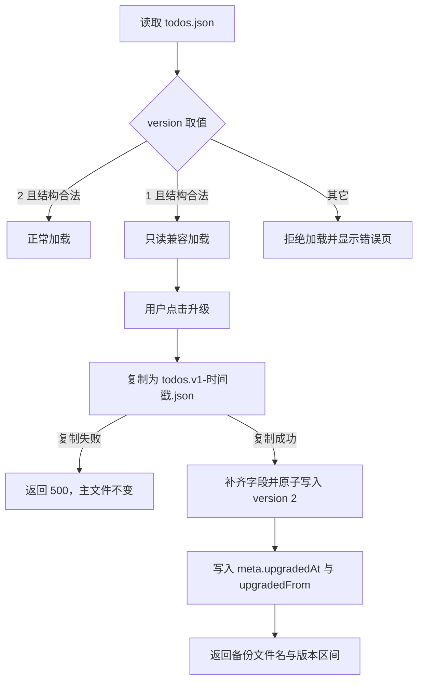
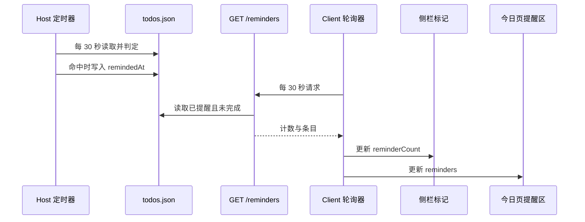
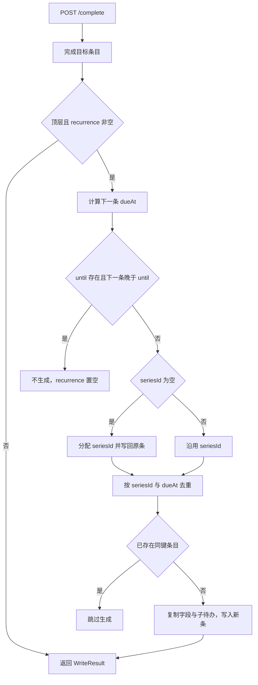
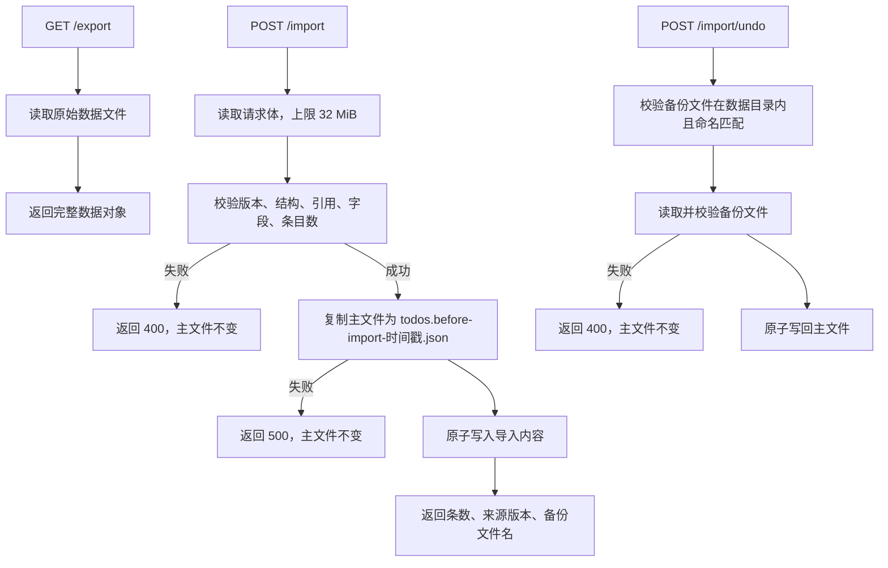

# 待办中心 2.0 结构说明

| 项 | 内容 |
| --- | --- |
| 文档版本 | 2.0 |
| 日期 | 2026-11-03 |
| 负责角色 | engineering-software-architect |
| 依据 | `docs/PRD-v2.md`（需求与验收）、`docs/api-v2.md`（字段与路由）、`docs/ui-spec-v2.md`（界面规格）、`lib/index.js`（715 行）、`lib/client.js`（1527 行） |
| 范围 | 包结构、Host 与 Client 分工、数据版本与升级、19 条路由的边界、提醒调度、重复生成、统计位置、导入导出、对话双向打通、挂载点选型 |
| 不在范围 | 需求裁定（`docs/PRD-v2.md` 第 2 节）、逐条字段与错误文本（`docs/api-v2.md`）、视觉规格（`docs/ui-spec-v2.md`） |

本文记录结构决策以及支撑这些决策的核实结果。接口字段以 `docs/api-v2.md` 为准，需求口径以 `docs/PRD-v2.md` 为准。

## 0. 结论

1. 插件仍是一个包 `@local/dsh-todo-center`，Host 半为 `lib/index.js`，Client 半为 `lib/client.js`。`package.json` 与 `cordis.patch.yml` 的结构不变，包版本改为 `2.0.0`。
2. Host 与 Client 的唯一交互面仍是 `/plugins/dsh-todo-center` 前缀下的 19 条 `exact` HTTP 路由：既有 9 条保留路径，新增 10 条。写请求继续要求 `x-dsh-todo: 1` 与 `content-type: application/json`，全部写入继续进入同一条 Promise 队列。
3. 提醒由 Host 常驻定时器判定：`ctx.timer.interval` 每 30 秒扫描一次，命中即写 `remindedAt`。界面信号由 Client 半的全局轮询器读取 `GET /reminders` 得到，轮询器放在 `apply` 中，不随面板卸载停止，这样面板关闭时侧栏标记也能在 60 秒内出现。
4. 平台没有通知服务。已核实的可用承载只有 `shell.overlay`（跨列浮动层，`list` 插槽，替换风险 `none`）与平台 `Toast`（只有文字，没有按钮）。提醒浮层使用 `shell.overlay`，作为附加呈现；验收对象是侧栏标记与今日页提醒区。
5. 统计、今日视图分区、快速录入解析、标签筛选全部在 Client 半完成，新增路由为零。`GET /snapshot` 已返回全量数据，Host 不重复实现按本机时区的周与月边界。
6. 重复待办的下一条在 `POST /complete` 的同一个写事务内生成。`seriesId` 在链首第一次完成时分配，`generatedFromId` 指向刚完成的条目，去重键是 `seriesId` 与 `dueAt` 的组合。
7. 数据文件版本升到 2。版本 1 的文件按只读兼容加载，界面显示升级横幅，写请求返回 400；用户点击升级后 `POST /upgrade` 先把原文件复制为 `todos.v1-<时间戳>.json`，再补齐字段并原子写入版本 2。
8. 导入与导出使用 `GET /export`、`POST /import`、`POST /import/undo`。导入是整份替换，请求体上限 32 MiB，条目上限 20000；导入前把当前文件复制为 `todos.before-import-<时间戳>.json`，复制失败就中止。
9. 对话双向打通新增 `sessions` 注入。新建会话用 `ctx.sessions.create`，显示会话用 `ctx.uiWorkspace.openSession`，首条消息用会话对象的 `beginSubmission` 与 `prompt`，成功后用 `POST /update` 写入 `startedSessionId` 与 `startedAt`。这套调用只做了静态核实，浏览器验证是 T28 的前置条件。
10. 挂载点为 `sidebar.panellist`、`main`（键 `todo-center`）、`conversation.input.dock`、`shell.overlay`（id `todo-center.reminder`）。样式表继续由 `apply` 在插件激活作用域创建一次，四处挂载点只使用类名。

## 1. 核实状态

| 对象 | 方式 | 结果 |
| --- | --- | --- |
| Host 服务目录 | `cordis_inspect_query`，platform `host`，provider `Service`，method `listService` | 含 `webServer`、`timer`、`workspace` 等服务，没有通知、提醒、消息推送类服务键 |
| 定时器 | `cordis-plugin-timer/lib/index.js:48-74` | `ctx.timer.interval(callback, delay)` 返回处置函数，随当前 fiber 释放；`timeout`、`throttle`、`debounce` 同样可用 |
| 全局浮层插槽 | `dsh-cordis-client-runner/lib/client.js:5481-5538` | `shell.overlay` 为 `list` 插槽，作用域 `root`，替换风险 `none`，`id` 必填；层本身点击穿透，条目自行恢复指针事件 |
| 平台 Toast | `dsh-client-ui-primitives/lib/index.js:3116-3179` | 只有 `text`、`icon`、`anchor`、`holdMs`、`onDone`，没有操作按钮，由 body portal 渲染 |
| 通知能力 | Host 服务目录与已安装包检索 | 没有通知类服务键与插件包；客户端代码中没有调用浏览器 `Notification` API 的位置 |
| 会话服务 | `dsh-cordis-client-runner/lib/client.js:1922-1931`、`1753-1758`、`2134-2140`、`2181-2183` | `ctx.sessions` 提供 `create`、`using`、`binding`、`retain`；会话对象提供 `beginSubmission` 与 `prompt`；`SessionBinding` 暴露 `session` 面 |
| 工作区服务 | `dsh-client-ui-workspace/lib/client.js:1380`、`1471`；目录条目 `dsh-cordis-client-runner/lib/client.js:1553` | 服务键 `uiWorkspace`，提供 `openSession`、`startSession`、`openWorkspace` |
| 四个挂载点 | `dsh-cordis-client-runner/lib/client.js:5748-5793`、`4372-4405`、`3339-3398`、`5481-5538` | 与 `docs/architecture.md` 第 5 节记录一致 |
| 当前实现 | `lib/index.js`、`lib/client.js`、`package.json`、`cordis.patch.yml` | Host 715 行、Client 1527 行；Host 有 9 条 `exact` 路由；Client 有样式装载与三个插槽注册 |
| 当前数据文件 | `C:\Users\21039291\.dsh\todo-center\todos.json` | `version` 为 1，`todos` 为空，`collapsed` 只有 `all` 的四个象限 |
| Client 实时插槽树 | `cordis_inspect_query`，platform `client`，provider `Slots`，method `listSubTree` | 失败：没有已连接的页面。改用已安装包内的插槽目录核实 |

未执行：没有在浏览器里运行 `sessions` 的发送流程；没有打开 `shell.overlay` 浮层；没有执行 39 至 75 条验收；没有重新安装本包，因此没有本次的 `application: applied`；没有在 2 万条数据下测量打开、统计、写入与扫描耗时。

## 2. 包结构

| 路径 | 2.0 的变化 |
| --- | --- |
| `package.json` | `version` 改为 `2.0.0`；`name`、`type`、`main`、`exports`、`dsh.bundle.patch`、`dsh.client.platform`、`files` 不改 |
| `cordis.patch.yml` | 保持顶层数组与一行 `insert`，id 仍为 `todo-center`，`config` 仍为空对象 |
| `icon.svg`、`locale/zh.json`、`locale/en.json` | 不改，语言资源仍只提供 `meta.title` 与 `meta.description` |
| `lib/index.js` | 增加版本兼容、升级、提醒定时器、导入导出、撤销、重复生成与 9 条新路由 |
| `lib/client.js` | 增加四个标签页、快速录入、今日视图、统计、标签筛选、提醒轮询与浮层、导入导出对话框、发起会话 |
| `docs/architecture-v2.md` | 本文 |
| `docs/PRD-v2.md`、`docs/api-v2.md`、`docs/ui-spec-v2.md` | 需求、接口、界面依据 |

包版本与数据版本是两件事：`package.json` 的 `version` 只用于包管理，平台不读它判断数据格式；数据格式只认数据文件内的 `version`。升级到 2.0 后，1.x 的 Host 会拒绝版本 2 的文件，降级需要用户手工把 `todos.v1-<时间戳>.json` 复制回 `todos.json`。

Host 半继续直接使用 `node:fs/promises`，没有改用平台的文件服务。数据文件由插件独占，单人本机使用；代价是路径为宿主绝对路径，且不带平台的文件访问策略。

## 3. 数据模型与不变量

文件结构、字段取值与规范化规则见 `docs/api-v2.md` 第 3 节。本文记录结构层面的不变量，Host 在每次读取与写入时校验：

1. `id` 在一份文件内唯一。
2. `parentId` 只能指向存在的顶层条目；子待办的 `parentId` 非空，顶层条目为空；只允许一层。
3. 子待办的 `quadrant`、`workspaceId`、`source`、`sourceKey` 与父任务一致；子待办不设置 `recurrence`、`seriesId`、`generatedFromId`、`reminder`、`remindedAt`、`startedSessionId`、`startedAt`，`tags` 为空数组。
4. 顶层条目的 `sourceKey` 非空时全文件唯一；重复实例的 `source` 为 `{ kind: 'manual' }`，`sourceKey` 为 `null`。
5. 同一 `seriesId` 与同一 `dueAt` 只允许一条条目。这个组合是重复生成的去重键。
6. `recurrence` 非空时 `interval` 在 1 至 12 之间；子待办的 `recurrence` 为 `null`。
7. `reminder` 非空时 `dueAt` 非空；`remindedAt` 非空时 `reminder` 非空。
8. `tags` 每项去除首尾空白后非空、不超过 20 字、同一条内按原样比较不重复；大小写不同视为不同标签。
9. `filters` 不超过 20 项，`name` 不重名。
10. 时间字段都是带时区标识的 ISO 8601 字符串。

链对象不单独存储。链的身份是 `seriesId`，顺序由每条实例的 `dueAt` 表达，来源由 `generatedFromId` 追溯。删除链中任意一条不影响其它条目；删除当前未完成实例后，链不再从它生成下一条，已经生成的下一条仍然存在。

## 4. 版本兼容与升级

### 4.1 读取行为

| 文件状态 | 读取 | 写入 | 界面 |
| --- | --- | --- | --- |
| 文件不存在 | 建立版本 2 空结构 | 允许 | 正常 |
| 版本 1，结构合法 | 补齐 2.0 缺省字段后返回，`readOnly` 为 true | 只有 `POST /upgrade`、`POST /import`、`POST /import/undo` 可用，其余返回 400 | 顶部升级横幅，写操作按钮禁用并显示原因 |
| 版本 2，结构合法 | 原样返回 | 允许 | 正常 |
| 版本缺失、为其它整数、JSON 解析失败、结构非法 | 拒绝 | 拒绝 | 错误页，写明路径、实际版本、允许的版本 1 或 2、第一条失败原因 |

版本 1 补齐的字段：`tags` 为空数组；`recurrence`、`seriesId`、`generatedFromId`、`reminder`、`remindedAt`、`startedSessionId`、`startedAt` 为 `null`；`filters` 为空数组；`settings` 取默认值；`meta` 的两个字段为 `null`。补齐只发生在内存中，原文件字节不变。

`GET /snapshot` 在版本 1 时返回 `dataVersion: 1` 与 `readOnly: true`，并返回补齐后的数据供界面显示。`GET /reminders` 在版本 1 时返回 `count: 0`、空列表与 `readOnly: true`，Host 定时器跳过扫描。`GET /export` 返回文件的原始版本与原始内容，版本 1 的文件导出后仍是版本 1。

### 4.2 升级

`POST /upgrade` 必须带写入标记。处理顺序：读取原文件、校验版本 1 的结构、复制备份、补齐字段、按版本 2 校验、原子写入。备份文件名形如 `todos.v1-20261103-1730.json`，与主文件同目录；同一分钟内重复升级时追加序号，避免覆盖已有备份。复制失败返回 500，主文件不变；写入失败返回 500，备份保留，主文件仍是版本 1，可以重试。

升级只补齐字段，不改变既有条目的取值。降级由用户把备份文件复制为 `todos.json`；2.0 不提供降级按钮。

## 5. 路由与 Host–Client 边界

### 5.1 路由清单

| 序 | 路由 | 方法 | 用途 |
| --- | --- | --- | --- |
| 1 | `/snapshot` | GET | 全量数据、版本状态、筛选预设、设置 |
| 2 | `/create` | POST | 新建条目 |
| 3 | `/update` | POST | 修改字段 |
| 4 | `/complete` | POST | 完成并生成重复实例 |
| 5 | `/reopen` | POST | 撤销完成 |
| 6 | `/remove` | POST | 删除条目与子待办 |
| 7 | `/setQuadrant` | POST | 改象限 |
| 8 | `/setCollapsed` | POST | 记录折叠状态 |
| 9 | `/fromConversation` | POST | 会话条目加入 |
| 10 | `/reminders` | GET | 已提醒且未完成的条目 |
| 11 | `/snooze` | POST | 稍后提醒 |
| 12 | `/duplicateRecurrence` | POST | 复制重复设置 |
| 13 | `/filterSave` | POST | 新建或更新筛选预设 |
| 14 | `/filterRemove` | POST | 删除筛选预设 |
| 15 | `/export` | GET | 导出完整数据 |
| 16 | `/import` | POST | 整份替换 |
| 17 | `/import/undo` | POST | 用备份写回 |
| 18 | `/upgrade` | POST | 版本 1 升级为版本 2 |
| 19 | `/pending` | GET | 列出会话正在等待确认的提问与审批 |

19 条路由全部 `exact` 注册，路径互不重叠。全部 POST 经过同一个包装函数：检查写入标记、检查 `content-type`、读取请求体、进入写队列。三个 GET 是只读路由，不进入写队列。`/pending` 读取的是 Host 进程内存里的待确认登记表，与数据文件无关。

### 5.2 请求体与响应

| 项 | 规则 |
| --- | --- |
| 默认请求体上限 | 1 MiB，沿用现行实现 |
| `/import` 上限 | 32 MiB |
| 成功响应 | `{ "ok": true, "value": { } }` |
| 失败响应 | `{ "ok": false, "error": "可直接展示的中文原因" }` |
| 状态码 | 成功 200；内容不合法 400；缺少写入标记 403；数据文件不可读、不可解析、结构非法、不可写 500 |
| 写作结果 | `{ upserted, removedIds }`；`create` 与 `fromConversation` 另带 `focusId`；`complete` 的 `upserted` 可以含多条 |
| 客户端分支依据 | 只使用 `readOnly` 与 `dataVersion` 两个字段；错误文本只用于展示，不参与分支判断 |

失败响应不增加 `code` 字段：客户端需要分支的两处（只读状态、导入确认）都由成功响应里的标志与界面状态表达，错误一律就地展示文本。

### 5.3 安全边界

既有探测结论继续成立：命名路由不经过 Web 登录校验，`x-dsh-todo` 是跨站请求防护标记，不承担身份认证。2.0 的导入与导出扩大了暴露面：任何能访问本机 3080 端口的进程都可以读取或替换全部待办数据。单人本机约束下，这与同一系统用户直接读写数据文件同级，本文接受这一暴露面。

出现下列任一条件时这条边界需要重新设计：DSH 开放局域网或远程访问；出现第二个使用者；平台要求命名路由经过登录校验；导入导出需要跨设备同步。

### 5.4 不使用 Remote 与推送

2.0 继续使用 HTTP 路由，不引入 `@Remote` 装饰器、WebSocket 或 SSE。19 条路由覆盖全部读写；提醒允许 30 秒轮询，不需要流式推送；Remote 会引入代码生成与 schema 注册，改动面大于收益。提醒需要秒级到达或多端同时在线的条件出现时，才需要把提醒改为推送通道。

## 6. Host 半结构

### 6.1 数据层

1. `DATA_VERSION` 改为 2，新增可接受版本集合 `{1, 2}`。
2. 读取函数返回 `{ data, readOnly }`：版本 1 走补齐与只读标记，版本 2 走完整校验，其它版本抛出带路径与版本号的错误。
3. 写入函数只接受版本 2 的数据；版本 1 的写请求在路由层返回 400，不进入数据层。
4. 校验函数分为版本 1 与版本 2 两套，共用标题、描述、时间、来源、父子关系的基础检查。
5. 备份函数把主文件复制到同目录，复制失败抛出 500；备份完成前不写主文件。
6. 原子写入继续使用同目录临时文件加重命名，临时文件名带进程号与序号，失败时清理本次临时文件。

数据层不引入数据库、缓存与索引。2 万条数据下每次读取的 JSON 解析与校验是主要成本；提醒定时器与 HTTP 请求共用这套读取函数，每 30 秒至少一次完整解析。这个代价在单人本机可以接受，换来的是外部改动数据文件后下一次请求立即发现。

### 6.2 写队列与提醒定时器

全部写入挂在同一条 Promise 链上。提醒定时器不直接写文件，它把「读取、判定、写入」作为一个任务放入同一条队列，避免与 HTTP 写请求互相覆盖。

定时器结构：

1. `apply` 内用 `ctx.effect` 注册 `ctx.timer.interval(scan, 30000)`，返回处置函数；插件卸载时停止。
2. 注册后用 `ctx.timer.timeout(scan, 5000)` 安排第一次扫描，等 Host 服务完成启动。
3. `scan` 带进行中标记；上一轮未结束时跳过本轮。
4. `scan` 在写队列内读取数据文件。版本 1 直接返回；版本非法时打印错误并返回；版本 2 时遍历顶层未完成条目，按 `docs/PRD-v2.md` F3 的判定函数计算是否到期。
5. 命中的条目写入同一个 `remindedAt`；本轮有命中时只写一次文件，没有命中时不写。
6. 写入失败时打印 `[dsh-todo-center] 提醒写入失败 <路径>: <原因>`，不修改内存数据，下一轮重新读取并重试。
7. 2.0 没有全局提醒开关，`reminder` 为 `null` 的条目不参与判定。

`GET /reminders` 只读，不写 `remindedAt`。它返回 `status` 为 `open`、`parentId` 为 `null`、`remindedAt` 非空的条目，按 `dueAt` 从早到晚、相同时按 `id` 升序排列，并返回 `at`（本次读取时刻）与 `readOnly`。

### 6.3 重复生成

`POST /complete` 的处理顺序：

1. 按既有规则完成目标条目；带未完成子待办时按 `includeChildren` 决定是否一并完成。
2. 对每个由 `open` 变为 `done` 的顶层条目检查 `recurrence`。
3. 计算下一条的截止时间：`dueAt` 非空时以它为基础，为空时以 `completedAt` 为基础；按天加 `interval` 个自然日，按周加 `interval × 7` 个自然日，按月加 `interval` 个自然月并对月末做截断。
4. `until` 非空且下一条晚于 `until` 时不生成，把原条目的 `recurrence` 置为 `null`；下一条等于 `until` 时生成，此后不再生成。
5. `seriesId` 为空时分配 `s_<uuid>` 并同时写回原条目；新条目共享该 `seriesId`，`generatedFromId` 指向原条目。
6. 新条目复制标题、描述、象限、工作区、标签、提醒设置与重复设置；状态为 `open`，`completedAt`、`remindedAt`、`startedSessionId`、`startedAt` 为 `null`，`source` 为 `{ kind: 'manual' }`，`sourceKey` 为 `null`。
7. 子待办按原条目的子待办复制标题，状态为 `open`，`completedAt` 与 `dueAt` 为 `null`，其余字段取子待办恒定值。
8. 生成前检查去重键：同一 `seriesId` 与同一 `dueAt` 已存在时不生成。这一条覆盖快速连点、撤销后再次完成与并发重试。
9. 已完成条目数达到 20000 时按 C9 的裁定拒绝生成，返回 400 并提示先导出备份；原条目的完成状态保留。

## 7. Client 半结构

### 7.1 注入与注册

`exports.inject` 改为 `['slots', 'layout', 'workspaces', 'uiWorkspace', 'sessions']`。`sessions` 用于发起会话，`uiWorkspace` 用于打开会话，`layout` 用于关闭面板与切换主区域，`workspaces` 用于工作区筛选。

`apply` 的注册顺序：

1. 保存 `ctx` 到模块级 `runtime`。
2. 用 `ctx.effect` 创建唯一一份样式表，写入 `STYLE_TEXT`，插入 `document.head`，返回移除函数。2.0 新增的类名全部追加到这份文本。
3. 注册 `sidebar.panellist`、`main`、`conversation.input.dock`，参数与 1.x 一致。
4. 注册 `shell.overlay`，id 为 `todo-center.reminder`，order 为 80。
5. 启动全局提醒轮询器，用 `ctx.effect` 包裹，返回停止函数。

### 7.2 模块级状态

模块级存储保存 `todos`、`collapsed`、`filters`、`settings`、`meta`、`readOnly`、`dataVersion`、`loading`、`error`、`reminders`、`reminderCount`。页面、侧栏图标、提醒浮层共用同一份状态，用 `useSyncExternalStore` 订阅。

`loadSnapshot` 读取 `GET /snapshot` 并整体替换存储。写操作成功后用 `upserted` 与 `removedIds` 合并；`filters` 变化时用响应中的完整数组替换。`requestFocus` 继续保留，快速录入、提醒区、来源标记跳转都复用它。

### 7.3 页面与组件

页面仍是 `main` 插槽中键为 `todo-center` 的一个组件，内部有四个标签：四象限、今日、已完成、统计。标签状态保存在组件内部，不写数据文件。

| 组件 | 职责 |
| --- | --- |
| `PanelIcon` | 侧栏入口、未完成角标、提醒标记 |
| `TodoCenterPage` | 页面外壳、四个标签、工作区切换器、升级横幅、导入导出入口 |
| `QuickAddBar` | 快速录入输入行、解析预览、提交 |
| `QuadrantGrid`、`QuadrantCell` | 四象限与方格 |
| `TodayView` | 五个时间分区与折叠状态 |
| `ReminderSection` | 今日页顶部提醒区、完成与稍后 10 分钟 |
| `CompletedList` | 已完成清单与筛选 |
| `StatsView` | 四项指标、象限分布、8 周柱状图 |
| `FilterBar`、`FilterPresetMenu` | 标签、逾期、截止范围、来源、关键词、预设 |
| `TagEditor`、`RecurrenceEditor`、`ReminderEditor` | 添加与编辑面板中的字段行 |
| `TodoCard` | 卡片、单一控件位、展开区、操作入口 |
| `TodoEditor`、`TodoEditorModal`、`ConfirmDialog` | 添加、编辑、二次确认 |
| `ImportExportDialog` | 导出、导入确认、撤销导入 |
| `UpgradeBanner` | 版本 1 只读横幅与升级按钮 |
| `ReminderOverlay` | `shell.overlay` 中的附加提醒浮层 |
| `TodoCenterDock` | 输入框上方的待确认事项操作条 |

### 7.4 样式表

样式表由 `apply` 创建一次，生命周期等于插件激活状态。面板打开、面板关闭、侧栏收起、浮层出现、对话框打开都复用同一份规则。浮层位于面板之外，因此必须依赖这份全局样式表，浮层组件不渲染样式元素。

新增样式只使用 `--dsw-alias-*` 令牌与 `--dsw-specific-sidebar-fill`，需要淡色底时用 `color-mix` 混合令牌。提醒标记、统计条、标签标记、升级横幅的颜色全部取主题令牌，不写十六进制、`rgba` 或 `hsl`。

### 7.5 全局提醒轮询

轮询器放在 `apply` 中，不放在页面组件内：验收 46 要求在面板关闭时侧栏出现提醒标记，轮询随面板卸载停止就无法满足。

1. 启动后立即请求一次 `GET /reminders`，把结果写入 `reminders` 与 `reminderCount`。
2. 用 `setTimeout` 链每 30 秒请求一次；上一轮未结束时跳过本轮。
3. 页面重新可见时立即请求一次；隐藏期间仍按 30 秒继续。
4. 请求失败时把错误写入模块级状态，界面不弹提示；间隔退到 60 秒，连续失败退到 5 分钟，成功一次后恢复 30 秒。
5. `readOnly` 为 true 时把计数置为 0，不显示提醒标记。
6. 插件卸载或禁用时由 `ctx.effect` 的处置函数清除定时器。

侧栏图标订阅 `reminderCount`，在未完成角标上方渲染提醒标记；标记不显示数字，数量放在悬停提示与今日页提醒区。

### 7.6 提醒浮层

`shell.overlay` 是跨列浮动层，层本身点击穿透，条目自行恢复指针事件。浮层规则：

1. 页面打开后第一次轮询的结果作为基线，不弹浮层；首次提醒由侧栏标记与今日页提醒区承担。
2. 之后轮询返回的计数大于上一次时弹出一条浮层，文字为「N 条待办已到提醒时间」，带「查看」与「知道了」。
3. 「查看」打开待办中心并切到今日页；「知道了」只关闭本次浮层，不改变 `remindedAt`，也不改变侧栏标记。
4. 同一时刻只显示一条，新提醒替换当前内容。不使用平台 `Toast`，因为它没有操作按钮。
5. 位置固定在右下角，避开平台顶部居中的 `Toast`；尺寸与间距由 `docs/ui-spec-v2.md` 固定。
6. 浮层不是验收对象，验收对象是侧栏标记与今日页提醒区。

## 8. 关键机制

### 8.1 提醒时序

Host 是提醒时间的唯一判定者，客户端只展示 `remindedAt` 已写入的条目。同一份数据在多个标签页看到相同的提醒结果，不因两侧时钟不同产生两份判定。

提醒只发一次：`remindedAt` 非空后定时器跳过该条；修改 `dueAt`、修改 `reminder`、`POST /snooze`、`POST /reopen` 四个入口清除 `remindedAt`，下一次扫描重新判定。`snooze` 把 `snoozeUntil` 设为当前时刻加指定分钟数并按较晚者判定，10 分钟后重新写入 `remindedAt`。

轮询范围以 `docs/PRD-v2.md` F3 接口段为准：插件激活期间每 30 秒请求一次，不随面板卸载停止，与本文 7.5 节一致。

### 8.2 重复生成

### 8.3 统计

统计在 Client 半计算，Host 不提供聚合路由。`GET /snapshot` 已返回全量条目，统计页直接使用同一份存储，按本机时区计算区间完成数、逾期比、两种象限分布与最近 8 个自然周完成数；全部指标只计顶层条目。

呈现方式：区间选择、指标卡、水平条、CSS 柱状图，不引入图表库，数值同时以文本提供。计算在 `useEffect` 中执行，先渲染「正在统计」占位再写入结果，避免 2 万条数据阻塞首次绘制。

选 Client 计算的理由：快照已经存在，统计没有独立的数据消费者；Host 计算会增加一条路由、重复实现按本机时区的周与月边界，结果仍要回传客户端。代价是快照的传输与解析成本集中在打开面板的那一刻，预算见 `docs/PRD-v2.md` 第 6 节。

### 8.4 导入、导出与撤销

导出返回文件原始内容：版本 1 的文件导出后仍是版本 1。客户端把返回对象序列化为 JSON 并下载，文件名由客户端生成，形如 `todo-center-backup-20261103-1730.json`。

导入是整份替换。Host 依次校验请求体大小、版本、顶层结构、条目字段与引用、`sourceKey` 唯一、`seriesId` 与 `dueAt` 去重键、筛选预设、设置与元数据、条目总数。导入版本 1 的 `payload` 时先用与升级相同的补齐函数转为版本 2，再写入，响应带 `fromVersion: 1`。

撤销只接受数据目录内匹配 `todos.before-import-<数字-数字>.json` 的文件名，不接受任意路径；备份不存在或校验不通过时返回 400，主文件不变。撤销把版本 1 的备份写回时，主文件回到只读状态，界面重新显示升级横幅。

请求体上限取 32 MiB：条目上限 20000、单文件规模提示阈值 30 MiB、导入上限 32 MiB 三个数字因此可以同时成立，2 万条带描述的导出文件可以原样导入回来。

### 8.5 对话双向打通

从待办发起会话：

1. 读取待办的 `workspaceId`；非空时传给 `ctx.sessions.create({ workspaceId })`，为空时省略该参数，由平台选择默认工作区。
2. `create` 返回会话标识后调用 `ctx.uiWorkspace.openSession(sessionId)` 切换过去。
3. 用 `ctx.sessions.using(sessionId, { source: 'controllerOperation' }, ...)` 取得会话引用，等待 `reference.ready` 得到 `SessionBinding`。
4. 调用 `binding.session.beginSubmission({ mode: 'queue', text, attachments: [] })` 取得 `requestId`，再调用 `binding.session.prompt([{ type: 'text', text }], 'queue', undefined, requestId)`。
5. `prompt` 返回 `ok` 为 false 时调用 `submission.abandon()`，在卡片下方显示错误，不写 `startedSessionId`。
6. 发送成功后调用 `POST /update` 写入 `startedSessionId` 与 `startedAt`；写入失败时卡片显示「会话已创建，关联保存失败」，用户可以从会话列表打开该会话。
7. 同一待办再次发起时先弹确认对话框，确认后创建新会话并覆盖两个字段。

首条消息内容：描述为空时只有标题，非空时为标题、一个空行、描述，拼接后不截断。

打开已发起的会话用 `ctx.uiWorkspace.openSession(startedSessionId)`，打开来源会话用 `source.sessionId`。会话不存在时在卡片下方显示「会话不存在」，保留标记，操作行提供「清除会话标记」，调用 `POST /update` 把两个字段置空。

会话一侧的加入入口继续使用 `conversation.input.dock`。`POST /fromConversation` 增加可选 `tags`，加入时可以在弹层里选择标签；去重仍按 `sourceKey`。

待确认事项的采集由 Host 半完成：插件监听 `user-questions/request` 与 `approval/request` 两个瀑布事件，登记条目后调用 `next()` 转交，请求结束后立即移除登记。登记表按会话标识分组保存在进程内存，`GET /pending?sessionId=` 按会话读取，界面每 30 秒拉取一次。两个监听只观察、只转交，不认领请求、不改变答案，因此不会影响提问与审批的既有行为。

`sessions` 的发送流程只做了静态核实。实施 T28 时必须用真实会话验证首条消息、会话标题、消息数量与返回状态；验证不通过时按 `docs/PRD-v2.md` Q1 的口径改写需求，实现中不使用静默替换。

### 8.6 快速录入、今日视图与标签筛选

快速录入是 Client 半的纯函数：输入原文、当前时刻与本机时区，输出标题、截止时间、象限、标签与被移除片段。规则按 `docs/PRD-v2.md` F1 的表格执行，不调用模型、不发网络请求。输入行回车展开预览，四个字段可改，确认后调用 `POST /create` 写入，写入成功后清空输入行并高亮新卡片。

今日视图从同一份快照分组：先按工作区筛选，再按 `dueAt` 与本机时区自然日边界分成已逾期、今天到期、未来 7 天、更晚、未安排五个分区；子待办与已完成条目不进入分组。面板打开期间每 60 秒重算一次，跨过 00:00 后自动调整归属；分区折叠状态只保存在页面组件内。

标签集合从条目的 `tags` 取并集，不单独存储；筛选条件是客户端谓词。预设通过 `/filterSave` 与 `/filterRemove` 写入数据文件，`GET /snapshot` 返回 `filters`；预设不记录工作区与标签页。

## 9. 挂载点

| 插槽 | 类型 | 作用域 | 替换风险 | 本插件用法 |
| --- | --- | --- | --- | --- |
| `sidebar.panellist` | list | root | none | id `todo-center`，order 2，图标、角标、提醒标记 |
| `main` | keyed | root | shadows-shipped-ui | key `todo-center`，页面与四个标签 |
| `conversation.input.dock` | list | session | none | id `todo-center`，order 60，待确认事项操作条 |
| `shell.overlay` | list | root | none | id `todo-center.reminder`，order 80，提醒浮层 |

`conversation.approval.detail` 继续不注册：它是单值插槽，注册会整体替换官方审批界面。`tool.call.toolview` 中 `ask_user_question` 的键继续不注册：它已被官方提问卡片占用。`sidebar.toggle.badge` 是单值插槽且已被桌面更新标记占用，不使用。

## 10. 风险登记

| 编号 | 位置 | 触发条件 | 影响 | 验证方式 | 状态 |
| --- | --- | --- | --- | --- | --- |
| A1 | Host 提醒定时器 | 数据达到 2 万条 | 每 30 秒解析与校验整份文件 | 2 万条数据下测量一轮扫描耗时与进程占用 | 推断，待实测 |
| A2 | 定时器与轮询的间隔 | 提醒时间处于两次轮询之间 | 侧栏标记最多延迟 60 秒 | 关闭面板，记录提醒时间到标记出现的秒数 | 推断，待实测 |
| A3 | 平台能力 | 页面关闭或浏览器退出 | 没有系统通知，提醒看不到 | 关闭页面跨过提醒时间，重开观察 | 已确认平台无通知服务 |
| A4 | `shell.overlay` 浮层 | 与平台 Toast 或其它浮层同时出现 | 浮层重叠或遮挡 | 同时触发两者，读取矩形 | 潜在风险 |
| A5 | `ctx.sessions` 发送流程 | 平台行为与声明不一致 | 首条消息没有发出，验收 62 失败 | 新建会话并读取消息列表 | 未核实，T28 前置 |
| A6 | 版本 1 只读 | 客户端没有处理 `readOnly` | 写按钮可用但请求返回 400 | 放入版本 1 文件，检查横幅与禁用状态 | 结构已定，待实现 |
| A7 | 版本 3 或结构非法 | 用户手工改文件 | 页面错误，数据不可用 | 改版本为 3，检查错误页与文件哈希 | 结构已定，待实现 |
| A8 | `POST /upgrade` 备份 | 数据目录只读或磁盘写满 | 升级中止，主文件仍是版本 1 | 目录设为只读后点击升级 | 推断，待实测 |
| A9 | `POST /import` 请求体 | 备份超过 32 MiB | 导入被拒绝 | 构造超过 32 MiB 的导出文件并导入 | 结构已定，待实现 |
| A10 | `POST /import/undo` | 备份被删除或修改 | 撤销失败，主文件不变 | 删除备份后撤销；修改备份后撤销 | 结构已定，待实现 |
| A11 | `POST /complete` | 快速连点、撤销后再次完成、并发重试 | 同一链出现重复实例 | 连点两次；撤销后再次完成；核对去重键 | 结构已定，待实现 |
| A12 | 按月推进 | 1 月 31 日、闰年 2 月、跨年 | 下一条日期错误 | 三种边界各构造一条 | 推断，待实测 |
| A13 | 统计页 | 2 万条数据 | 计算超过 800 毫秒 | 测量点击统计到结果可见 | 推断，待实测 |
| A14 | `GET /snapshot` | 2 万条数据 | 响应体较大，打开面板超时 | 测量打开耗时与响应体大小 | 推断，待实测 |
| A15 | 标记与提醒区 | 提醒被完成、删除、稍后处理 | 两处数量不一致 | 逐条处理后读取两处数量 | 结构已定，待实现 |
| A16 | 多标签页 | 两个页面同时轮询与操作 | 重复浮层或短暂计数不一致 | 打开两个标签页完成一条提醒后观察 | 潜在风险，单人本机接受 |
| A17 | 筛选预设 | 超过 20 个、重名、标签失效 | 保存被拒绝或结果为空 | 保存第 21 个；重名；删除标签后应用预设 | 结构已定，待实现 |
| A18 | 定时器与 HTTP 写入 | 同时完成待办并触发提醒 | 后写覆盖先写 | 并发发起完成与提醒，核对 `remindedAt` | 队列串行，推断不覆盖 |
| A19 | 系统时钟回拨 | 提醒已写后又回拨 | 已提醒条目不重复，未提醒按新时间判定 | 回拨 10 分钟后观察 | 结构已定，待实现 |
| A20 | 已完成 2 万条上限 | 完成一条带重复的待办使完成数超过上限 | 重复链终止 | 构造 2 万条完成后完成一条重复待办 | 按 C9 拒绝生成，待实现 |
| A21 | 数据文件被外部改坏 | 定时器读取时 JSON 非法 | 本轮不写，控制台报错，下一轮重试 | 改坏文件后等待 30 秒读取控制台 | 结构已定，待实现 |
| A22 | 版本 1 下的提醒 | 只读文件加定时器 | 定时器跳过，侧栏无标记 | 放入版本 1 文件等待 30 秒 | 结构已定，待实现 |
| A23 | 样式表与浮层 | 浮层在面板外渲染 | 浮层没有样式 | 关闭面板触发提醒，读取浮层计算样式 | 结构已定，待实现 |
| A24 | 导入上限与其它路由 | 其它路由误用 32 MiB | 普通写请求占用更多内存 | 对 `/create` 发送超过 1 MiB 的请求 | 结构已定，待实现 |

## 11. 验收办法

| 检查 | 操作 | 通过标准 |
| --- | --- | --- |
| 路由清单 | 读取启动日志或路由表 | 19 条 `exact` 路由，路径无重复，同一前缀 |
| 写入守卫 | 不带 `x-dsh-todo` 调用每条 POST | 全部 403，文件不变 |
| 默认请求体上限 | 对 `/create` 发送超过 1 MiB | 400，文件不变 |
| 导入请求体上限 | 对 `/import` 发送 20 MiB 的合法数据 | 不被 1 MiB 上限拒绝，按业务规则校验 |
| 版本 1 只读 | 放入版本 1 文件并打开面板 | 列表正常，横幅出现，写按钮禁用并显示原因 |
| 版本 1 写拒绝 | 调用 `/create` | 400，文件字节不变 |
| 升级 | 点击升级 | 出现 `todos.v1-<时间戳>.json`，主文件版本为 2，条目取值逐条一致，`meta` 写入 |
| 未知版本 | 把版本改为 3 | 错误页写明路径、实际版本、允许值；文件字节与修改时间不变 |
| 降级 | 把备份复制回 `todos.json` | 1.x 可读；2.0 显示只读横幅 |
| 面板关闭时提醒 | 新建 2 分钟后到期的待办，关闭面板等 60 秒 | 侧栏出现提醒标记，计数为 1 |
| 提醒只发一次 | 同一截止时间等两个扫描周期 | `remindedAt` 不再变化 |
| 稍后 10 分钟 | 点击稍后 | 条目立即消失，10 分钟后重新出现 |
| 改期 | 把已提醒条目的截止时间改到 3 分钟后 | `remindedAt` 清空，60 秒后再次提醒 |
| 重复生成 | 完成 11-05 09:00、按天间隔 1、终止 11-08 的待办 | 出现 11-06 09:00 的新条，字段与子待办复制，`generatedFromId` 指向原条 |
| 连续完成 | 连续完成同一链 3 条 | 4 条同 `seriesId`，截止时间依次推进，无重复 |
| 月末 | 完成 01-31 09:00 的按月待办 | 新条为 02-28 09:00 |
| 连点与撤销 | 连点两次完成；撤销后再次完成 | 各只生成一条新实例 |
| 导出 | 点击导出全部数据 | 文件名匹配，版本、条数、`filters`、`settings`、`meta` 与文件一致 |
| 非法导入 | 8 类非法输入各一次 | 全部 400，主文件哈希不变 |
| 撤销导入 | 点击撤销 | 恢复导入前的条数与内容 |
| 备份缺失或篡改 | 删除备份后撤销；修改备份后撤销 | 400，主文件不变 |
| 统计 | 2 万条数据下点击统计 | 结果可见不超过 800 毫秒 |
| 安装 | 用 `plugin_manager` 安装本包 | 返回 `application: applied`，刷新后入口可用 |

安装与 2 万条性能两项本轮未执行；未执行的检查不记为通过。

## 12. 交接与未核实

### 12.1 已固定的事项

| 事项 | 结论 |
| --- | --- |
| 提醒轮询范围 | 插件激活期间持续轮询，每 30 秒一次，不随面板卸载停止 |
| 已完成上限与重复生成 | 达到 20000 条时拒绝生成，返回 400 并提示先导出 |
| 导入请求体上限 | 32 MiB，与条目上限 20000、文件规模提示阈值 30 MiB 同时成立 |
| 升级路由名 | `POST /upgrade`，成功响应带 `backupFile`、`fromVersion`、`toVersion` |
| 只读响应字段 | `GET /snapshot` 与 `GET /reminders` 带 `readOnly`；`GET /snapshot` 带 `dataVersion` |
| 提醒浮层 | 纳入 2.0，使用 `shell.overlay`，作为附加呈现，不改变验收 46 至 49 |
| 新实例子待办的 `dueAt` | 为 `null`，只复制标题 |
| 失败响应 | 只有 `{ ok: false, error }`，不增加 `code` 字段 |

### 12.2 未核实

1. Client 实时插槽树：`Slots.listSubTree` 因没有已连接页面失败；`shell.overlay` 的占用列表与顺序来自已安装包目录。
2. `sessions` 发送首条消息的浏览器行为：静态声明存在，实际发送、会话标题、消息数量尚未验证。
3. `shell.overlay` 浮层的实际位置、点击穿透与平台 Toast 的重叠：尚未在浏览器内读取矩形。
4. 2 万条数据下的打开、统计、写入、提醒扫描耗时：尚未测量。
5. 39 至 75 条验收与 1 至 38 条回归：尚未执行。
6. 本包装入 profile 后的 `application: applied`：尚未重新安装。
