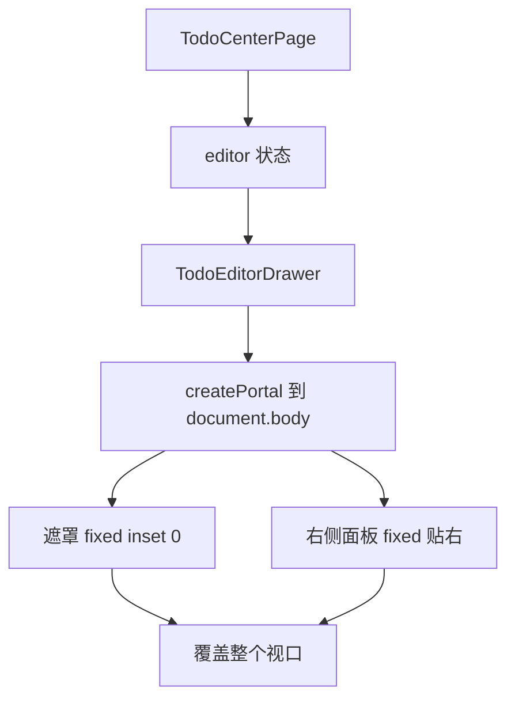

# 待办中心 2.0 结构说明

本文记录包结构、Host 与 Client 分工、挂载点、抽屉宿主、样式表归属与 Host–Client 边界。需求口径以 `docs/PRD.md` 6.4 至 6.6 与 `docs/PRD-v2.md` F9 为准，接口字段以 `docs/api-v2.md` 为准。

## 1. 结构决定

1. `package.json` 与 `cordis.patch.yml` 的结构正确，UX 3.0 不需要修改这两个文件。包名、导出路径、语言资源、图标、Client 平台声明与 Loader 补丁行都符合当前平台读取规则。
2. Host 与 Client 的分工保持单向：Host 持有数据文件、版本校验、原子写入、提醒扫描、导入导出与升级；Client 持有渲染、快速录入解析、今日分区、统计、倒计时文案、抽屉状态与焦点管理。
3. Host 与 Client 的唯一交互面是 `/plugins/dsh-todo-center` 前缀下的 19 条 `exact` HTTP 路由。不引入 Remote、WebSocket 或 SSE。
4. 挂载点保持四处：`sidebar.panellist`、`main`、`conversation.input.dock`、`shell.overlay`。`shell.overlay` 只承载提醒浮层，不承载抽屉。
5. 添加与编辑共用一个右侧抽屉。抽屉通过 `react-dom` 的 `createPortal` 渲染到 `document.body`，不注册新插槽。这样抽屉不受 `.tc-page` 的布局包含与 `overflow:hidden` 影响，能贴合视口四边，并且随页面卸载自动消失。
6. 样式表由 Client 半在首次挂载时向 `document.head` 插入一份，带 `data-plugin="@local/dsh-todo-center"` 标记，后续挂载点只使用类名。抽屉在 `body` 下仍能取到同一份规则。
7. 方格内容区为单列纵向排列，卡片占满内容宽度，卡片列数不随视口宽度变化；卡片固定 44 像素高，三列为 24 像素、剩余宽度、104 像素。卡片悬浮只显示覆盖倒计时列的浮层，不改变行高与列位置。
8. 倒计时文案按 PRD 6.5.1 的七类顺序判定；完成态的卡片不进入方格与今日页卡片行，短暂出现时倒计时列显示「已完成」。

## 2. 核实来源

| 核实对象 | 方式 | 结果 |
| --- | --- | --- |
| `webServer` 服务与 `register` 签名 | `cordis_inspect_query`，platform `host`，provider `Service`，method `listService` | 成功。`register(route: WebRoute): () => void`；重复 `(kind, path)` 抛错；路由类型为 `exact` 或 `prefix` |
| `timer` 服务 | 同上，service `timer` | 成功。`interval(callback, delay)` 返回处置函数，与 `ctx.effect` 配合 |
| Client 插槽实时树 | `cordis_inspect_query`，platform `client`，provider `Slots`，method `listSubTree` | 超时（10000 毫秒）。当前没有已连接的 GUI 页面；实时占用与标准属性未核实 |
| 插槽注册参数、标准属性、替换风险 | 已安装包 `@deepseek-ai/dsh-cordis-client-runner/lib/client.js` 的插槽目录 | 成功。`shell.overlay` 5481-5538 行，`sidebar.panellist` 5748-5793 行，`conversation.input.dock` 3339-3398 行，`main` 4372-4405 行 |
| Client 模块导出规则 | `@deepseek-ai/dsh-client-modules/lib/index.js` | `dsh.client.platform` 必须为字符串（66 行）；`exports["./client"]` 接受字符串或一级条件对象（171-181 行） |
| 补丁文件规则 | `@deepseek-ai/dsh-app-boot/lib/index.js` | `dsh.bundle.patch` 接受字符串或字符串数组（518-519 行）；补丁文件顶层为数组（3932-3981 行） |
| 安装状态 | `C:\Users\21039291\.dsh\profiles\web\package.json` | 第 11 行为 `link:D:/Workspace/Aika2 DevSpace/todo-center`，第 52 行列入 bundles |
| 抽屉宿主能力 | 已安装包 `@deepseek-ai/dsh-client-ui-schedule/lib/client.js:10`；`@deepseek-ai/dsh-client-ui-primitives/lib/index.js:2268-2275` | `require("react-dom")` 在客户端模块中可用；平台已有把页面根 `#root` 设为 `inert` 的弹层先例 |

未执行：没有重新调用 `install_bundle`，因此没有本次的 `application: applied`；没有连接浏览器读取抽屉矩形、焦点顺序与滚动位置；没有运行 `tests/` 下的套件；没有在浅色与深色主题下读取计算颜色；没有复查实时插槽树。

## 3. 包结构

| 路径 | 作用 |
| --- | --- |
| `package.json` | 包清单 |
| `cordis.patch.yml` | Loader 补丁，插入一行 `id` 为 `todo-center` 的插件 |
| `icon.svg` | 插件图标 |
| `locale/zh.json`、`locale/en.json` | 插件标题与描述的中英文资源 |
| `lib/index.js` | Host 半 |
| `lib/client.js` | Client 半 |
| `docs/` | 需求、接口、界面与结构说明 |
| `tests/` | 验收脚本与运行记录 |

清单字段与平台规则：

| 字段 | 取值 | 规则 |
| --- | --- | --- |
| `name` | `@local/dsh-todo-center` | 与 profile 依赖名、Loader 行 `name` 一致 |
| `version` | `2.0.0` | 2.0 数据与路由已经实现，主版本取 2 |
| `type` | `module` | `lib/index.js` 使用 ESM |
| `exports["."]` | `./lib/index.js` | Loader 从包根装载 Host 半 |
| `exports["./client"]` | `./lib/client.js` | 声明 `dsh.client` 的包必须导出 `./client` |
| `exports["./locale/*.json"]` | `./locale/*.json` | 显示资源按 `<specifier>/locale/<language>.json` 解析 |
| `exports["./icon"]` | `./icon.svg` | 图标取 `<specifier>/icon` |
| `dsh.bundle.patch` | `./cordis.patch.yml` | 允许字符串或字符串数组 |
| `dsh.client.platform` | `web` | 必填字符串；非 `web` 不进入浏览器模块表 |
| `dsh.client.immediately` | 未声明 | 可选布尔值；未声明表示不预加载 |
| `files` | `lib`、`locale`、`icon.svg`、`cordis.patch.yml` | 本地 link 安装不依赖该字段，保留用于打包 |

`cordis.patch.yml` 是顶层数组，`insert` 列表内一行指向本包，`config` 为空对象。`lib/index.js` 的 `apply` 对 `config` 做空对象兜底，`dataDir` 缺省为 `<DSH_HOME>/todo-center`，因此空配置是合法取值。该文件不需要增加新行，也不需要改变 `id`。

## 4. Host 半

`lib/index.js` 导出 `name`、`inject` 与 `apply(ctx, config)`，声明 `inject = ['webServer']`。`apply` 取得 `webServer` 与 `timer`，建立数据目录，注册路由，启动提醒扫描。

### 4.1 路由清单

| 序 | 路由 | 方法 | 用途 |
| --- | --- | --- | --- |
| 1 | `/snapshot` | GET | 全量数据、版本状态、筛选预设、设置 |
| 2 | `/reminders` | GET | 已提醒且未完成的条目与计数 |
| 3 | `/pending` | GET | 某一会话正在等待确认的提问与审批 |
| 4 | `/export` | GET | 完整数据文件对象 |
| 5 | `/create` | POST | 新建顶层或子待办 |
| 6 | `/update` | POST | 修改标题、描述、截止时间、标签、重复、提醒、会话标记 |
| 7 | `/complete` | POST | 完成一组条目，带重复时生成下一条 |
| 8 | `/reopen` | POST | 撤销完成，清除提醒记录 |
| 9 | `/remove` | POST | 删除条目与其子待办 |
| 10 | `/setQuadrant` | POST | 修改象限，作用于子待办 |
| 11 | `/setCollapsed` | POST | 记录方格折叠状态 |
| 12 | `/fromConversation` | POST | 由会话条目生成待办 |
| 13 | `/snooze` | POST | 稍后 10 分钟 |
| 14 | `/duplicateRecurrence` | POST | 复制重复设置 |
| 15 | `/filterSave` | POST | 新建或更新筛选预设 |
| 16 | `/filterRemove` | POST | 删除筛选预设 |
| 17 | `/import` | POST | 整份替换 |
| 18 | `/import/undo` | POST | 用备份写回 |
| 19 | `/upgrade` | POST | 版本 1 升级为版本 2 |

19 条全部为 `exact`，统一挂在 `/plugins/dsh-todo-center` 前缀下，路径互不重叠。每条注册包在 `ctx.effect` 内，插件卸载时由处置函数移除。路由表由 `lib/index.js` 的 `routes` 数组生成，启动日志打印 `routes.length`。

### 4.2 传输规则

| 项 | 规则 |
| --- | --- |
| 读取 | GET，无请求头要求 |
| 写入 | POST，必须带 `content-type: application/json` 与 `x-dsh-todo: 1`；缺写入标记返回 403 |
| 请求体上限 | 默认 1 MiB；`POST /import` 为 32 MiB |
| 成功响应 | `{ ok: true, value }` |
| 失败响应 | `{ ok: false, error }`，状态码为 400、403 或 500 |
| 并发 | 全部写入进入同一条 Promise 队列；读取不排队 |
| 数据权威 | 每次请求重新读取文件，进程内不保留数据副本 |

`x-dsh-todo` 是跨站请求防护标记，配合 `content-type: application/json` 触发预检；它不承担身份认证。命名路由不经过 Web 登录校验，单人本机约束下，能访问 3080 端口的进程与直接读写数据文件具有同等能力。

### 4.3 数据与提醒

数据文件版本为 2，读取时接受 1 与 2。版本 1 的文件按只读方式加载，写路由在写队列内返回 400，只有 `/upgrade`、`/import`、`/import/undo` 可以执行。版本 2 写入前先写同目录临时文件，再重命名覆盖；导入前复制当前文件为 `todos.before-import-<时间戳>.json`，升级前复制为 `todos.v1-<时间戳>.json`。

提醒由 Host 常驻定时器每 30 秒扫描一次，首次延迟 5 秒。命中条目写入 `remindedAt`；`GET /reminders` 只读，不写数据。提醒的显示与侧栏标记由 Client 的全局轮询器读取，轮询器放在 `apply` 中，不随面板卸载停止。

`/pending` 读取 Host 进程内存中的待确认登记表，与数据文件无关。登记由 `user-questions/request` 与 `approval/request` 两个监听完成，监听只观察并调用 `next()` 转交，不认领请求，不改变答案。

### 4.4 Host 不承担的结构

抽屉、倒计时文案、单列布局、行内标记的收起顺序、焦点循环与滚动锁都在 Client 半。Host 不新增与抽屉相关的路由，不保存抽屉状态。

## 5. Client 半

Client 半通过浏览器模块表注册：

- 模块标识 `@local/dsh-todo-center`，工厂函数内取 `require('react')`；抽屉宿主再取 `require('react-dom')`。
- 导出 `apply` 与 `inject = ['slots', 'layout', 'timer', 'sessions', 'uiWorkspace', 'workspaces']`。
- `apply` 把 `ctx` 存入模块级 `runtime`，注册四个挂载点，启动提醒轮询。
- 数据存储使用模块级 `store` 与 `useSyncExternalStore`；面板关闭后侧栏图标与提醒轮询仍能读取同一份状态。

### 5.1 样式表

`StyleSheet` 组件在首次挂载时检查 `style[data-plugin="@local/dsh-todo-center"]`，不存在则创建 `<style>`，写入 `STYLE_TEXT`，插入 `document.head`。页面、侧栏图标、会话操作条与提醒浮层都渲染这个组件，但守卫保证同一时刻只有一份规则。样式元素不随任一挂载点卸载而移除，抽屉在 `body` 下仍能取到规则。

样式表只使用主题令牌与 `color-mix`，不写十六进制、`rgba` 或 `hsl`。类名统一使用 `tc-` 前缀。

### 5.2 抽屉宿主

抽屉组件 `TodoEditorDrawer` 返回的树通过 `createPortal` 挂到 `document.body`：

宿主规则：

1. 抽屉根节点为遮罩容器，类名为 `tc-modal-mask tc-drawer-mask`，`position:fixed`，`inset:0`，`z-index:50`。
2. 面板为 `aside`，类名为 `tc-modal tc-drawer`，`role="dialog"`，`aria-modal="true"`，由 `aria-labelledby` 指向 `tc-modal-title tc-drawer-title`。
3. 根节点带 `data-tc-drawer="create"` 或 `data-tc-drawer="edit"`。遮罩、面板、标题、底部操作条同时保留 `.tc-modal-mask`、`.tc-modal`、`.tc-modal-title`、`.tc-modal-actions`，并增加 `.tc-drawer-mask`、`.tc-drawer`、`.tc-drawer-title`、`.tc-drawer-foot`。
4. 面板宽 420 像素；视口小于 1024 像素时取 `92vw`。高度为视口高度，贴右，左侧两个圆角，右侧无边框。标题栏与底部操作条不滚动，`.tc-drawer-body` 滚动。
5. 抽屉不注册 `shell.overlay` 条目。`shell.overlay` 的层 `z-index` 为 20，位于布局框架内；抽屉需要覆盖整个视口并拥有独立的模态层，`body` 门户更直接。平台 `Modal` 的 `z-index` 为 1000，平台自身的确认框仍能显示在抽屉之上。
6. 抽屉随 `TodoCenterPage` 卸载而卸载，不需要跨插槽清理状态。打开另一个方格的添加按钮时，页面先把旧抽屉关闭，再以新方格打开。

### 5.3 无障碍与键盘

| 项 | 要求 |
| --- | --- |
| 焦点进入 | 打开后焦点进入抽屉内第一个可编辑控件（标题输入）；触发元素在打开前记录到页面状态 `drawerReturnFocus` |
| 焦点返回 | 关闭后焦点回到记录的触发元素；元素仍连接时调用 `focus({ preventScroll: true })`，元素已移除时回到当前方格添加按钮或 `.tc-page` |
| Tab 循环 | Tab 与 Shift+Tab 在抽屉内循环；焦点在最后一个可聚焦元素时 Tab 到第一个，在第一个时 Shift+Tab 到最后一个；没有可聚焦元素时焦点停在面板本身 |
| Esc | 抽屉内还有标签选择或重复确认浮层时先关闭该浮层；否则关闭抽屉；保存进行中按 Esc 不关闭，并且不把事件交给页面级 Esc 处理 |
| 遮罩关闭 | 在遮罩上按下指针且目标为遮罩本身时关闭；保存进行中不关闭；从面板内部拖到遮罩不触发关闭 |
| 滚动锁 | 打开期间锁住页面滚动，关闭后恢复原来的滚动位置；抽屉字段区使用 `overscroll-behavior: contain`，滚到边界不带动背景 |
| 背景 | 抽屉打开期间给 `#root` 设置 `inert`，关闭后恢复原值；抽屉门户位于 `#root` 之外，仍可交互 |
| 标题与说明 | `role="dialog"`、`aria-modal="true"`、`aria-labelledby`；保存按钮有明确的可用与忙碌文案 |

平台 `OnboardingSurface` 已经有 `#root.inert = true` 的先例（`dsh-client-ui-primitives/lib/index.js:2268-2275`），抽屉沿用同一做法。`inert` 只作用于应用根，不作用于 `body` 下的抽屉门户。

### 5.4 倒计时边界

`countdownText(item, now)` 按以下顺序判定，先命中先生效：

| 序 | 条件 | 文案 | 边界 |
| --- | --- | --- | --- |
| 1 | `status` 不为 `open` | 已完成 | 完成态短暂进入卡片行时优先于截止时间判定 |
| 2 | 计划截止时间为空 | 未安排 | 与状态无关，完成态由第 1 条先截获 |
| 3 | 计划分钟早于当前分钟，且差值小于 60 分钟 | 逾期 N 分钟 | N 向下取整且不小于 1；同一分钟不算逾期 |
| 4 | 已逾期且小于 24 小时 | 逾期 N 小时 | N 向下取整；60 分钟为 1 小时 |
| 5 | 已逾期且不小于 24 小时 | 逾期 N 天 | N 向下取整；24 小时为 1 天 |
| 6 | 本机自然日与当前相同 | 今天 HH:mm | 同一分钟显示今天；跨过下一分钟后进入逾期 |
| 7 | 本机自然日为当前日加 1 | 明天 HH:mm | 跨月、跨年同样按自然日 |
| 8 | 自然日差为 2 至 7 | 周X HH:mm | 第 7 天包含在内；第 8 天进入今年内 |
| 9 | 同年且自然日差大于 7 | MM-DD HH:mm | 使用本机月份与日期 |
| 10 | 年份不同 | YYYY-MM-DD | 日期即可，不带时刻 |

当前实现位于 `lib/client.js` 的 `overdueBadgeText` 与 `countdownText`（本次读取为 361-385 行）。第 1 条尚未实现：函数只看 `dueTime`，没有检查 `status`。第 3 至 5 条与 PRD 6.5.1 一致；任务单的摘要只列「逾期 N 天或逾期 N 小时」，与 PRD 的分钟档存在差异，需要 CPO 给出最终口径。

`dayGap` 使用本机午夜时间差除以 86400000 后取整。Asia/Shanghai 没有夏令时，当前取值稳定；在有 30 分钟或 1 小时夏令时切换的时区，跨切换日的自然日差需要按年月日比较，不能只依赖毫秒差。该项未在其它时区实测。

## 6. 挂载点

### 6.1 已注册的四处

| 插槽 | 类型与作用域 | 注册参数 | 标准属性 | 替换风险 | 本插件取值 | 核实来源 |
| --- | --- | --- | --- | --- | --- | --- |
| `sidebar.panellist` | list，root | `id` 必填；`order`、`label` 选填 | 含 `useWorkspaces`、`usePanelInfo`、`useSessions` 等 | none | `id: 'todo-center'`，`order: 2`，`label` 返回「待办中心」 | 插槽目录 5748-5793 行 |
| `main` | keyed，root | `key` 必填 | 含 `useWorkspaces`、`usePanelInfo` 等 | `shadows-shipped-ui` | `key: 'todo-center'` | 插槽目录 4372-4405 行 |
| `conversation.input.dock` | list，session | `id` 必填；`order`、`label` 选填 | 含 `session`、`input`、`sessionId`、`useTrajectory` | none | `id: 'todo-center'`，`order: 60` | 插槽目录 3339-3398 行 |
| `shell.overlay` | list，root | `id` 必填；`order`、`label` 选填 | 无 owner props；含 `useSessions`、`usePanelInfo` 等 | none | `id: 'todo-center.reminder'`，`order: 80` | 插槽目录 5481-5538 行 |

`sidebar.panellist` 的当前占用包含 `client-ui-plugin-manager` 与 `client-ui-schedule`；本插件使用独立 id，不替换既有条目。`main` 的保留键为 `conversation`，本插件不占用该键。`conversation.input.dock` 的当前占用包含 `queue`、`todo`、`goal`、`claude-code-mods`；本插件 id 不重复。`shell.overlay` 的当前占用包含配额提示、插件刷新提示、日程删除提示、工作区会话重命名与归档确认框、行操作提示、快捷键说明与引导页；本插件只增加提醒条目。

`shell.overlay` 的条目自身恢复指针事件，层本身点击穿透。提醒浮层使用固定定位与 `pointer-events:auto`，不阻塞页面其余区域。

### 6.2 不注册的插槽

- `conversation.approval.detail`：单值插槽，已被官方审批界面占用，注册会替换官方界面。
- `tool.call.toolview` 的 `ask_user_question` 键：已被官方提问视图占用，注册同名键会替换提问卡片。
- `sidebar.toggle.badge`：已被 `DesktopUpdateBadge` 占用，替换风险为 `shadows-shipped-ui`，本插件不使用。
- `shell.overlay` 的抽屉条目：本插件不使用；抽屉由页面门户承载。

### 6.3 插槽核实状态

插槽目录来自已安装的 `@deepseek-ai/dsh-cordis-client-runner` 包，条目包含注册参数、标准属性、占用列表、替换风险与上游源文件位置。实时 `Slots.listSubTree` 本次超时，因此占用列表与顺序以已安装包目录为准；运行中的实际顺序、是否有其它本地插件占用同名 id，需要在 GUI 页面连接后复查。

## 7. 卡片与布局结构

### 7.1 单列与格头

方格内容区 `.tc-cell-body` 为 `overflow:auto`，卡片容器 `.tc-card-flow` 为单列 `flex-direction:column`，间距由容器 `gap` 提供。`.tc-grid` 仍为 2×2 的四象限栅格；1720 像素以上的卡片双列规则已经不存在。内容宽度不足 640 像素时，`.tc-grid` 改为纵向单列，页面滚动承载在 `.tc-shell`。

格头 `.tc-cell-head` 位于滚动容器之外，位置固定。内容区滚动位置大于 0 时设置 `data-tc-scrolled="1"`，顶部出现内阴影；回到 0 时移除。当前规则使用 `inset 0 8px 6px -8px`，PRD 写的是 1 像素内阴影，视觉取值需要 UI Designer 按 1 像素提示重新确认。

### 7.2 卡片三列

| 列 | 宽度 | 内容 |
| --- | --- | --- |
| 勾选列 | 24 像素 | 16 像素勾选框，控件位 24 像素 |
| 标题列 | 剩余宽度 | 象限色点、标题、行内标记 |
| 倒计时列 | 104 像素 | 文字靠右、`font-variant-numeric: tabular-nums` |

卡片左右内边距 10 像素，列间距 10 像素，左侧 3 像素象限强调条。标题单行省略；行内标记按标签、描述、子待办进度、重复、来自会话、已发起会话的顺序排列，宽度不足时从右向左收起。标签最多显示 2 个，其余合并为 `+N`。

悬浮或键盘聚焦时，操作浮层绝对定位在倒计时列上方，右边缘贴齐，倒计时文字隐藏，卡片高度、宽度、列位置不变。触摸设备不显示浮层，倒计时文字保持可见。

会话错误存在时卡片加 `tc-card-has-error`，高度改为自适应，错误消除后回到 44 像素。

### 7.3 CSS 条件

| 项 | 当前规则 | 需要满足的条件 |
| --- | --- | --- |
| 卡片高度 | `.tc-card` 为 `height:44px`，未声明 `box-sizing` | 使用 `box-sizing:border-box`；上下边框各 0.5 像素，内容盒高度会把外框推到 45 像素 |
| 标题与标记 | `.tc-card-head` 为横向 flex，`min-width:0`，`overflow:hidden` | 标题按钮与标记区都可收缩；标记区需要按顺序隐藏并给末位标记加省略号 |
| 操作浮层 | `.tc-card-actions` 位于 `.tc-card-side` 内，两个图标按钮 | 两个按钮加 12 像素渐变内边距约占 58 像素，能放进 104 像素；PRD 6.5 列出的四个操作若全部放进浮层，4×22+3×2+12=106 像素，会超出 2 像素 |
| 顶部内阴影 | `inset 0 8px 6px -8px` | PRD 的 1 像素提示需要更窄的阴影或 1 像素边框 |
| 抽屉宽度 | 420 像素；`max-width:1024px` 时 `92vw` | 900 像素视口下宽 828 像素，遮罩剩 72 像素；600 像素视口下宽 552 像素，遮罩剩 48 像素，均不小于 40 像素 |
| 抽屉高度 | `height:100%` | 宿主为 `body` 门户时等于视口高度；宿主在 `.tc-page` 内时只等于页面高度 |
| 抽屉边框 | `.tc-modal` 有 0.5 像素边框，`.tc-drawer` 只去掉右边框 | 需要 `box-sizing:border-box`，否则外框高度比视口多 1 像素 |

## 8. 文档与套件同步

| 位置 | 现状 | 需要同步的内容 |
| --- | --- | --- |
| `docs/ui-spec-v2.md:141` | 1720 像素以上卡片两列 | 改为单列，删除双列描述 |
| `docs/ui-spec-v2.md:160-162` | 单行 34 像素、带元信息 54 像素 | 改为固定 44 像素、三列 24/剩余/104 |
| `docs/ui-spec-v2.md:171` | 1920 视口实测两列 | 改为单列实测 |
| `docs/ui-spec-v2.md:220` | 方格卡片行高 34 | 改为 44 |
| `docs/ui-spec-v2.md:1030` | `@media (min-width:1720px)` 双列规则 | 删除 |
| `docs/ui-spec-v2.md:1065` | 卡片悬停向上位移 1 像素 | 改为位移 0 |
| `tests/ui-layout.mjs:510-539` | L4 断言 1720 视口每格卡片两列 | 改为断言单列、左边缘一致、右边缘贴齐、相邻顶边间距等于行高加 gap |
| `tests/ui-layout.mjs:545-551` | 900 视口 `.tc-grid` 两列 | 保留；这里断言的是四象限栅格，不是卡片列 |
| `tests/ui-check-v11.mjs:182-200` | 等待 `.tc-editor`，点击 `.tc-header` 关闭添加面板 | 改为等待 `[data-tc-drawer]`；关闭动作改为点击 `.tc-drawer-mask` |
| `tests/ui-check-edit.mjs:24,56,77,212` | `.tc-editor` 作为创建面板的定位范围 | 改为 `[data-tc-drawer]`；`.tc-modal` 仍可保留作为兼容定位 |
| `tests/ui-check-v2.mjs:667` | 范围回退包含 `.tc-editor` | 增加 `[data-tc-drawer]`；抽屉的 `role="dialog"` 已能被现有回退命中 |
| `tests/ui-check.mjs:246-260` | 合并完成确认框使用 `.tc-modal` | 保留；抽屉不是确认框，不应替代该断言 |

新增套件至少覆盖：1920 与 900 视口下抽屉的 `top`、`bottom`、`right` 与宽度；遮罩覆盖视口；焦点进入标题、Tab 20 次不逸出、Esc 返回触发按钮；保存中 Esc 与遮罩不关闭；打开前后内容区 `scrollTop` 相同；卡片外框 44 像素；24 与 104 列宽；悬浮不改变行高；完成态短暂出现时显示「已完成」。

`docs/PRD.md` 6.4 至 6.6 与 `docs/PRD-v2.md` F9 已包含 UX 3.0 条文与 76 至 95 条验收，本文按这两处执行。`docs/ui-spec-v2.md` 仍是旧规格，需要 UX Architect 与 UI Designer 更新后再作为视觉验收依据。

## 9. 风险

| 编号 | 位置 | 触发条件 | 影响 | 验证方式 | 状态 |
| --- | --- | --- | --- | --- | --- |
| A1 | `lib/client.js` 的 `TodoEditorDrawer` 返回树 | 抽屉在 `.tc-page` 内渲染 | `.tc-page` 的 `container-type:inline-size` 与 `overflow:hidden` 使固定定位以页面为包含块，抽屉不能贴合视口四边，可能被裁切 | 在 1920、900、600 视口读取抽屉与遮罩矩形 | 已复现的结构条件；尚未在浏览器读取矩形 |
| A2 | `TodoEditorDrawer` 的焦点 effect | 打开时子组件先自动聚焦标题 | effect 记录的 `document.activeElement` 是标题，关闭后焦点回到已移除的节点，触发按钮失去焦点 | 打开抽屉后按 Esc，读取 `document.activeElement` | 静态推断，待浏览器确认 |
| A3 | `TodoEditorDrawer` 的 `onKeyDown` | 保存进行中按 Esc | 处理函数直接返回，事件继续传到页面级 Esc，抽屉被关闭，保存中途丢失上下文 | 保存中按 Esc，观察抽屉是否关闭 | 静态推断，待浏览器确认 |
| A4 | `TodoEditorDrawer` 的滚动锁 | 打开抽屉后滚动背景内容区 | 只设置 `document.body.style.overflow`，页面内部滚动容器未锁定，关闭后 `scrollTop` 可能变化 | 记录打开前后 `.tc-cell-body` 的 `scrollTop`，滚轮与 PageDown 各一次 | 未执行 |
| A5 | `.tc-card` 的盒模型 | 读取卡片外框高度 | 未声明 `box-sizing:border-box`，上下边框把 44 像素内容盒推到约 45 像素，超出验收 77 的 0.5 像素容差 | 读取三张卡片 `getBoundingClientRect().height` | 静态推断，待浏览器确认 |
| A6 | `.tc-card-actions` 与 PRD 6.5 | 按 PRD 放入编辑、复制重复、删除、发起会话四个按钮 | 4×22+3×2+12=106 像素，超过 104 像素倒计时列；当前实现只放发起会话与更多两个按钮，其余在菜单内 | 读取浮层按钮数量与矩形，对照 PRD 6.5 | 已确认数量差异，需 UX 裁决 |
| A7 | `.tc-card-marks` | 标题列窄于标记总宽 | 只有 `overflow:hidden`，没有按顺序隐藏与末位省略号；末位标记可能被直接裁掉 | 在 900 视口造 3 标签、描述、子待办、重复、来源的卡片，读取标记可见顺序 | 未执行 |
| A8 | `.tc-cell-body[data-tc-scrolled="1"]` | 内容滚动 | 阴影为 8 像素扩散，PRD 写 1 像素提示 | 读取计算样式与截图对照 | 已确认取值差异，视觉验收未执行 |
| A9 | `countdownText` | 完成态短暂进入卡片行 | 没有 `status` 判定，显示逾期或今天文案，PRD 要求「已完成」 | 构造完成条目并临时渲染到方格，读取倒计时文字 | 已确认代码缺口 |
| A10 | 任务单摘要与 PRD 6.5.1 | 逾期不足 1 小时 | 任务单只列天与小时，PRD 列分钟、小时、天三档 | 由 CPO 对照两份条文裁定 | 已确认条文差异 |
| A11 | `StyleSheet` | 插件禁用或客户端重载 | 样式元素只在首次挂载时插入，没有在 `apply` 的 `ctx.effect` 中登记移除；禁用插件后规则可能留在 `head` | 禁用插件后读取 `style[data-plugin="@local/dsh-todo-center"]` 数量 | 潜在风险，未执行 |
| A12 | 实时插槽树 | GUI 页面未连接 | 无法确认运行中的占用、顺序与标准属性 | 连接页面后调用 `Slots.listSubTree` | 未核实 |
| A13 | profile 安装 | 本次未重新安装 | 没有 `application: applied` 的本次证据，link 依赖可能未加载最新改动 | 重新安装并读取插件管理页状态 | 未执行 |
| A14 | `tests/ui-layout.mjs` 与 `tests/ui-check-v11.mjs` | 运行旧套件 | L4 双列断言与点击页头关闭抽屉的断言会失败 | 运行套件并读取失败项 | 已确认断言冲突，未运行 |

A1 是 UX 3.0 的阻塞项。最小修法：在 `lib/client.js` 顶部取 `const { createPortal } = require('react-dom')`，把 `TodoEditorDrawer` 的返回树包进 `createPortal(..., document.body)`；回归用例是 1920、900、600 三个视口下抽屉矩形贴合视口，遮罩覆盖视口，页面内容区不出现裁切。

A2 的最小修法：在 `openCreate` 与 `openEdit` 接收触发事件，把 `event.currentTarget` 存入页面状态 `drawerReturnFocus`，通过 props 传给抽屉；关闭时先检查 `isConnected`，再调用 `focus({ preventScroll: true })`。回归用例是添加按钮、卡片标题、子待办进度三种触发方式各一次。

A3 的最小修法：Esc 分支先调用 `event.stopPropagation()`，再按 `busy` 决定是否关闭。回归用例是保存中按 Esc 与保存完成后按 Esc 各一次。

A5 的最小修法：`.tc-card` 与 `.tc-drawer` 增加 `box-sizing:border-box`。回归用例是读取三张卡片高度与抽屉上下边。

A9 的最小修法：`countdownText` 先判断 `item.status !== 'open'` 返回「已完成」，再处理空截止时间。回归用例是完成态条目短暂渲染到方格。

## 10. 交接

- CPO：裁定 A10 的逾期分钟档，确认 PRD 6.5 的四个悬浮操作与当前两个按钮加菜单的差异；确认验收 94 对 `.tc-editor` 的表述是否允许该 class 作为抽屉字段容器保留。
- UX Architect 与 UI Designer：更新 `docs/ui-spec-v2.md` 的 141、160-162、171、220、1030、1065 行；确认 1 像素内阴影、标记按顺序隐藏与末位省略号、四个操作按钮与 104 像素列的取舍。
- Client 实现：处理 A1、A2、A3、A5、A9；A1 是发布阻塞项。保持 `.tc-modal` 四个兼容类名与 `data-tc-drawer`。
- Reality Checker：按第 8 节新增断言并运行 `tests/`；重点记录抽屉矩形、焦点往返、保存中 Esc、滚动锁、卡片高度与列宽。旧套件的 L4 与点击页头关闭断言需要先更新，不能把旧断言失败当成新功能失败。
- Backend Architect：Host 19 条路由与数据规则不需要为 UX 3.0 改动；`lib/index.js` 顶部注释仍写「18 条」，与 `routes` 的 19 条不一致，可以在下一次 Host 改动时同步为 19。
- Lead：确认抽屉宿主采用 `document.body` 门户；确认 A1 的修法进入本轮实现；确认 `application: applied` 需要重新安装后才能作为交付证据。
