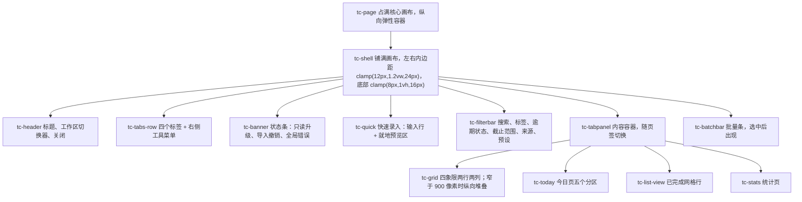

# 待办中心 2.0 界面规格

| 项 | 内容 |
| --- | --- |
| 文档版本 | 2.0 |
| 日期 | 2026-11-03 |
| 负责角色 | design-ux-architect（页面布局与样式基础、键盘操作） |
| 依据 | `docs/PRD-v2.md`（8 项功能，验收 39 至 75）、`docs/api-v2.md`（19 条路由与数据校验）、`docs/architecture-v2.md`（提醒承载与会话接口） |
| 主题范围 | 浅色与深色各一套，全部颜色取 `--dsw-alias-*` 与由令牌混合得到的派生色 |
| 类名前缀 | `tc-`，与 1.x 共用同一份样式表 |

## 0 范围与依据

### 0.1 覆盖范围

本文给出 2.0 的页面骨架、八个功能的界面结构、几何尺寸、状态表现、键盘路径与界面判定口径。焦点与令牌的基础结论沿用 `docs/ui-spec.md` 第 1 至 9 节；卡片密度、四象限染色与动效按第 1.4、2.2、17 节执行。本文记录 2.0 的全部界面规则，并在第 2.5 节列出与 1.x 的差异。

接口与字段以 `docs/api-v2.md` 为准，本文不重复定义字段类型。需求条目以 `docs/PRD-v2.md` 为准，本文按 F1 至 F8 引用，验收按 39 至 75 引用。

### 0.2 平台事实核实

| 核实对象 | 结论 | 依据 | 等级 |
| --- | --- | --- | --- |
| 焦点环令牌 | `--dsw-focus-ring-color` 与 `--dsw-focus-ring-width` 都在主题登记表中 | `dsh-client-ui-theme/lib/client.js` 令牌登记表 | 已确认 |
| 警告色令牌名 | 登记表中为 `--dsw-alias-state-warn-primary`；`--dsw-alias-state-warning-primary` 不存在 | 同上 | 已确认 |
| 第三级文字令牌 | `--dsw-alias-label-tertiary` 浅色 `#81858c`、深色 `#adb2b8`，对页面底的对比度为 3.71 与 7.36 | 同上，数值见第 1.3 节 | 计算值 |
| 浮层底色令牌 | `--dsw-alias-bg-overlay` 浅色 `#e9ecf2`、深色 `#61666b`；深色下 `label-secondary` 在其上只有 3.85 | 同上 | 计算值 |
| 字号令牌 | 组合令牌本身是完整的 `font` 简写，例如 `--dsw-font-xxs-12` 为 `12px/18px`，`--dsw-font-xl-24` 为 `600 24px/32px` | 同上 | 已确认 |
| 全局快捷键 | `dsh-client-ui-shortcuts` 已在文档上注册全局键盘处理并提供快捷键面板 | `dsh-client-ui-shortcuts/lib/client.js:584,876` | 静态代码确认 |
| 多选入口形态 | 工具栏「多选」按钮（`aria-pressed`）+ 卡片左侧 20×20 单一控件位，两种状态共用该控件位 | `lib/client.js:662-670`、`889-905`；`docs/PRD-v2.md:44` | 已实测 |
| 挂载点 | `sidebar.panellist`（order 2）、`main`（key `todo-center`）、`conversation.input.dock`（order 60）、`shell.overlay`（order 80） | `docs/architecture-v2.md` 第 9 节 | 已定稿 |
| 提醒轮询 | 轮询器放在 `apply`，插件激活期间每 30 秒一次，面板卸载不停止；失败时退避到 60 秒与 5 分钟 | `docs/architecture-v2.md` 7.5 节 | 已定稿 |
| 样式表生命周期 | 样式由 `apply` 创建一次，面板关闭与浮层出现都复用；浮层不渲染样式元素 | `docs/architecture-v2.md` 7.4 节 | 已定稿 |
| 提醒浮层 | 使用 `shell.overlay` 的 `todo-center.reminder` 条目，作为附加呈现，不改变验收 46 至 49 | `docs/architecture-v2.md` 7.6 节 | 已定稿 |
| 会话创建与首条消息 | `ctx.sessions.create`、`beginSubmission`、`prompt` 的调用顺序已定稿；发送流程只做了静态核实，浏览器验证是 T28 前置 | `docs/architecture-v2.md` 8.5 节 | 静态核实 |

浏览器内的实际计算样式、真实焦点顺序、预览区就地展开引起的内容位移、浮层与平台 `Toast` 的实际矩形均未在本轮执行，本文标注「未验证」。

## 1 令牌与文字规则

### 1.1 本文使用的令牌

| 用途 | 令牌 | 浅色 | 深色 |
| --- | --- | --- | --- |
| 正文与标题 | `--dsw-alias-label-primary` | `#0f1115` | `#f9fafb` |
| 说明、计数、副行 | `--dsw-alias-label-secondary` | `#61666b` | `#cfd3d6` |
| 图标与装饰 | `--dsw-alias-label-tertiary` | `#81858c` | `#adb2b8` |
| 内容面 | `--dsw-alias-bg-layer-1` | `#ffffff` | `#232324` |
| 卡片面 | `--dsw-alias-bg-layer-2` | `#ffffff` | `#2c2c2e` |
| 悬浮控件面 | `--dsw-alias-bg-layer-3` | `#ffffff` | `#353638` |
| 轨道与禁用底 | `--dsw-alias-interactive-bg-active` | `#2631481a` | `#ffffff24` |
| 悬停底 | `--dsw-alias-interactive-bg-hover` | `#2631480d` | `#ffffff14` |
| 分隔线一至三级 | `--dsw-alias-border-l1` / `-l2` / `-l3` | 由浅到深 | 由深到浅 |
| 品牌色 | `--dsw-alias-brand-primary` | 主按钮、选中下划线 | 同左 |
| 焦点环 | `--dsw-focus-ring-color` | 输入聚焦边框 | 同左 |
| 警告 | `--dsw-alias-state-warn-primary` | `#f59e0b` | `#f59e0b` |
| 错误 | `--dsw-alias-state-error-primary` | `#ec1313` | `#f25a5a` |
| 业务蓝 | `--dsw-alias-state-business-primary` | `#4176e6` | `#7aaaff` |
| 空闲灰 | `--dsw-alias-state-idle-primary` | `#d4d4d4` | `#545557` |
| 遮罩 | `--dsw-alias-bg-mask-1` | `#0000003d` | `#00000080` |
| 对话框阴影 | `--dsw-shadow-lv3` | 三级阴影 | 同左 |
| 浮层阴影 | `--dsw-shadow-lv2` | 二级阴影 | 同左 |
| 圆角 | `--dsw-radius-xs` / `-sm` / `-md` | 4 / 8 / 12 像素 | 同左 |
| 字号 | `--dsw-font-xxxs-11` / `-xxs-12` / `-xs-13` / `-s-14` / `-l-20` / `-xl-24` | 11/12/13/14/20/24 像素 | 同左 |

### 1.2 四条文字规则

1. 有信息量的文字只用 `label-primary` 与 `label-secondary`。`label-tertiary` 只用于图标笔画与装饰线：浅色下对白色 3.71:1、深色下对 `bg-layer-1` 7.36:1，达到图形元素的 3:1，低于正文的 4.5:1。
2. 输入框占位文字使用 `label-secondary`。占位文字给出示例输入，属于可读内容。
3. 对话框、下拉浮层、预览区一律使用 `bg-layer-1` 或 `bg-layer-2` 作面底，不使用 `bg-overlay`：深色下 `bg-overlay` 为 `#61666b`，`label-secondary` 在其上只有 3.85:1。
4. 状态色只用于图形，正文一律使用 `label-primary` 或 `label-secondary`。纯警告色对白色只有 2.15:1、纯空闲灰只有 1.48:1，都低于图形元素 3:1 的门槛；因此第 1.4、6.2、9.3、9.4 节的图形颜色一律取状态色与令牌的混合派生色，具体比例按用途分别写定。

### 1.3 面底与文字的对比度

| 前景 | 背景 | 浅色 | 深色 |
| --- | --- | --- | --- |
| `label-primary` | `bg-layer-1` | 18.90 | 15.03 |
| `label-secondary` | `bg-layer-1` | 5.80 | 10.42 |
| `label-secondary` | 12% `label-secondary` 混入 `bg-layer-1`（标签标记底） | 4.94 | 7.78 |
| `label-primary` | 8% `state-warn` 混入 `bg-layer-1`（提醒区底） | 17.74 | 13.01 |
| `label-secondary` | 同上 | 5.45 | 9.03 |
| `label-primary` | 12% 象限色混入 `bg-layer-2`（象限胶囊底） | 15.54 至 18.10 | 10.66 至 12.42 |
| `label-secondary` | `bg-overlay` | 4.90 | 3.85 |
| `label-tertiary` | `bg-layer-1` | 3.71 | 7.36 |

图形与线条的对比度：

| 图形 | 相邻表面 | 浅色 | 深色 |
| --- | --- | --- | --- |
| 提醒区左侧 3 像素边框（42% 警告色派生） | 提醒区底 | 7.22 | 9.53 |
| 象限分布条（42% 象限色派生） | 分布轨道 `interactive-bg-active` | 5.00 至 10.07 | 4.89 至 7.03 |
| 象限分布条 | 区块底 `bg-layer-1` | 6.01 至 12.11 | 7.65 至 11.00 |
| 周柱状图柱（42% 业务蓝派生） | 区块底 `bg-layer-1` | 10.93 | 10.91 |

按 sRGB 分量插值与 WCAG 相对亮度公式计算，未在浏览器内测量。侧栏提醒点对侧栏底色的对比度依赖 `--dsw-specific-sidebar-fill` 在两侧主题下的取值，未验证。

### 1.4 四象限染色与等级文案

四个象限共用 `--tc-quadrant` 令牌，方格头部底色、方格左缘、卡片左缘与卡片圆点分别按固定比例混色。比例固定在四个 `[data-tc-quadrant]` 选择器里，同一象限的三处图形取同一色相，深浅由比例决定。

| 象限 | 令牌 | 方格头部底色 | 方格左缘 4px | 卡片左缘 3px 与圆点 | 等级文案 |
| --- | --- | --- | --- | --- | --- |
| 紧急且重要 | `--dsw-alias-state-error-primary` | 22% 混 `bg-layer-1` | 68% 混 `label-primary` | 56% 混 `label-primary` | 立刻处理 |
| 紧急不重要 | `--dsw-alias-state-warn-primary` | 18% 混 `bg-layer-1` | 60% 混 `label-primary` | 56% 混 `label-primary` | 尽快处理 |
| 重要不紧急 | `--dsw-alias-state-business-primary` | 14% 混 `bg-layer-1` | 52% 混 `label-primary` | 56% 混 `label-primary` | 排入计划 |
| 不重要不紧急 | `--dsw-alias-state-idle-primary` | 8% 混 `bg-layer-1` | 36% 混 `label-primary` | 56% 混 `label-primary` | 有空再做 |

头部正文取 `label-primary`：名称 13.5/20 500、等级文案 12/18 400、计数 12/18 400。等级文案与名称之间用「· 」连接，例如「紧急且重要 · 立刻处理」。方格左缘与卡片左缘、卡片圆点取派生色，只作图形使用。

| 象限 | 头部底色 浅 / 深 | 头部文字 浅 / 深 | 方格左缘对头部 浅 / 深 | 卡片左缘与圆点对卡片面 浅 / 深 |
| --- | --- | --- | --- | --- |
| 紧急且重要 | `#fbcbcb` / `#512f30` | 13.05 / 11.17 | 5.38 / 5.03 | 9.57 / 6.92 |
| 紧急不重要 | `#fdeed3` / `#493920` | 16.51 / 10.64 | 4.30 / 6.87 | 5.43 / 8.82 |
| 重要不紧急 | `#e4ecfc` / `#2f3643` | 15.93 / 11.62 | 7.72 / 7.78 | 8.57 / 8.66 |
| 不重要不紧急 | `#fcfcfc` / `#272728` | 18.42 / 14.28 | 7.04 / 8.10 | 4.06 / 5.19 |

文字门槛 4.5:1、图形门槛 3:1，四行全部达到。深色主题的头部底色由状态色与 `bg-layer-1` 混合得出，比例与浅色相同；卡片面在深色下为 `#2c2c2e`，因此卡片左缘的比值与浅色不同。逐项算式与两套主题的完整取值见 `docs/review/quadrant-palette.md`。

逾期表现取 `state-error-primary`：卡片 1 像素描边（对卡片面 4.50 / 4.24）、高 18px 的徽标底为 6% 状态错误混入 `bg-layer-2`、徽标文字与时间文字取 `label-primary`（徽标底上 17.16 / 12.41）。状态错误色在深色下对卡片面只有 4.24:1，低于正文 4.5:1，因此红色只出现在描边与徽标底两处图形上。

## 2 页面骨架

### 2.1 结构



内容列铺满 `main` 插槽提供的核心画布，宽度 100%，不设最大宽度，不做居中留白；左右内边距 `clamp(12px,1.2vw,24px)`，底部 `clamp(8px,1vh,16px)`。画布宽于 1720 像素时四象限方格体与今日页分区内的卡片排两列；901 至 1180 像素时收窄间距、卡片内边距与象限名字号；窄于 900 像素时四象限改为纵向单列、整页滚动，每格最小高度 40vh，任何宽度下都不出现横向滚动。

### 2.2 度量、断点与卡片密度

| 区域 | 高度 | 说明 |
| --- | --- | --- |
| `.tc-header` | 56px | 上下内边距 12px，标题 20/28 |
| `.tc-tabs-row` | 36px | 标签底边 0.5px |
| `.tc-banner` | 变高（最小 36px） | 无状态时整块不渲染 |
| `.tc-quick` | 44px，展开预览时增加预览区高度 | 输入行 36px + 上下 4px |
| `.tc-filterbar` | 32px | 单行，控件过多时换行 |
| 内容区 `.tc-tabpanel` | 剩余高度 | `flex:1 1 auto;min-height:0;min-width:0` |
| `.tc-cell-head` | 40px，窄于 1181 像素时 32px | 圆点、名称、等级文案、计数 |
| `.tc-batchbar` | 44px | 选中后出现 |

断点分两类：密度按视口宽度，栅格布局按面板内容宽度（`.tc-page` 声明 `container-type:inline-size`，用容器查询判定，避免侧栏宽度影响判定）。

| 视口宽度 | 卡片密度 | 间距 | 方格头部与名称 |
| --- | --- | --- | --- |
| 1720 及以上 | 方格体与今日页分区内卡片两列，内边距 `6px 8px 6px 10px`，单行 34px、带元信息 54px | `clamp(8px,0.9vw,16px)` | 40px，13.5/20 500 |
| 1181 至 1719 | 卡片单列，内边距 `6px 8px 6px 10px`，单行 34px、带元信息 54px | `clamp(8px,0.9vw,16px)` | 40px，13.5/20 500 |
| 1180 及以下 | 卡片单列，内边距 `4px 6px`，单行 32px、带元信息 50px | 8px | 32px，12/18 500 |

| 面板内容宽度 | 四象限网格 |
| --- | --- |
| 大于 640px | 两行两列，方格填满内容高度 |
| 640px 及以下 | 纵向单列，`grid-auto-rows:auto`，每格最小高度 40vh，整页滚动承载在 `.tc-shell` |

卡片在四象限方格、今日页分区与已完成清单三处共用同一密度规则：勾选位 24×24，勾选框 16×16，标题 13.5/20 500，元信息 12/18。已完成清单的行为四列网格：标题自适应、截止 120px、完成 150px、操作自适应，行高不小于 36px。

实测对照：1920 视口、默认侧栏时面板内容宽 1640，网格两列各 789px；756 视口、侧栏 85px 时内容宽 676，仍为两列，方格宽 334；600 视口时内容宽 544，改为单列，方格宽 515，四个页签均无横向溢出。

### 2.3 焦点顺序

页面级 Tab 顺序，与视觉顺序一致：

1. 工作区切换器（标题条中部）
2. 关闭按钮
3. 四个标签（`role="tab"`，方向键在标签间移动）
4. 工具菜单按钮（标签行右端）
5. 快速录入输入行
6. 语法提示按钮、预览区内的字段与按钮（预览展开时）
7. 筛选区控件：搜索框、标签多选、逾期状态、截止范围、来源、预设下拉
8. 内容区：分区折叠按钮（今日页）、方格标题行、卡片完成勾选框、卡片标题按钮、卡片操作层
9. 批量条（选中后）

`docs/PRD-v2.md:793` 的验收 74 列出的六个停靠点（关闭、四个标签、快速录入、分区折叠、卡片勾选框、卡片操作）在这条顺序上依次出现，途中经过工作区切换器与筛选控件。该口径见第 20.2 节 P1。

### 2.4 滚动策略

| 区域 | 滚动 | 依据 |
| --- | --- | --- |
| 页面 | 宽于 900 像素时不滚动 | `.tc-page` 与 `.tc-shell` 均 `overflow:hidden` |
| 四象限每个方格 | 各自滚动 | 沿用 `docs/ui-spec.md` 第 4 节 |
| 四象限（900 像素及以下） | 纵向堆叠，整页滚动 | 第 2.2 节 |
| 今日页 | 整列滚动 | `docs/PRD-v2.md:312` |
| 已完成清单 | 按可视区渲染 | 沿用 1.x，行高 36 |
| 统计页 | 整列滚动 | 第 9 节 |
| 快速录入预览区 | 就地展开，不滚动 | 第 4.3 节 |
| 对话框正文 | 对话框内滚动，最大高度 `min(80vh,720px)` | 第 13 节 |

### 2.5 与 1.x 的差异

| 项 | 1.x | 2.0 |
| --- | --- | --- |
| 标签数量 | 两个 | 四个：四象限、今日、已完成、统计，默认四象限 |
| 标签语义 | `tc-tab-active` 类名 | `role="tablist"`、`role="tab"`、`aria-selected` |
| 标签行右侧 | 无 | 工具菜单：导出全部数据、导入数据 |
| 快速录入 | 无 | 四象限与今日两页的输入行与就地预览区 |
| 状态条 | 无 | 只读升级横幅、导入撤销横幅、全局错误行 |
| 筛选项 | 搜索、逾期状态、截止范围、来源 | 另加标签多选与预设下拉，逾期状态扩为四值 |
| 卡片附加元素 | 逾期标记、来源标记、工作区标记 | 另加标签标记、重复循环图标、已发起会话标记 |
| 卡片操作 | 行内常显三项 | 标题行右侧固定 88 像素操作区，含象限选择、编辑、发起会话、删除、更多菜单，隐藏时保留占位 |
| 内容列 | 上限 960 像素、居中、左右 16 像素 | 铺满核心画布，左右 `clamp(12px,1.2vw,24px)`，底部 `clamp(8px,1vh,16px)` |
| 四象限染色 | 每格 12% 单色底，左缘 3 像素 | 头部按 22 / 18 / 14 / 8 四级混色，方格左缘 4 像素按 68 / 60 / 52 / 36 混色，卡片另加 3 像素左缘与 6 像素圆点 |
| 方格标题 | 名称加计数 | 名称、等级文案、计数三处文本（第 1.4 节） |
| 已完成清单行 | 绝对定位，行容器无高度 | 网格行，头部弹性单行，数据行四列 |
| 勾选控件 | 15×15 | 勾选框 16×16，控件位 24×24 |
| 动效 | 无过渡与动画 | 过渡 120ms、卡片进入 180ms、页签淡入 140ms，减少动态效果下归零（第 17 节） |
| 行高常量 | 34 | 已完成清单 36，方格卡片沿用 34 |
| 方格空态 | 「暂无任务，点击添加」 | 区分「无待办」与「筛选无结果」两种（第 15 节） |
| 对话框面底 | `bg-overlay` | `bg-layer-1` 或 `bg-layer-2`（第 1.2 节第 3 条） |

## 3 状态条

状态条位于标签行与快速录入之间，按下列优先级自上而下排列。

| 类型 | 触发 | 结构与文案 | 外观 |
| --- | --- | --- | --- |
| 全局错误 | 导出失败、升级失败、写入失败且无就近位置 | 一行错误原文来自服务端，右侧「关闭」 | `bg-layer-1`，0.5px `state-error-primary` 边框，`radius-sm`，文字 `label-primary`，`font-xxs-12` |
| 只读升级 | `snapshot.readOnly` 为 true | 「数据格式为 1.0，升级后可用 2.0 功能」，右侧「升级」主按钮 | 8% `state-warn` 混入 `bg-layer-1`，左侧 3px 派生警告色边框，`radius-sm` |
| 升级结果 | 升级成功 | 「已升级为 2.0，已备份为 <备份文件名>，共 N 条」，右侧「关闭」 | `bg-layer-1`，0.5px `border-l2` |
| 导入撤销 | 本次会话内导入成功 | 「已导入 N 条，原数据已备份为 <备份文件名>」，右侧「撤销导入」与「关闭」 | `bg-layer-1`，0.5px `border-l2` |

只读升级横幅存在期间，全部写操作控件处于禁用态：快速录入的「添加」、新建按钮、完成勾选框、编辑保存、删除、批量动作、拖拽、导入。禁用控件保留原位置，`aria-disabled="true"`，`title` 与就近说明为「数据格式为 1.0，请先升级」。

## 4 快速录入（F1）

### 4.1 输入行

四象限页与今日页都在内容顶部显示同一条输入行，位于筛选区之上、状态条之下。

| 元素 | 规格 |
| --- | --- |
| 外框 `.tc-quick-field` | 高 36px，左内边距 12px，`bg-layer-1`，0.5px `border-l1`，`radius-sm`；聚焦时边框改 `--dsw-focus-ring-color` |
| 输入框 | 单行，`font-s-14`，占位「一行写完：明天下午交报告 #重要」，占位文字 `label-secondary` |
| 字数提示 `.tc-quick-counter` | `font-xxs-12`、`label-secondary`，输入达到 180 字后显示「剩余 N 字」 |
| 语法提示按钮 | 20×20 像素问号图标，`label-tertiary`，`aria-label="快速录入语法说明"`；悬停或聚焦时显示浮层，四组示例：日期词、时刻词、象限标记、标签标记 |
| 提交 | 输入行内按回车展开预览区；预览区内点「添加」或按 Ctrl+Enter 写入 |

### 4.2 语法说明浮层

| 元素 | 规格 |
| --- | --- |
| 位置与外观 | 输入行下方 6px，靠左，宽 320px，`bg-layer-2`，0.5px `border-l3`，`radius-md`，`shadow-lv2`，内边距 `10px 12px` |
| 分组 | 「日期」：今天、明天、后天、大后天、周三、下周三、11月5日；「时刻」：14点、下午3点半、上午、中午、下午、傍晚、晚上；「象限」：`#紧急重要`、`#重要`、`#紧急`、`#一般`；「标签」：`#家里` |
| 键盘 | 按钮聚焦即显示，失焦即隐藏；浮层内容不可聚焦，纯说明 |

### 4.3 预览区

预览区就地展开在输入行下方 8px，占据内容列整宽，展开时其下方内容整体下移。四行字段按「标题、截止时间、象限、标签」排列，右侧固定一列放「添加」与「取消」。

| 元素 | 规格 |
| --- | --- |
| `.tc-parse` | `bg-layer-1`，0.5px `border-l2`，`radius-md`，内边距 12px，字段与按钮两列布局，间距 12px |
| 识别摘要行 | 顶部一行，`font-xxs-12`、`label-secondary`，把 `matched` 里的原文片段做成胶囊，底色 `interactive-bg-active`，前缀「已识别：」；无识别片段时不渲染 |
| 字段行 | 左列宽 120px 的说明文字（`font-xxs-12`、`label-secondary`），右列为控件 |
| 标题控件 | `.tc-input`，`maxlength` 200，编辑即同步到待写对象 |
| 截止时间控件 | 日期输入 + 时间输入 + 「清除时间」文字按钮，与编辑面板共用同一组控件 |
| 象限控件 | 原生下拉，四值，默认取解析结果 |
| 标签控件 | 已选标记（可删）加一个输入框，回车追加；下方候选列表按使用次数降序，最多 20 个 |
| 添加按钮 | `.tc-button.tc-button-primary`，文字「添加」 |
| 取消按钮 | `.tc-button`，文字「取消」，收起预览并保留输入行原文 |
| 行内提示 | 字段下方的 `font-xxs-12`、`state-error-primary` 文字，用于标题为空与标签超限两类校验 |

### 4.4 校验与提示

| 情形 | 表现 |
| --- | --- |
| 标题为空 | 标题控件下方显示「标题不能为空」，点「添加」不写入，输入行原文保留 |
| 输入超过 200 字 | 输入框拒绝继续输入，右侧显示「剩余 0 字」 |
| 出现两个时间片段 | 取第一个，摘要行下方一行「已取第一个时间」 |
| 无法识别的时间表达 | 截止时间为空，摘要行下方一行「未识别截止时间」 |
| 标签超过 10 个或单项超过 20 字 | 标签控件下方显示「标签最多 10 个，每个最多 20 字」，「添加」禁用，直到删减到达标 |
| 写入失败 | 预览区保留，底部一行显示服务端返回的错误原文，可重试 |
| 只读期 | 「添加」禁用，旁侧说明「数据格式为 1.0，请先升级」 |

### 4.5 键盘

| 按键 | 行为 |
| --- | --- |
| Enter（输入行） | 展开预览区并把焦点移到标题控件 |
| Tab（预览区） | 依次经过标题、截止日期、截止时间、象限、标签输入、添加、取消 |
| Esc（预览区） | 收起预览区并保留输入行原文，焦点回到输入行 |
| Ctrl+Enter（任意位置） | 提交当前预览内容 |
| Alt+↑ / Alt+↓（象限下拉） | 原生下拉行为，方向键切换取值 |

### 4.6 写入后的表现

写入成功后：输入行清空、预览区收起、焦点留在输入行；按响应里的 `focusId` 定位新卡片，卡片边框改 `--dsw-alias-state-business-primary`，2 秒后恢复；目标方格折叠时自动展开；卡片不在可视区时滚动到可视区。

## 5 今日视图（F2）

### 5.1 五个分区

| 分区 | 判定 | 默认状态 | 排序 |
| --- | --- | --- | --- |
| 已逾期 | 未完成且截止时间早于当前时刻 | 展开 | 截止时间从早到晚 |
| 今天到期 | 未完成且截止时间在今天 00:00 至 23:59，且未逾期 | 展开 | 时刻从早到晚 |
| 未来 7 天 | 未完成且截止时间在明天 00:00 至第 7 天 23:59 | 展开 | 日期与时刻从早到晚 |
| 更晚 | 未完成且截止时间晚于第 7 天 23:59 | 折叠 | 日期与时刻从早到晚 |
| 未安排 | 未完成且截止时间为空 | 展开 | 创建时间从早到晚 |

截止时间恰好等于当前分钟按未逾期处理，归入「今天到期」。分区只列顶层未完成待办；已完成条目与子待办不出现在本页。

### 5.2 分区标题

| 元素 | 规格 |
| --- | --- |
| `.tc-section` | 相邻分区间距 16px，分区顶部 0.5px `border-l2` |
| `.tc-section-head` | 整行按钮，高 32px，`font-xs-strong-13`（13.5/20 500），`label-primary`，`aria-expanded` |
| 计数 | 标题右侧，文字「· N 项」，`font-xxs-12`、`label-secondary` |
| 折叠箭头 | 行尾 16px 箭头图标，`label-tertiary`，展开与折叠两个方向 |
| 吸顶 | 分区标题在滚动时吸顶，底色 `bg-base`，`z-index:3` |

折叠状态只在本次会话内保持，不写入数据文件；关闭面板再打开恢复默认。

### 5.3 分区内的卡片

复用四象限的卡片组件，密度一致：单行 34px、带元信息 54px、勾选位 20×20、标题 13.5/20 500、元信息 12/18。本页不支持拖拽，卡片操作层提供象限选择、编辑、发起会话、删除与更多菜单。

### 5.4 六十秒重算与跨日

面板打开期间每 60 秒按当前时刻重新计算分区归属，重算后按新归属重排；跨过 00:00 后原属「未来 7 天」的条目自动进入「今天到期」。重排时保持焦点所在卡片与滚动锚点：整页滚动容器记录锚点卡片标识，重排后滚动到该卡片位置。

### 5.5 空分区与整页空态

分区为空时显示一行「暂无」，`font-xxs-12`、`label-secondary`，高 24px，不显示添加按钮。五个分区全空时，分区标题与「暂无」照常显示，页面不出现错误与空白区域。

### 5.6 与筛选条件的关系

筛选区在今日页同样可用。分区归属按当前时刻先算，筛选条件只在分区内部过滤：某条已逾期的待办在「已逾期」分区内，若筛选条件为「未逾期」，该分区显示「暂无」，其余分区照常。筛选条件不改变分区定义与计数口径，计数为过滤后的条数。

### 5.7 键盘

分区标题可用回车或空格切换折叠。Tab 从分区标题进入分区内第一张卡片的完成勾选框，再进入标题按钮与操作层。

## 6 到期提醒（F3）

### 6.1 提醒的界面范围

2.0 的提醒信号由两处承担：侧栏入口图标上的提醒点，与今日页顶部的提醒区。系统级通知与托盘不在 2.0 范围（`docs/PRD-v2.md:827`）。页面内浮层与系统通知若后续由平台能力提供，作为附加呈现，不改变本节的判定对象。

### 6.2 侧栏提醒点

| 元素 | 规格 |
| --- | --- |
| 位置 | 侧栏入口图标右上角，角标位置上方 2px |
| 尺寸 | 直径 8px，无文字 |
| 颜色 | 42% 警告色混入 `label-primary` 的派生色，浅色 `#704c11`、深色 `#f7d396` |
| 提示 | `title` 与 `aria-label` 为「N 条待办已到提醒时间」 |
| 出现条件 | `GET /reminders` 返回的 `count` 大于 0 |
| 消失条件 | `count` 归零，即全部提醒条目被完成或删除 |

提醒点由常驻组件渲染：面板关闭时仍需显示，所以轮询必须挂在面板之外的常驻组件上。客户端每 30 秒请求一次 `GET /reminders`，侧栏提醒点与今日页提醒区共用这份结果。承载位置由 `docs/architecture-v2.md` 定稿，界面只消费 `count` 与 `items`。

### 6.3 今日页提醒区

| 元素 | 规格 |
| --- | --- |
| 位置 | 今日页内容最上方，位于快速录入之上 |
| `.tc-reminder` | `bg-layer-1` 与 8% 警告色混合的底色，左侧 3px 派生警告色边框，`radius-sm`，内边距 `8px 10px`，下外边距 8px |
| 头部 | 「N 条待办已到提醒时间」，`font-xs-strong-13`、`label-primary` |
| 行 | 每条一行，高 32px：标题 `font-xs-13`、`label-primary`，截断处理；右侧「截止 14:00 · 已超期 3 分钟」或「截止 14:00 · 还有 12 分钟」，`font-xxs-12`、`label-secondary` |
| 行尾动作 | 「完成」与「稍后 10 分钟」两个小尺寸按钮，高 24px，`font-xxs-12` |
| 出现与消失 | 条目进入 `GET /reminders` 即出现在此；完成后从提醒区与今日页分区同时移出 |
| 上限 | 一次最多显示 50 条，超出时列表内滚动，最大高 240px |

### 6.4 提醒行的设置位置

提醒的提前量在添加与编辑面板的「提醒」行设置：

| 控件 | 规格 |
| --- | --- |
| 提醒下拉 | 不提醒、准时、提前 5 分钟、提前 15 分钟、提前 30 分钟、提前 1 小时、提前 1 天 |
| 默认值 | 取 `snapshot.settings.reminderLeadMinutes`，该项文字追加「（默认）」，例如「提前 30 分钟（默认）」 |
| 写入 | 选择后随新建或保存动作写入 `reminder`；选「不提醒」写 `null` |

提醒行只对顶层待办显示，子待办的编辑面板不出现该行。

### 6.5 动作与状态同步

| 动作 | 请求 | 界面表现 |
| --- | --- | --- |
| 完成 | `POST /complete` | 该行立即移出提醒区，所属分区同步移除，侧栏提醒点按新的 `count` 更新 |
| 稍后 10 分钟 | `POST /snooze` | 该行立即移出，侧栏提醒点更新；10 分钟后重新出现 |
| 修改截止时间到更早 | `POST /update` | 已提醒记录被清除，下次扫描补发；界面在该卡片下方一行提示「已改为更早的时间，将重新提醒」 |
| 提醒写入失败 | — | 界面不弹窗；该条目在下次拉取时仍显示未提醒，错误写入控制台 |

### 6.6 与分区的关系

提醒区与分区会同时列出同一条待办，这是同一数据的两种视图：提醒区按「已提醒未完成」组织，分区按截止时间组织。提醒区不隐藏分区中的条目，也不改变分区计数。

### 6.7 跨面板提醒浮层

浮层由 `shell.overlay` 的 `todo-center.reminder` 条目渲染（order 80），位于窗口右下角，属于附加呈现，不在验收范围内。

| 元素 | 规格 |
| --- | --- |
| 定位 | `right:16px;bottom:16px`，宽 320px，最大高 160px，`z-index:40` |
| 外观 | `bg-layer-2`，0.5px `border-l3`，`radius-md`，`shadow-lv3`，内边距 `10px 12px`，层本身点击穿透，卡片恢复指针事件 |
| 文字 | 第一行「N 条待办已到提醒时间」，`font-xs-strong-13`、`label-primary`；第二行取最近一条的标题与截止时刻，`font-xxs-12`、`label-secondary`，单行截断 |
| 按钮 | 右下角「查看」文字按钮与「知道了」文字按钮，高 24px，`font-xxs-12`；「查看」打开面板并切到今日页，「知道了」只关闭浮层 |
| 出现 | 页面打开后的首次轮询不弹；之后 `count` 大于上一次时弹出一条，替换当前内容 |
| 消失 | 点「知道了」、点「查看」、`count` 归零，或 10 秒后自动收起 |
| 焦点 | 容器本身不可聚焦，两个按钮在页面内容的停靠点之后进入 Tab 顺序；浮层不参与 Esc 层级，Esc 不关闭它 |
| 无障碍 | 容器 `role="status"`、`aria-live="polite"`，避免打断正在输入的用户 |

浮层与平台顶部居中的 `Toast` 保持 16px 以上的间距，避免重叠。

## 7 重复待办（F4）

### 7.1 重复行

位于添加面板与编辑面板的「重复」行，三个控件横向排列：

| 控件 | 规格 |
| --- | --- |
| 频率 | 原生下拉：不重复、按天、按周、按月 |
| 间隔 | 数字输入，最小 1、最大 12，右侧文字「个周期」；频率为不重复时隐藏 |
| 终止日期 | 日期输入，可空；旁侧文字「为空表示一直重复」 |
| 规则预览 | `font-xxs-12`、`label-secondary`，实时显示「每 2 周重复，到 2026-11-08 结束」 |

子待办不显示重复行，会话来源的待办也不显示。

### 7.2 卡片标记

重复待办在卡片标题右侧显示一个循环图标，14px，`label-tertiary`，仅作装饰，不进入 Tab 顺序；`title` 为「每 N 天重复，到 <日期> 结束」或「每 N 天重复」，日期为空时省略结束部分。

### 7.3 完成后的表现

完成一条带重复的待办后：

1. 原条从方格移出并进入已完成清单；
2. 新实例立即出现在同一方格，按排序规则定位，边框改 `--dsw-alias-state-business-primary`，2 秒后恢复；
3. 生成被终止条件拦下时，卡片上出现「重复已结束」标记，`font-xxs-12`、`label-secondary`；
4. 生成使已完成条目超过上限时，页面顶部出现一行提示「已完成记录已达上限，建议导出备份」，不阻止生成。

### 7.4 复制重复设置

卡片操作层的「更多」菜单内提供「复制重复设置」：

| 步骤 | 界面 |
| --- | --- |
| 入口状态 | 该条没有重复设置时菜单项禁用，`title` 为「该待办没有重复设置」 |
| 目标选择对话框 | 标题「把重复设置复制到」，一个带搜索的顶层待办列表（排除自身），每行显示标题与截止时间；选中一行后底部按钮可用 |
| 覆盖确认 | 目标已有重复设置时，按钮下方一行「目标的现有重复设置将被覆盖」，确认按钮文字为「覆盖并复制」 |
| 成功 | 对话框关闭，目标卡片出现循环图标，来源卡片下方一行「已复制到 <标题>」 |

### 7.5 卡片上的其它相关动作

「更多」菜单同时提供「清除会话标记」，仅当该条有 `startedSessionId` 时出现。

## 8 标签与自定义筛选（F5）

### 8.1 标签标记

| 项 | 规格 |
| --- | --- |
| 外观 | `.tc-tag`，高 20px，`radius-xs`（4px），左右内边距 6px，`font-xxs-12` |
| 颜色 | 底色为 12% `label-secondary` 混入 `bg-layer-1`，文字 `label-secondary`；对比度 4.94（浅色）与 7.78（深色） |
| 卡片上的数量 | 元信息行最多显示 2 个，超出的显示「+N」，`title` 列出全部标签 |
| 交互 | 卡片上的标签是文本，不进入 Tab 顺序；筛选入口统一在筛选区 |
| 展开后 | 卡片展开区新增一行「标签」，列出全部标记，右侧「编辑标签」文字按钮，打开编辑面板并聚焦标签输入框 |

### 8.2 标签编辑行

编辑面板的「标签」行：

| 元素 | 规格 |
| --- | --- |
| 已选标记 | 每个标记右侧一个 14px 删除按钮，可访问名称「删除标签 <名称>」 |
| 输入框 | 占位「输入标签后回车」，回车追加；空内容与重复内容不追加 |
| 候选列表 | 输入框下方，按使用次数降序，最多 20 个，`label-secondary`，点击即追加 |
| 校验 | 超过 10 个或单项超过 20 字时，输入框下方显示「标签最多 10 个，每个最多 20 字」，并禁止追加 |
| 提交 | 随面板「保存」整组提交 |

### 8.3 筛选区

单行横向排列，行高 32px，间距 8px，控件过多时换行：

| 顺序 | 控件 | 取值 |
| --- | --- | --- |
| 1 | 工作区切换器 | 全部工作区、个人待办、各工作区名称 |
| 2 | 搜索框 | 标题与描述，关键词上限 100 字，占位「搜索标题与描述」 |
| 3 | 标签多选 | 按钮文字「标签」，已选 n 个时显示「标签 · n」，`aria-expanded` |
| 4 | 逾期状态 | 全部、已逾期、未逾期、无截止时间 |
| 5 | 截止范围 | 全部、今天、本周、自定义；选自定义时追加两个日期输入 |
| 6 | 来源 | 全部、手工创建、来自会话 |
| 7 | 预设 | 按钮文字「预设」，未应用时显示「预设」 |

筛选条件变化即重算列表，无「应用」按钮。

四象限页、今日页、已完成页共用这一行控件。已完成页把「逾期状态」换成 1.x 已有的完成时间范围，其余控件与四象限页一致，标签多选与预设下拉在已完成页同样可用。

### 8.4 标签多选浮层

| 元素 | 规格 |
| --- | --- |
| `.tc-pop` | 宽 260px，最大高 320px，`bg-layer-2`，0.5px `border-l3`，`radius-md`，`shadow-lv2`，内边距 8px |
| 搜索 | 标签总数超过 200 个时出现，占位「查找标签」，输入即过滤 |
| 行 | 复选框、标签名、使用次数；行高 28px；悬停底色 `interactive-bg-hover` |
| 语义 | 选中多个按「同时含有全部」匹配 |
| 底部 | 左侧「已选 n 个」，右侧「清除」文字按钮 |
| 空态 | 「还没有标签」加一行「在待办编辑面板的标签行添加」 |

### 8.5 预设下拉与对话框

| 元素 | 规格 |
| --- | --- |
| `.tc-preset-panel` | 宽 280px，`bg-layer-2`，0.5px `border-l3`，`radius-md`，`shadow-lv2`，内边距 4px |
| 行 | 左侧预设名称，右侧 16px 删除图标按钮（可访问名称「删除预设 <名称>」），行高 32px |
| 已修改状态 | 当前应用的预设名称后追加「（已修改）」，面板顶部出现「更新当前预设」与「另存为新预设」两项 |
| 底部 | 「保存当前条件」；预设已达 20 个时该项禁用，旁侧说明「最多保存 20 个筛选条件」 |
| 保存对话框 | 字段「名称」，1 至 40 字，校验重名与超限，错误显示在字段下方；按钮「保存」与「取消」 |
| 删除确认 | 「删除预设「<名称>」？」，按钮「删除」与「取消」 |

### 8.6 失效标签提示

应用预设或标签筛选后，若条件里的某个标签在当前数据中已无匹配，筛选区下方显示一行「以下标签已无匹配：<标签名>」，`font-xxs-12`、`label-secondary`，可关闭。预设本身不删除，条件不清空。

### 8.7 键盘

标签多选浮层与预设面板打开后焦点进入面板第一项，方向键在项间移动，Esc 关闭并把焦点还给触发按钮；预设删除确认对话框关闭后焦点回到被删行的上一行。

## 9 统计与复盘（F6）

### 9.1 区间选择

顶部一行分段按钮：本周、本月、近 90 天、自定义。初次打开按 `snapshot.settings.statsRange` 选中对应项，缺省为本周。

| 元素 | 规格 |
| --- | --- |
| `.tc-seg` | 高 28px，`radius-sm`，底色 `interactive-bg-active`，内边距 2px |
| 按钮 | 高 24px，左右内边距 10px，`font-xxs-12`；选中项底色 `bg-layer-1`、文字 `label-primary`、0.5px `border-l2`；未选中项文字 `label-secondary` |
| 自定义 | 选中后出现两个日期输入，右侧说明「统计范围为 YYYY-MM-DD 至 YYYY-MM-DD」 |

开始日期晚于结束日期时，不显示任何数字，区间行下方显示「开始日期不能晚于结束日期」。

区间选择不写回 `settings`：`docs/api-v2.md` 没有写设置的路由，下次打开面板按 `statsRange` 选中。该结论见第 20.2 节 P3。

### 9.2 指标卡

两列网格，`grid-template-columns:repeat(2,minmax(0,1fr))`，间距 12px。

| 卡片 | 主数值 | 说明行 |
| --- | --- | --- |
| 区间完成数 | 数字，`font-xl-24`（20px/500），`label-primary` | 「本区间完成的顶层待办」，`font-xs-13`、`label-secondary` |
| 区间逾期比 | 百分比一位小数或「—」 | 「分子 X / 分母 Y；分母为区间内完成且有截止时间的条目」，`font-xs-13`、`label-secondary` |

分母为 0 时主数值显示「—」，说明行末尾追加「区间内没有带截止时间的已完成条目」。

### 9.3 两个象限分布

两个区块，标题分别为「当前未完成」与「本区间已完成」，区块外观为 `bg-layer-1`、0.5px `border-l2`、`radius-md`、内边距 12px，两块间距 12px。

| 元素 | 规格 |
| --- | --- |
| 行 | 四行，每行 `grid-template-columns:96px minmax(0,1fr) 88px`，行高 28px |
| 象限名 | 6px 色点加名称，`font-xxs-12`、`label-primary` |
| 轨道 | 高 10px，`radius-xs`，底色 `interactive-bg-active` |
| 条形 | 高 10px，`radius-xs`，底色为 42% 象限色混入 `label-primary`，宽度按占比 |
| 右侧数值 | 「计数 · 百分比」，`font-xxs-12`、`label-secondary`，等宽数字 |

百分比按最大余数法补齐到合计 100%，界面不显示舍入误差。四项计数全为 0 时，四条轨道保留，右侧显示「0 · —」。

### 9.4 周柱状图

区块标题「最近 8 周完成数」，右侧说明「截止到本周」。

| 元素 | 规格 |
| --- | --- |
| `.tc-weeks` | 高 140px，横向 8 列，列间距 8px，底部齐平 |
| 列 | 自上而下：计数、柱、周标签 |
| 柱 | 宽为列宽 60%，圆角 3px 3px 0 0，最小高 2px，底色为 42% `state-business` 混入 `label-primary` |
| 计数 | `font-xxxs-11`、`label-secondary`，为 0 时显示「0」 |
| 周标签 | `font-xxxs-11`、`label-secondary`，格式「MM-DD」，为当周周一日期 |

### 9.5 空态与计算占位

四个指标全为 0 时：指标卡显示 0 与「—」，柱状图为 8 根 2px 基线与「0」文本，页面显示一行「该区间没有完成记录」。计算耗时超过 300 毫秒时先渲染「正在统计」占位行，计算完成后再替换为结果，占位与结果的容器高度一致，不出现跳动。

### 9.6 键盘与文本替代

分段按钮组用方向键切换取值，`aria-pressed` 表达选中。图表容器不进入 Tab 顺序，数值全部以可见文本提供，柱状图每列另带 `aria-label`「11-03 当周完成 7 项」。

## 10 与对话双向打通（F7）

### 10.1 卡片入口

卡片操作层提供「发起会话」图标按钮，16px 气泡笔画，可访问名称「发起会话：<标题>」。子待办不提供该按钮。

首次点击直接发起，不出现确认对话框；该条已有 `startedSessionId` 时先出现确认对话框。

### 10.2 再次发起确认

| 元素 | 规格 |
| --- | --- |
| 对话框 | 宽 480px，标题「已有会话」 |
| 正文 | 「该待办已有一个会话，将新建一个会话并替换标记。」 |
| 按钮 | 「新建会话」主按钮、「取消」次按钮 |

### 10.3 成功与失败

成功后：卡片来源行左侧出现「已发起会话」标记（14px 会话图标加文字，`font-xxs-12`、`label-primary`），该标记是按钮，可访问名称「打开会话：<标题>」，点击切到该会话；主区域切换到新会话。

失败时：卡片下方就地一行错误文本，`font-xxs-12`、`state-error-primary`，不弹窗，不写 `startedSessionId`；该行在下次操作或刷新数据后消失。会话已创建但关联写入失败时，该行文字为「会话已创建，关联保存失败」，卡片不显示「已发起会话」标记，用户可从会话列表进入该会话。

会话已被删除时点击标记，就地显示「会话不存在」，并在「更多」菜单提供「清除会话标记」。

### 10.4 会话侧加入待办

沿用 `conversation.input.dock` 的既有操作条，展开区新增「标签」输入框，回车追加标记，候选列表与编辑面板一致；操作条宽度上限 760px，内容超长时内部滚动。加入成功后既有的「已在待办中心」状态与「前往该条待办」按钮行为不变，后者跳到新条目所在方格与位置。待确认事项的数据来自 `GET /pending?sessionId=`，每 30 秒轮询一次，会话里没有待确认事项时操作条不渲染。

### 10.5 平台能力缺失

会话创建与发送能力按注入存在性判断：`ctx.sessions` 或 `ctx.uiWorkspace.openSession` 缺失时，「发起会话」按钮不渲染，卡片操作层只显示象限选择、编辑、删除与更多菜单。能力存在但运行时 `prompt` 返回失败时，按第 10.3 节在卡片下方显示原因，不写关联字段，也不把失败替换为成功提示。

## 11 数据备份与恢复（F8）

### 11.1 工具菜单

入口在标签行右端的工具菜单按钮，`role="menu"`，两项：「导出全部数据」「导入数据」。方向键在项间移动，Esc 关闭并把焦点还给按钮。

### 11.2 导出

| 步骤 | 界面 |
| --- | --- |
| 点击 | 调用 `GET /export`，成功后用 Blob 触发下载，文件名 `todo-center-backup-YYYYMMDD-HHmm.json` |
| 结果提示 | 工具菜单旁一行「已导出 N 条」，保持 5 秒 |
| 失败 | 页面顶部全局错误条显示服务端原文，不生成文件 |
| 下载被拦截 | 导出菜单项旁常驻「复制 JSON」次级动作，把同一份内容写入剪贴板，成功后就地显示「已复制」；导出后另显示一行「若没有开始下载，可改用「复制 JSON」」 |

下载是否被拦截无法可靠检测，界面提供复制通道作为替代路径。该结论见第 19.2 节 P6。

### 11.3 导入确认

选择文件后先在本地校验体积与条目数，通过后弹出确认对话框。

| 元素 | 规格 |
| --- | --- |
| 对话框 | 宽 560px，标题「导入数据」 |
| 文件信息 | 四行说明：文件名、文件版本、条目数、筛选预设数；四项都取自导入文件本身，导入文件缺 `filters` 时预设数显示 0 |
| 警告 | 「将替换当前全部 N 条待办，替换后可在本次会话内撤销」；N 为 0 时改为「将清空当前全部数据」 |
| 按钮 | 「替换」主按钮与「取消」次按钮 |

四项说明全部由客户端从导入文件的 JSON 里读出：文件名取用户选择的文件，版本取 `version`，条目数取 `todos` 长度，预设数取 `filters` 长度。

### 11.4 校验失败

Host 返回 400 时，对话框不关闭，列表下方出现错误块：显示服务端 `error` 原文（含条目序号与字段名）。错误块为 `bg-layer-1`、0.5px `state-error-primary` 边框、`radius-sm`、内边距 10px，文字 `font-xxs-12`、`state-error-primary`，允许换行。文件不写入，主文件不变。

本地先行拦截的三类：文件超过 32 MiB（`docs/api-v2.md` 第 9 节的请求体上限）、条目数超过 20000、JSON 解析失败。三类都在对话框内显示对应文案，不发起请求。

### 11.5 导入成功与撤销

成功后对话框关闭，列表按新数据重渲染，页面顶部出现撤销横幅「已导入 N 条，原数据已备份为 <备份文件名>」，右侧「撤销导入」与「关闭」。切换标签后横幅保留，关闭面板后消失。

撤销成功后横幅改为「已撤销导入，恢复到 <条数> 条」，右侧只保留「关闭」。撤销失败时横幅下方一行错误原文，主文件不变。

### 11.6 与备份相关的其它界面规则

导出的内容包含 `version`、`todos`、`collapsed`、`filters`、`settings`、`meta` 六段，不含备份文件本身。导入为整份替换，界面不提供合并模式。

撤销版本 1 的备份后，主文件回到只读状态，页面重新显示只读升级横幅，写操作恢复禁用。

数据文件超过 30 MiB 时，工具菜单按钮旁显示一行「数据文件已达 31.4 MB，共 18432 条，建议导出备份并清理已完成记录」，`font-xxs-12`、`label-secondary`，体积与条数取当前快照；导入与导出照常可用。

## 12 版本兼容

### 12.1 只读状态

`snapshot.readOnly` 为 true 时：页面顶部出现只读升级横幅，写操作控件全部禁用并显示原因，标签、筛选、搜索、统计照常可用，数据按补齐后的字段显示（标签为空、重复为空、提醒为空）。

### 12.2 升级

点横幅上的「升级」弹出确认对话框：正文写明「升级会先把当前文件备份为 `todos.v1-<时间戳>.json`，再把数据改写为 2.0 格式；已有条目的取值不变」，按钮「升级」与「取消」。

成功后：只读横幅消失，出现升级结果横幅「已升级为 2.0，已备份为 <备份文件名>，共 N 条」，写操作恢复可用。失败时就地显示服务端原文，横幅保留。请求为 `POST /upgrade`，带 `confirm: true`；返回 400「数据已经是 2.0 格式」时只刷新快照并收起对话框。

### 12.3 错误页

数据文件版本不受支持、JSON 解析失败、结构校验失败时，内容区整体替换为错误页，不渲染标签、输入行、筛选区与任何待办。

| 元素 | 规格 |
| --- | --- |
| `.tc-errorpage` | 最大宽 640px，居中，`bg-layer-1`，0.5px `state-error-primary` 边框，`radius-md`，内边距 16px，间距 10px |
| 标题 | 「无法读取数据文件」，`font-s-strong-14` |
| 正文 | 文件绝对路径、实际版本值、允许的版本为 1 或 2、第一条校验失败原因；`font-xxs-12`、`label-secondary`，允许换行 |
| 动作 | 「重试」按钮，重新请求 `GET /snapshot` |

## 13 卡片与操作层

### 13.1 卡片结构

| 区域 | 内容 |
| --- | --- |
| 左侧控件位 | 24×24，浏览态为完成勾选框（16×16），多选态为选择框，两种状态共用同一个位置 |
| 标题行 | 6×6 象限圆点、标题按钮占剩余宽度单行截断、14×14 重复循环图标 |
| 操作区 | 标题行右侧固定 88×22，五项控件横排；隐藏时保留占位 |
| 元信息行 | 截止时间、逾期徽标、标签标记（最多 2 个 + 「+N」）、来源标记、工作区标记、「已发起会话」标记 |
| 展开区 | 描述、子待办列表、添加子待办、标签行 |
| 卡片边 | 左缘 3px 取所在象限派生色；逾期时整卡 1px `state-error-primary` 描边 |

### 13.2 操作层

| 顺序 | 控件 | 说明 |
| --- | --- | --- |
| 1 | 象限下拉 | 紧凑样式，高 22px，宽 88px，`aria-label`「改象限：<标题>」 |
| 2 | 编辑 | 22×22 图标按钮，可访问名称「编辑：<标题>」 |
| 3 | 发起会话 | 22×22 图标按钮，能力缺失时不渲染 |
| 4 | 删除 | 22×22 图标按钮，可访问名称「删除：<标题>」 |
| 5 | 更多 | 22×22 图标按钮，可访问名称「更多操作：<标题>」，打开菜单 |

「更多」菜单项：复制重复设置、清除会话标记（仅有会话标记时）。菜单 `role="menu"`，方向键移动，Esc 关闭并归还焦点。

操作区位于标题行右端，宽度固定 88 像素，卡片悬停、卡片内元素获得焦点或多选选中时由 `visibility` 切换显示，隐藏时保留占位，标题按剩余宽度截断。触屏与无悬停设备上操作区常显。逾期卡片的时间文字取 `label-primary`，红色由 1 像素描边与「逾期 N 天」徽标承担（第 1.4 节）。

### 13.3 多选与批量

沿用 1.x 的工具栏「多选」开关与单一控件位；2.0 在开关旁增加「全选当前筛选结果」按钮，选中后批量条出现：已选 N 项、批量完成、批量改象限、退出多选。批量条固定在内容列底部，高 44px。

### 13.4 添加与编辑抽屉的字段排布

| 项目 | 规格 |
| --- | --- |
| 字段高度 | 按内容高度排列，字段容器不参与纵向伸缩，避免空白被拉到某一个字段上 |
| 字段间距 | 抽屉身内相邻字段 10 像素；字段内部标签与控件 4 像素 |
| 象限字段 | 四个带颜色的选项，两列排布，单项高 34 像素、间距 6 像素；左侧 8 像素圆点取所在象限派生色，文字取次级文字色 |
| 象限选中态 | 该项底色为象限派生色 20% 与面板底色混合，描边取象限派生色 56%，文字升为主文字色；其余选项为面板底色 |
| 描述字段 | 唯一吸收抽屉剩余高度，字段最小 92 像素，文本框最小 70 像素 |
| 编辑模式 | 同样显示象限选项，保存时先提交其余字段，再单独发一次换象限请求，子待办随父任务一起移动 |
| 溢出口径 | 内容超出抽屉身时由抽屉身滚动，页脚固定可见 |

## 14 键盘与 Esc 层级

### 14.1 Esc 层级

| 层 | 内容 | Esc 行为 |
| --- | --- | --- |
| L1 | 二次确认对话框（删除预设、再次发起会话、升级、导入） | 关闭对话框，焦点回到触发元素 |
| L2 | 表单对话框（保存预设、复制重复设置目标、导入文件信息） | 关闭对话框，焦点回到触发元素 |
| L3 | 工具菜单、标签多选浮层、预设下拉、卡片更多菜单、语法说明浮层 | 关闭浮层，焦点回到触发按钮 |
| L4 | 快速录入预览区 | 收起预览并保留输入行原文 |
| L5 | 卡片展开区 | 收起展开区，焦点回到卡片标题按钮 |
| L6 | 多选模式 | 退出多选并清空已选 |
| L7 | 页面本身 | 关闭面板回到对话 |

同一时刻只有最上面一层响应 Esc。实现规则：监听挂在 `window` 上；事件已 `defaultPrevented` 时不处理；焦点不在页面子树内且不在 `body` 上时不处理，避免抢走平台弹层的 Esc。

### 14.2 对话框焦点

打开时焦点进入第一个可编辑控件，无输入控件时进入主按钮；Tab 在对话框内循环，首尾相接；关闭后焦点回到打开它的元素；对话框标记 `role="dialog"`、`aria-modal="true"`、`aria-labelledby` 指向标题。

### 14.3 不做全局快捷键

平台已有 `dsh-client-ui-shortcuts` 在文档上处理全局按键并提供快捷键面板，插件再加一层会与之竞争；`docs/PRD-v2.md:821` 也把全局快捷键列在 2.0 之外。键盘可达性通过 Tab 顺序、方向键与 Esc 层级达成。

## 15 空态与错误态

| 位置 | 条件 | 文案 | 操作 |
| --- | --- | --- | --- |
| 方格 | 无待办且无条件生效 | 「暂无待办」 | 整块可点击，打开该象限的添加面板 |
| 方格 | 有待办但当前条件筛掉全部 | 「当前筛选下没有待办」 | 「清除全部条件」 |
| 今日页分区 | 分区为空 | 「暂无」 | 无 |
| 今日页 | 五个分区全空 | 五个标题与「暂无」照常显示 | 无 |
| 标签多选浮层 | 没有任何标签 | 「还没有标签」 | 说明行指向编辑面板的标签行 |
| 预设下拉 | 没有保存的预设 | 「尚无保存的筛选条件」 | 底部「保存当前条件」 |
| 统计页 | 区间内无完成记录 | 「该区间没有完成记录」 | 无 |
| 统计页 | 自定义区间起点晚于终点 | 「开始日期不能晚于结束日期」 | 修正日期 |
| 快速录入 | 标题为空 | 「标题不能为空」 | 继续编辑 |
| 快速录入 | 未识别时间 | 「未识别截止时间」 | 在截止时间控件里选择 |
| 导入 | 文件不合法 | 服务端错误原文 | 「重新选择文件」 |
| 导入 | 撤销失败 | 「备份文件不存在」或「备份文件内容不合法」 | 无 |
| 数据文件 | 版本不支持 | 错误页：路径、实际版本、允许的版本、第一条失败原因 | 「重试」 |
| 数据文件 | 写入失败 | 触发操作的控件旁边显示服务端原文 | 保留输入，允许重试 |
| 提醒 | 拉取失败 | 不显示提醒区，控制台打印错误 | 下一轮拉取重试 |

## 16 CSS

### 16.1 需要的标记改动

| 序号 | 改动 | 说明 |
| --- | --- | --- |
| 1 | 标签行改为 `role="tablist"`，标签用 `aria-selected` | 移除 `tc-tab-active` |
| 2 | 标签行外层新增 `.tc-tabs-row`，右端放工具菜单按钮 | 第 11.1 节 |
| 3 | 新增 `.tc-banner` 三种变体 | 第 3 节 |
| 4 | 新增 `.tc-quick` 与 `.tc-parse` | 第 4 节 |
| 5 | 今日页改为五个 `.tc-section`，标题带 `data-tc-section` | 第 5 节 |
| 6 | 新增 `.tc-reminder` 与侧栏 `.tc-badge-dot` | 第 6 节 |
| 7 | 卡片新增 `.tc-tag`、`.tc-recur-mark`、`.tc-mark-session` | 第 8.1、7.2、10.3 节 |
| 8 | 卡片操作区改为标题行内固定 88 像素，`visibility` 切换显示 | 第 13.2 节 |
| 9 | 筛选区新增标签多选、预设下拉、失效标签提示 | 第 8.3 至 8.6 节 |
| 10 | 新增统计页组件 | 第 9 节 |
| 11 | 对话框统一为 `.tc-modal*`，面底改 `bg-layer-1` | 第 1.2 节第 3 条 |
| 12 | 象限令牌改为裸属性选择器 | `[data-tc-quadrant]` 直接设置 `--tc-quadrant` |
| 13 | 已完成清单行高常量改为 36 | 沿用 `docs/ui-spec.md` 第 5 节 |
| 14 | 新增 `.tc-float*` 供 `shell.overlay` 条目使用 | 第 6.7 节 |
| 15 | 内容外层新增 `.tc-tabpanel`，带页签键值 | 承载页签淡入，四个页签共用同一高度 |
| 16 | `.tc-shell` 去掉最大宽度与居中，内边距改 `clamp(12px,1.2vw,24px)` 与 `clamp(8px,1vh,16px)` | 第 2.1 节 |
| 17 | `.tc-grid` 加三档断点，900 像素及以下改纵向单列 | 第 2.2 节 |
| 18 | `.tc-cell` 分出 `.tc-cell-head`，头部底色与 4 像素左缘按象限比例混色 | 第 1.4 节 |
| 19 | 卡片新增 `.tc-card-title-row`、`.tc-card-dot`、`.tc-card-overdue-mark` | 第 13.1 节 |
| 20 | 已完成清单头部与数据行分开定义，数据行改四列网格，删除 `ROW_HEIGHT` 与行容器类 | 第 2.2 节 |
| 21 | 勾选框改 16 像素，控件位 24 像素 | 第 13.1 节 |
| 22 | 新增 `--tc-dur-*`、`--tc-ease` 与三处动画，减少动态效果下归零 | 第 17 节 |

样式表只在插件 `apply` 中创建一次，生命周期等于插件激活状态：面板关闭、侧栏收起、对话框打开、浮层出现都复用同一份规则。`shell.overlay` 的浮层位于面板之外，不渲染自己的样式元素，所用的 `.tc-float*` 规则必须在插件作用域的样式表里。

### 16.2 样式

```css
/* 1 页面骨架与页签容器 */
.tc-page{--tc-dur-fast:120ms;--tc-dur-base:180ms;--tc-dur-tab:140ms;--tc-ease:cubic-bezier(.2,.7,.3,1);display:flex;flex-direction:column;min-height:0;overflow:hidden}
.tc-shell{display:flex;flex-direction:column;flex:1 1 auto;min-height:0;width:100%;box-sizing:border-box;padding:0 clamp(12px,1.2vw,24px) clamp(8px,1vh,16px);overflow:hidden}
.tc-header{display:flex;align-items:center;gap:12px;flex:0 0 auto;padding:12px 0}
.tc-title{flex:0 0 auto;font:var(--dsw-font-l-20);color:var(--dsw-alias-label-primary)}
.tc-header-spacer{flex:1 1 auto}
.tc-tabpanel{display:flex;flex-direction:column;flex:1 1 auto;min-height:0;min-width:0;animation:tc-fade var(--tc-dur-tab) var(--tc-ease)}

/* 2 标签行与工具菜单 */
.tc-tabs-row{display:flex;align-items:flex-end;gap:8px;flex:0 0 auto;border-bottom:.5px solid var(--dsw-alias-border-l1)}
.tc-tabs{display:flex;gap:24px;flex:1 1 auto;min-width:0}
.tc-tab{padding:4px 0 8px;background:none;border:0;border-bottom:2px solid transparent;color:var(--dsw-alias-label-secondary);font:var(--dsw-font-s-14);cursor:pointer}
.tc-tab[aria-selected="true"]{color:var(--dsw-alias-label-primary);border-bottom-color:var(--dsw-alias-brand-primary)}
.tc-tools-wrap{position:relative;flex:0 0 auto;padding-bottom:4px}
.tc-menu{position:absolute;right:0;top:calc(100% + 4px);z-index:26;display:flex;flex-direction:column;min-width:176px;padding:4px;background:var(--dsw-alias-bg-layer-2);border:.5px solid var(--dsw-alias-border-l3);border-radius:var(--dsw-radius-md);box-shadow:var(--dsw-shadow-lv3)}
.tc-menu-item{display:flex;align-items:center;gap:8px;height:32px;padding:0 10px;background:none;border:0;border-radius:var(--dsw-radius-xs);color:var(--dsw-alias-label-primary);font:var(--dsw-font-xs-13);text-align:left;cursor:pointer}
.tc-menu-item:hover,.tc-menu-item:focus-visible{background:var(--dsw-alias-interactive-bg-hover)}
.tc-menu-note{padding:4px 10px 6px;color:var(--dsw-alias-label-secondary);font:var(--dsw-font-xxxs-11)}

/* 3 状态条 */
.tc-banner{display:flex;align-items:center;gap:8px;flex:0 0 auto;min-height:36px;margin:8px 0 0;padding:6px 10px;border-radius:var(--dsw-radius-sm);font:var(--dsw-font-xxs-12);color:var(--dsw-alias-label-primary)}
.tc-banner-text{flex:1 1 auto;min-width:0}
.tc-banner-actions{display:flex;align-items:center;gap:4px;flex:0 0 auto}
.tc-banner-info{background:var(--dsw-alias-bg-layer-1);border:.5px solid var(--dsw-alias-border-l2)}
.tc-banner-warn{background:color-mix(in srgb,var(--dsw-alias-state-warn-primary) 8%,var(--dsw-alias-bg-layer-1));border:.5px solid var(--dsw-alias-border-l2);border-left:3px solid color-mix(in srgb,var(--dsw-alias-state-warn-primary) 42%,var(--dsw-alias-label-primary))}
.tc-banner-error{background:var(--dsw-alias-bg-layer-1);border:.5px solid var(--dsw-alias-state-error-primary)}

/* 4 快速录入 */
.tc-quick{position:relative;flex:0 0 auto;padding:8px 0 0}
.tc-quick-field{display:flex;align-items:center;gap:8px;height:36px;padding:0 6px 0 12px;background:var(--dsw-alias-bg-layer-1);border:.5px solid var(--dsw-alias-border-l1);border-radius:var(--dsw-radius-sm)}
.tc-quick-field:focus-within{border-color:var(--dsw-focus-ring-color)}
.tc-quick-input{flex:1 1 auto;min-width:0;height:34px;background:none;border:0;color:var(--dsw-alias-label-primary);font:var(--dsw-font-s-14)}
.tc-quick-input::placeholder{color:var(--dsw-alias-label-secondary)}
.tc-quick-counter{flex:0 0 auto;color:var(--dsw-alias-label-secondary);font:var(--dsw-font-xxs-12)}
.tc-quick-help{display:inline-flex;align-items:center;justify-content:center;width:20px;height:20px;flex:0 0 auto;background:none;border:0;border-radius:var(--dsw-radius-xs);color:var(--dsw-alias-label-tertiary);cursor:pointer}
.tc-quick-syntax{position:absolute;left:0;top:calc(100% + 6px);z-index:24;width:320px;padding:10px 12px;background:var(--dsw-alias-bg-layer-2);border:.5px solid var(--dsw-alias-border-l3);border-radius:var(--dsw-radius-md);box-shadow:var(--dsw-shadow-lv2)}
.tc-syntax-group{display:flex;flex-direction:column;gap:2px;margin-bottom:6px}
.tc-syntax-name{color:var(--dsw-alias-label-primary);font:var(--dsw-font-xxs-strong-12)}
.tc-syntax-values{color:var(--dsw-alias-label-secondary);font:var(--dsw-font-xxs-12)}
.tc-parse{display:grid;grid-template-columns:minmax(0,1fr) auto;gap:12px;margin-top:8px;padding:12px;background:var(--dsw-alias-bg-layer-1);border:.5px solid var(--dsw-alias-border-l2);border-radius:var(--dsw-radius-md)}
.tc-parse-fields{display:flex;flex-direction:column;gap:10px;min-width:0}
.tc-parse-matched{display:flex;align-items:center;gap:6px;flex-wrap:wrap;color:var(--dsw-alias-label-secondary);font:var(--dsw-font-xxs-12)}
.tc-parse-chip{display:inline-flex;align-items:center;height:20px;padding:0 6px;border-radius:var(--dsw-radius-xs);background:var(--dsw-alias-interactive-bg-active);color:var(--dsw-alias-label-primary);font:var(--dsw-font-xxs-12)}
.tc-parse-row{display:grid;grid-template-columns:120px minmax(0,1fr);gap:8px;align-items:start}
.tc-parse-label{color:var(--dsw-alias-label-secondary);font:var(--dsw-font-xxs-12);line-height:28px}
.tc-parse-control{display:flex;align-items:center;gap:6px;flex-wrap:wrap;min-width:0}
.tc-parse-error{color:var(--dsw-alias-state-error-primary);font:var(--dsw-font-xxs-12)}
.tc-parse-note{color:var(--dsw-alias-label-secondary);font:var(--dsw-font-xxs-12)}
.tc-parse-actions{display:flex;flex-direction:column;justify-content:flex-end;gap:8px;flex:0 0 auto}

/* 5 四象限栅格与染色 */
.tc-grid{flex:1 1 auto;min-height:0;display:grid;grid-template-columns:repeat(2,minmax(0,1fr));grid-template-rows:repeat(2,minmax(0,1fr));gap:clamp(8px,.9vw,16px);padding:0 0 16px}
.tc-grid-first-auto{grid-template-rows:auto 1fr}
.tc-grid-second-auto{grid-template-rows:1fr auto}
.tc-grid-both-auto{grid-template-rows:auto auto}
.tc-cell{position:relative;display:flex;flex-direction:column;min-width:0;min-height:0;overflow:hidden;background:var(--dsw-alias-bg-layer-1);border:.5px solid var(--dsw-alias-border-l1);border-radius:var(--dsw-radius-md);transition:border-color var(--tc-dur-fast) var(--tc-ease),box-shadow var(--tc-dur-fast) var(--tc-ease)}
.tc-cell::before{content:"";position:absolute;left:0;top:0;bottom:0;width:4px;background:var(--tc-edge)}
.tc-cell-collapsed{align-self:start}
.tc-cell-drop{border-color:var(--dsw-alias-state-business-primary);border-style:dashed;animation:tc-breath 1.2s var(--tc-ease) infinite}
.tc-cell-head{display:flex;align-items:center;gap:8px;flex:0 0 auto;height:40px;padding:0 10px 0 16px;background:var(--tc-head-fill);border-bottom:.5px solid var(--dsw-alias-border-l1)}
.tc-cell-dot{width:6px;height:6px;border-radius:3px;flex:0 0 auto;background:var(--tc-edge)}
.tc-cell-name{font:var(--dsw-font-xs-strong-13);color:var(--dsw-alias-label-primary);white-space:nowrap}
.tc-cell-level{font:var(--dsw-font-xxs-12);color:var(--dsw-alias-label-primary);white-space:nowrap}
.tc-cell-count{margin-left:auto;color:var(--dsw-alias-label-primary);font:var(--dsw-font-xxs-12);overflow:hidden;text-overflow:ellipsis;white-space:nowrap}
.tc-cell-body{flex:1 1 auto;min-height:0;overflow:auto;padding:8px 10px 8px 16px}
.tc-card-flow{display:grid;grid-template-columns:minmax(0,1fr);gap:4px}
[data-tc-quadrant="urgent-important"]{--tc-quadrant:var(--dsw-alias-state-error-primary);--tc-head-fill:color-mix(in srgb,var(--dsw-alias-state-error-primary) 22%,var(--dsw-alias-bg-layer-1));--tc-edge:color-mix(in srgb,var(--dsw-alias-state-error-primary) 68%,var(--dsw-alias-label-primary));--tc-card-edge:color-mix(in srgb,var(--dsw-alias-state-error-primary) 56%,var(--dsw-alias-label-primary))}
[data-tc-quadrant="urgent-not-important"]{--tc-quadrant:var(--dsw-alias-state-warn-primary);--tc-head-fill:color-mix(in srgb,var(--dsw-alias-state-warn-primary) 18%,var(--dsw-alias-bg-layer-1));--tc-edge:color-mix(in srgb,var(--dsw-alias-state-warn-primary) 60%,var(--dsw-alias-label-primary));--tc-card-edge:color-mix(in srgb,var(--dsw-alias-state-warn-primary) 56%,var(--dsw-alias-label-primary))}
[data-tc-quadrant="not-urgent-important"]{--tc-quadrant:var(--dsw-alias-state-business-primary);--tc-head-fill:color-mix(in srgb,var(--dsw-alias-state-business-primary) 14%,var(--dsw-alias-bg-layer-1));--tc-edge:color-mix(in srgb,var(--dsw-alias-state-business-primary) 52%,var(--dsw-alias-label-primary));--tc-card-edge:color-mix(in srgb,var(--dsw-alias-state-business-primary) 56%,var(--dsw-alias-label-primary))}
[data-tc-quadrant="not-urgent-not-important"]{--tc-quadrant:var(--dsw-alias-state-idle-primary);--tc-head-fill:color-mix(in srgb,var(--dsw-alias-state-idle-primary) 8%,var(--dsw-alias-bg-layer-1));--tc-edge:color-mix(in srgb,var(--dsw-alias-state-idle-primary) 36%,var(--dsw-alias-label-primary));--tc-card-edge:color-mix(in srgb,var(--dsw-alias-state-idle-primary) 56%,var(--dsw-alias-label-primary))}

/* 6 今日页 */
.tc-today{flex:1 1 auto;min-height:0;overflow:auto;padding-bottom:12px}
.tc-section{padding-top:0}
.tc-section + .tc-section{margin-top:16px;border-top:.5px solid var(--dsw-alias-border-l2)}
.tc-section-head{position:sticky;top:0;z-index:3;display:flex;align-items:center;gap:6px;width:100%;height:32px;padding:0 4px;background:var(--dsw-alias-bg-base);border:0;color:var(--dsw-alias-label-primary);font:var(--dsw-font-xs-strong-13);text-align:left;cursor:pointer}
.tc-section-count{color:var(--dsw-alias-label-secondary);font:var(--dsw-font-xxs-12)}
.tc-section-arrow{margin-left:auto;display:inline-flex;align-items:center;justify-content:center;width:16px;height:16px;color:var(--dsw-alias-label-tertiary)}
.tc-section-empty{padding:2px 4px 4px;color:var(--dsw-alias-label-secondary);font:var(--dsw-font-xxs-12)}

/* 7 提醒 */
.tc-reminder{margin:8px 0;padding:8px 10px;background:color-mix(in srgb,var(--dsw-alias-state-warn-primary) 8%,var(--dsw-alias-bg-layer-1));border:.5px solid var(--dsw-alias-border-l2);border-left:3px solid color-mix(in srgb,var(--dsw-alias-state-warn-primary) 42%,var(--dsw-alias-label-primary));border-radius:var(--dsw-radius-sm)}
.tc-reminder-head{color:var(--dsw-alias-label-primary);font:var(--dsw-font-xs-strong-13)}
.tc-reminder-list{display:flex;flex-direction:column;max-height:240px;overflow:auto;margin-top:4px}
.tc-reminder-row{display:flex;align-items:center;gap:8px;min-height:32px}
.tc-reminder-title{flex:1 1 auto;min-width:0;overflow:hidden;text-overflow:ellipsis;white-space:nowrap;color:var(--dsw-alias-label-primary);font:var(--dsw-font-xs-13)}
.tc-reminder-when{flex:0 0 auto;color:var(--dsw-alias-label-secondary);font:var(--dsw-font-xxs-12)}
.tc-reminder-actions{display:flex;align-items:center;gap:4px;flex:0 0 auto}
.tc-badge-dot{position:absolute;top:-2px;right:-2px;width:8px;height:8px;border-radius:4px;background:color-mix(in srgb,var(--dsw-alias-state-warn-primary) 42%,var(--dsw-alias-label-primary))}
.tc-float{position:fixed;right:16px;bottom:16px;z-index:40;display:flex;flex-direction:column;gap:6px;width:320px;max-height:160px;padding:10px 12px;background:var(--dsw-alias-bg-layer-2);border:.5px solid var(--dsw-alias-border-l3);border-radius:var(--dsw-radius-md);box-shadow:var(--dsw-shadow-lv3);pointer-events:auto}
.tc-float-head{color:var(--dsw-alias-label-primary);font:var(--dsw-font-xs-strong-13)}
.tc-float-body{color:var(--dsw-alias-label-secondary);font:var(--dsw-font-xxs-12);overflow:hidden;display:-webkit-box;-webkit-box-orient:vertical;-webkit-line-clamp:2}
.tc-float-actions{display:flex;align-items:center;justify-content:flex-end;gap:4px}

/* 8 标签与筛选 */
.tc-qchip{display:inline-flex;align-items:center;gap:5px;height:20px;padding:0 8px;border-radius:var(--dsw-radius-xs);background:color-mix(in srgb,var(--tc-quadrant) 12%,var(--dsw-alias-bg-layer-2));color:var(--dsw-alias-label-primary);font:var(--dsw-font-xxs-12)}
.tc-qchip-dot{width:6px;height:6px;border-radius:3px;flex:0 0 auto;background:var(--tc-quadrant)}
.tc-tag{display:inline-flex;align-items:center;gap:4px;height:20px;padding:0 6px;border-radius:var(--dsw-radius-xs);background:color-mix(in srgb,var(--dsw-alias-label-secondary) 12%,var(--dsw-alias-bg-layer-1));color:var(--dsw-alias-label-secondary);font:var(--dsw-font-xxs-12)}
.tc-tag-x{display:inline-flex;align-items:center;justify-content:center;width:14px;height:14px;background:none;border:0;border-radius:var(--dsw-radius-xs);color:var(--dsw-alias-label-secondary);cursor:pointer}
.tc-tag-list{display:flex;align-items:center;gap:4px;flex-wrap:wrap;min-width:0}
.tc-filterbar{display:flex;align-items:center;gap:8px;flex:0 0 auto;padding:8px 0;flex-wrap:wrap}
.tc-filterbar .tc-input{flex:0 1 200px}
.tc-filter-btn{display:inline-flex;align-items:center;gap:6px;height:28px;padding:0 10px;background:var(--dsw-alias-bg-layer-1);border:.5px solid var(--dsw-alias-border-l2);border-radius:var(--dsw-radius-sm);color:var(--dsw-alias-label-primary);font:var(--dsw-font-xxs-12);cursor:pointer}
.tc-filter-btn[aria-expanded="true"]{border-color:var(--dsw-alias-brand-primary)}
.tc-filter-wrap{position:relative}
.tc-pop{position:absolute;left:0;top:calc(100% + 4px);z-index:24;display:flex;flex-direction:column;gap:4px;width:260px;max-height:320px;overflow:auto;padding:8px;background:var(--dsw-alias-bg-layer-2);border:.5px solid var(--dsw-alias-border-l3);border-radius:var(--dsw-radius-md);box-shadow:var(--dsw-shadow-lv2)}
.tc-pop-row{display:flex;align-items:center;gap:8px;height:28px;padding:0 6px;border-radius:var(--dsw-radius-xs);color:var(--dsw-alias-label-primary);font:var(--dsw-font-xxs-12)}
.tc-pop-row:hover{background:var(--dsw-alias-interactive-bg-hover)}
.tc-pop-count{margin-left:auto;color:var(--dsw-alias-label-secondary)}
.tc-pop-foot{display:flex;align-items:center;gap:8px;padding-top:6px;border-top:.5px solid var(--dsw-alias-border-l2);color:var(--dsw-alias-label-secondary);font:var(--dsw-font-xxs-12)}
.tc-pop-empty{padding:12px 6px;color:var(--dsw-alias-label-secondary);font:var(--dsw-font-xxs-12)}
.tc-preset-panel{position:absolute;right:0;top:calc(100% + 4px);z-index:24;display:flex;flex-direction:column;width:280px;padding:4px;background:var(--dsw-alias-bg-layer-2);border:.5px solid var(--dsw-alias-border-l3);border-radius:var(--dsw-radius-md);box-shadow:var(--dsw-shadow-lv2)}
.tc-preset-row{display:flex;align-items:center;gap:8px;height:32px;padding:0 6px;border-radius:var(--dsw-radius-xs);color:var(--dsw-alias-label-primary);font:var(--dsw-font-xxs-12)}
.tc-preset-row:hover{background:var(--dsw-alias-interactive-bg-hover)}
.tc-preset-name{flex:1 1 auto;min-width:0;overflow:hidden;text-overflow:ellipsis;white-space:nowrap}
.tc-filter-note{padding:0 0 4px;color:var(--dsw-alias-label-secondary);font:var(--dsw-font-xxs-12)}

/* 9 统计 */
.tc-stats{flex:1 1 auto;min-height:0;overflow:auto;padding-bottom:16px}
.tc-seg{display:inline-flex;align-items:center;gap:2px;height:28px;padding:2px;border-radius:var(--dsw-radius-sm);background:var(--dsw-alias-interactive-bg-active)}
.tc-seg-btn{height:24px;padding:0 10px;border:.5px solid transparent;border-radius:var(--dsw-radius-xs);background:none;color:var(--dsw-alias-label-secondary);font:var(--dsw-font-xxs-12);cursor:pointer}
.tc-seg-btn[aria-pressed="true"]{background:var(--dsw-alias-bg-layer-1);border-color:var(--dsw-alias-border-l2);color:var(--dsw-alias-label-primary)}
.tc-stats-range{display:flex;align-items:center;gap:8px;flex-wrap:wrap;padding:8px 0}
.tc-stats-range-note{color:var(--dsw-alias-label-secondary);font:var(--dsw-font-xxs-12)}
.tc-stat-grid{display:grid;grid-template-columns:repeat(2,minmax(0,1fr));gap:12px}
.tc-stat-card{display:flex;flex-direction:column;gap:2px;padding:12px;background:var(--dsw-alias-bg-layer-1);border:.5px solid var(--dsw-alias-border-l2);border-radius:var(--dsw-radius-md)}
.tc-stat-value{color:var(--dsw-alias-label-primary);font:var(--dsw-font-xl-24);font-variant-numeric:tabular-nums}
.tc-stat-label{color:var(--dsw-alias-label-secondary);font:var(--dsw-font-xs-13)}
.tc-panel{margin-top:12px;padding:12px;background:var(--dsw-alias-bg-layer-1);border:.5px solid var(--dsw-alias-border-l2);border-radius:var(--dsw-radius-md)}
.tc-panel-head{display:flex;align-items:baseline;justify-content:space-between;gap:8px;margin-bottom:8px;color:var(--dsw-alias-label-primary);font:var(--dsw-font-xs-strong-13)}
.tc-panel-note{color:var(--dsw-alias-label-secondary);font:var(--dsw-font-xxxs-11)}
.tc-dist-row{display:grid;grid-template-columns:96px minmax(0,1fr) 88px;gap:10px;align-items:center;height:28px}
.tc-dist-label{display:flex;align-items:center;gap:6px;color:var(--dsw-alias-label-primary);font:var(--dsw-font-xxs-12)}
.tc-dist-track{height:10px;border-radius:var(--dsw-radius-xs);background:var(--dsw-alias-interactive-bg-active)}
.tc-dist-fill{height:10px;border-radius:var(--dsw-radius-xs);background:color-mix(in srgb,var(--tc-quadrant) 42%,var(--dsw-alias-label-primary))}
.tc-dist-value{text-align:right;color:var(--dsw-alias-label-secondary);font:var(--dsw-font-xxs-12);font-variant-numeric:tabular-nums}
.tc-weeks{display:flex;align-items:flex-end;gap:8px;height:140px;padding-top:8px}
.tc-week-col{display:flex;flex-direction:column;align-items:center;justify-content:flex-end;gap:4px;flex:1 1 0;min-width:0;height:100%}
.tc-week-bar{width:60%;min-height:2px;border-radius:3px 3px 0 0;background:color-mix(in srgb,var(--dsw-alias-state-business-primary) 42%,var(--dsw-alias-label-primary))}
.tc-week-count{color:var(--dsw-alias-label-secondary);font:var(--dsw-font-xxxs-11)}
.tc-week-label{color:var(--dsw-alias-label-secondary);font:var(--dsw-font-xxxs-11);white-space:nowrap}

/* 10 卡片与已完成清单 */
.tc-card{position:relative;display:flex;align-items:flex-start;gap:8px;padding:6px 8px 6px 10px;margin-bottom:4px;background:var(--dsw-alias-bg-layer-2);border:1px solid var(--dsw-alias-border-l2);border-left:3px solid var(--tc-card-edge);border-radius:var(--dsw-radius-sm);cursor:pointer;transition:border-color var(--tc-dur-fast) var(--tc-ease),box-shadow var(--tc-dur-fast) var(--tc-ease),transform var(--tc-dur-fast) var(--tc-ease)}
.tc-card:last-child{margin-bottom:0}
.tc-card:hover{border-color:var(--dsw-alias-border-l3);border-left-color:var(--tc-card-edge);box-shadow:var(--dsw-shadow-lv1);transform:translateY(-1px)}
.tc-card-overdue,.tc-card-overdue:hover{border-color:var(--dsw-alias-state-error-primary);border-left-color:var(--tc-card-edge)}
.tc-card-selected,.tc-card-selected:hover{border-color:var(--dsw-alias-brand-primary);background:color-mix(in srgb,var(--dsw-alias-state-business-primary) 8%,var(--dsw-alias-bg-layer-2))}
.tc-check-slot{display:flex;align-items:center;justify-content:center;width:24px;height:24px;flex:0 0 auto}
.tc-check{display:inline-flex;align-items:center;justify-content:center;width:16px;height:16px;padding:0;margin:0;border:.5px solid var(--dsw-alias-border-l2);border-radius:var(--dsw-radius-xs);background:var(--dsw-alias-bg-layer-1);color:var(--dsw-alias-bg-base);font:var(--dsw-font-xxxs-11);accent-color:var(--dsw-alias-brand-primary);cursor:pointer}
.tc-check[aria-pressed="true"]{background:var(--dsw-alias-brand-primary);border-color:var(--dsw-alias-brand-primary)}
.tc-check:disabled{cursor:default;opacity:.55}
.tc-card-main{display:flex;flex-direction:column;gap:2px;flex:1 1 auto;min-width:0}
.tc-card-title-row{display:flex;align-items:flex-start;gap:6px;min-width:0}
.tc-card-dot{width:6px;height:6px;margin-top:7px;border-radius:3px;flex:0 0 auto;background:var(--tc-card-edge)}
.tc-card-title-button{flex:1 1 auto;min-width:0;padding:0;border:0;background:none;color:var(--dsw-alias-label-primary);font:var(--dsw-font-xs-strong-13);text-align:left;overflow:hidden;text-overflow:ellipsis;white-space:nowrap;cursor:pointer}
.tc-card-title-done{text-decoration:line-through;color:var(--dsw-alias-label-secondary)}
.tc-card-meta{display:flex;align-items:center;gap:8px;flex-wrap:wrap;color:var(--dsw-alias-label-secondary);font:var(--dsw-font-xxs-12)}
.tc-card-overdue-mark{display:inline-flex;align-items:center;height:18px;padding:0 6px;border-radius:var(--dsw-radius-xs);background:color-mix(in srgb,var(--dsw-alias-state-error-primary) 6%,var(--dsw-alias-bg-layer-2));color:var(--dsw-alias-label-primary);font:var(--dsw-font-xxxs-11)}
.tc-card-actions{display:flex;align-items:center;justify-content:flex-end;gap:2px;width:88px;flex:0 0 auto;visibility:hidden}
.tc-card:hover .tc-card-actions,.tc-card:focus-within .tc-card-actions,.tc-card-selected .tc-card-actions{visibility:visible}
.tc-card-actions .tc-select{height:22px;max-width:88px;padding:0 4px;font:var(--dsw-font-xxs-12)}
.tc-icon-btn{display:inline-flex;align-items:center;justify-content:center;width:22px;height:22px;background:none;border:0;border-radius:var(--dsw-radius-xs);color:var(--dsw-alias-label-secondary);cursor:pointer}
.tc-icon-btn:hover{background:var(--dsw-alias-interactive-bg-hover);color:var(--dsw-alias-label-primary)}
.tc-recur-mark{display:inline-flex;align-items:center;justify-content:center;width:14px;height:14px;flex:0 0 auto;color:var(--dsw-alias-label-tertiary)}
.tc-mark-session{display:inline-flex;align-items:center;gap:4px;height:20px;padding:0 6px;background:none;border:0;border-radius:var(--dsw-radius-xs);color:var(--dsw-alias-label-primary);font:var(--dsw-font-xxs-12);cursor:pointer}
.tc-card-error{padding:0 8px 4px;color:var(--dsw-alias-state-error-primary);font:var(--dsw-font-xxs-12)}
.tc-card-notice{padding:0 8px 4px;color:var(--dsw-alias-label-secondary);font:var(--dsw-font-xxs-12)}
.tc-list-view{flex:1 1 auto;min-height:0;overflow:auto;display:flex;flex-direction:column;padding:0 0 12px}
.tc-list-head{display:flex;align-items:center;gap:8px;flex:0 0 auto;min-height:32px;padding:6px 8px;color:var(--dsw-alias-label-secondary);font:var(--dsw-font-xxs-12);border-bottom:.5px solid var(--dsw-alias-border-l1)}
.tc-list-head-title{flex:1 1 auto;min-width:0;overflow:hidden;text-overflow:ellipsis;white-space:nowrap}
.tc-list-head-tools{display:flex;align-items:center;gap:8px;flex:0 0 auto}
.tc-list-row{display:grid;grid-template-columns:minmax(0,1fr) 120px 150px auto;gap:10px;align-items:center;min-height:36px;padding:6px 8px;border-bottom:.5px solid var(--dsw-alias-border-l1)}
.tc-list-row:hover{background:var(--dsw-alias-bg-layer-1)}
.tc-list-title{display:flex;align-items:center;gap:8px;min-width:0}
.tc-list-actions{display:flex;align-items:center;gap:4px;justify-content:flex-end}

/* 11 对话框 */
.tc-modal-mask{position:fixed;inset:0;z-index:50;display:flex;align-items:center;justify-content:center;background:var(--dsw-alias-bg-mask-1)}
.tc-modal{display:flex;flex-direction:column;gap:10px;width:480px;max-width:calc(100vw - 32px);max-height:min(80vh,720px);overflow:auto;padding:16px;background:var(--dsw-alias-bg-layer-1);border:.5px solid var(--dsw-alias-border-l2);border-radius:var(--dsw-radius-md);box-shadow:var(--dsw-shadow-lv3)}
.tc-modal-wide{width:560px}
.tc-modal-title{color:var(--dsw-alias-label-primary);font:var(--dsw-font-s-strong-14)}
.tc-modal-text{color:var(--dsw-alias-label-primary);font:var(--dsw-font-xs-13);white-space:pre-wrap}
.tc-modal-note{color:var(--dsw-alias-label-secondary);font:var(--dsw-font-xxs-12);white-space:pre-wrap}
.tc-modal-actions{display:flex;justify-content:flex-end;gap:8px;margin-top:12px}
.tc-modal-list{display:flex;flex-direction:column;max-height:280px;overflow:auto;border:.5px solid var(--dsw-alias-border-l2);border-radius:var(--dsw-radius-sm)}
.tc-modal-list-row{display:flex;align-items:center;gap:8px;height:32px;padding:0 8px;background:none;border:0;border-bottom:.5px solid var(--dsw-alias-border-l1);color:var(--dsw-alias-label-primary);font:var(--dsw-font-xxs-12);text-align:left;cursor:pointer}
.tc-modal-list-row-on{background:var(--dsw-alias-bg-module-platform)}
.tc-modal-list-title{flex:1 1 auto;min-width:0;overflow:hidden;text-overflow:ellipsis;white-space:nowrap}
.tc-modal-list-when{flex:0 0 auto;color:var(--dsw-alias-label-secondary)}
.tc-kv-row{display:flex;align-items:baseline;gap:8px;padding:2px 0}
.tc-kv-name{color:var(--dsw-alias-label-secondary);flex:0 0 96px}
.tc-kv-value{color:var(--dsw-alias-label-primary);min-width:0;overflow-wrap:anywhere}
.tc-modal-error{padding:10px;background:var(--dsw-alias-bg-layer-1);border:.5px solid var(--dsw-alias-state-error-primary);border-radius:var(--dsw-radius-sm);color:var(--dsw-alias-state-error-primary);font:var(--dsw-font-xxs-12);white-space:pre-wrap}
.tc-field-error{color:var(--dsw-alias-state-error-primary);font:var(--dsw-font-xxs-12)}

/* 12 错误页与视觉隐藏 */
.tc-errorpage{display:flex;flex-direction:column;gap:10px;max-width:640px;margin:32px auto;padding:16px;background:var(--dsw-alias-bg-layer-1);border:.5px solid var(--dsw-alias-state-error-primary);border-radius:var(--dsw-radius-md)}
.tc-errorpage-title{color:var(--dsw-alias-label-primary);font:var(--dsw-font-s-strong-14)}
.tc-errorpage-text{color:var(--dsw-alias-label-secondary);font:var(--dsw-font-xxs-12);white-space:pre-wrap;word-break:break-all}
.tc-vh{position:absolute;width:1px;height:1px;padding:0;margin:-1px;overflow:hidden;clip-path:inset(50%);white-space:nowrap;border:0}

/* 13 焦点可见 */
.tc-tab:focus-visible,.tc-menu-item:focus-visible,.tc-quick-input:focus-visible,.tc-quick-help:focus-visible,.tc-tag-x:focus-visible,.tc-icon-btn:focus-visible,.tc-mark-session:focus-visible,.tc-filter-btn:focus-visible,.tc-pop-row:focus-within,.tc-preset-row:focus-within,.tc-seg-btn:focus-visible,.tc-section-head:focus-visible,.tc-reminder button:focus-visible,.tc-modal:focus-visible,.tc-modal input:focus-visible,.tc-modal select:focus-visible,.tc-modal button:focus-visible,.tc-modal textarea:focus-visible,.tc-check:focus-visible,.tc-card-title-button:focus-visible{outline:2px solid var(--dsw-alias-brand-primary);outline-offset:1px}

/* 14 动效 */
@keyframes tc-fade{from{opacity:0}to{opacity:1}}
@keyframes tc-rise{from{opacity:0;transform:translateY(4px)}to{opacity:1;transform:none}}
@keyframes tc-breath{0%,100%{border-color:var(--dsw-alias-state-business-primary)}50%{border-color:var(--dsw-alias-interactive-bg-active)}}
.tc-card-enter{animation:tc-rise var(--tc-dur-base) var(--tc-ease)}
.tc-button:active,.tc-icon-btn:active,.tc-seg-btn:active,.tc-tab:active{transform:scale(.94);transition:transform var(--tc-dur-fast) var(--tc-ease)}
.tc-section-arrow svg{transition:transform var(--tc-dur-base) var(--tc-ease)}
.tc-section-head[aria-expanded="true"] .tc-section-arrow svg{transform:rotate(180deg)}
@media (prefers-reduced-motion:reduce){
.tc-page{--tc-dur-fast:0ms;--tc-dur-base:0ms;--tc-dur-tab:0ms}
.tc-card,.tc-card-enter,.tc-tabpanel,.tc-cell-drop,.tc-button:active,.tc-icon-btn:active,.tc-seg-btn:active,.tc-tab:active,.tc-section-arrow svg{animation:none;transition:none;transform:none}
}

/* 15 断点 */
@media (min-width:1720px){.tc-card-flow{grid-template-columns:repeat(2,minmax(0,1fr))}}
@media (max-width:1180px){
.tc-grid{gap:8px}
.tc-cell-head{height:32px;padding-right:8px}
.tc-cell-name{font:var(--dsw-font-xxs-strong-12)}
.tc-cell-level,.tc-cell-count{font:var(--dsw-font-xxxs-11)}
.tc-card{padding:4px 6px 4px 8px}
.tc-list-row{grid-template-columns:minmax(0,1fr) 96px 120px auto;gap:8px}
}
@media (max-width:900px){
.tc-shell{overflow:auto}
.tc-grid{display:flex;flex-direction:column;gap:8px;padding-bottom:12px}
.tc-cell{min-height:40vh}
.tc-cell-body{overflow:visible}
}
```

`.tc-quick-field` 的焦点表现由 `:focus-within` 的边框颜色表达，内部输入框不再单独画焦点环，同一处不出现两条焦点提示。

## 17 动效规范

动效说明状态变化发生在哪里，时长与缓动取 `.tc-page` 上定义的三个变量。

| 变量 | 取值 | 用途 |
| --- | --- | --- |
| `--tc-dur-fast` | 120ms | 悬停、按下、操作区显示 |
| `--tc-dur-base` | 180ms | 卡片进入、折叠箭头旋转、拖拽目标 |
| `--tc-dur-tab` | 140ms | 页签切换淡入 |
| `--tc-ease` | `cubic-bezier(.2,.7,.3,1)` | 全部过渡与动画 |

四处场景：

| 场景 | 触发 | 表现 | 时长与缓动 |
| --- | --- | --- | --- |
| 卡片进入 | 新卡片挂载 | 位移 4 像素归零，透明度 0 到 1（`tc-rise`） | 180ms |
| 卡片悬停 | 指针移入，或卡片内元素获得焦点 | 边框颜色、阴影、向上位移 1 像素 | 120ms |
| 按钮按下 | 按下主按钮、图标按钮、分段按钮、标签 | 缩放至 0.94 | 120ms |
| 页签切换 | 切到另一个页签 | 内容容器透明度 0 到 1（`tc-fade`） | 140ms |

折叠与拖拽：

| 场景 | 表现 | 时长与缓动 |
| --- | --- | --- |
| 折叠箭头 | `aria-expanded` 为 true 时旋转 180 度 | 180ms |
| 拖拽目标 | 虚线边框颜色在两种颜色之间往返（`tc-breath`） | 1.2s 循环 |

卡片进入动画只在新条目挂载时播放：列表重排、筛选结果刷新、六十秒重算复用同一批节点，不重放 `tc-rise`。实现时以条目标识作节点键，节点复用时不添加 `.tc-card-enter`。

系统开启「减少动态效果」时，`prefers-reduced-motion:reduce` 把三个时长变量归零，卡片进入、页签淡入、拖拽呼吸与按下缩放一并去掉，悬停只保留颜色变化。

动效只改 `transform` 与 `opacity`，不改宽度、高度与外边距；`will-change` 不常驻。

## 18 验收判定口径

PRD 第 7 节的 39 至 75 条为唯一验收编号，本节只补充界面层的判定动作与读取方式。

| 编号 | 界面判定动作 |
| --- | --- |
| 39 | 回车后读四个控件取值：标题输入框、日期与时间输入、象限下拉、标签标记数；点「添加」后读方格内卡片文本与截止时间文本 |
| 40 | 同上，核对截止时间位于下一个自然周的周三且时刻为 14:00 |
| 41 | 象限下拉取值为「紧急不重要」，标签区有一个「家里」标记，日期与时间输入为空 |
| 42 | 标题控件下方出现「标题不能为空」；点「添加」后数据文件修改时间不变 |
| 43 | 五个分区标题文本与计数，各自卡片数与文本 |
| 44 | 修改截止时间后等待 60 秒，读该条所在分区的标题 |
| 45 | 折叠后切标签再切回读 `aria-expanded`；关闭面板再打开读 `aria-expanded` 恢复为 true |
| 46 | 面板关闭状态下读侧栏图标上提醒点的存在与 `aria-label` |
| 47 | 提醒区行数与侧栏提醒点 `aria-label`；点「完成」后两者同时消失 |
| 48 | 点「稍后 10 分钟」后读行数与提醒点；10 分钟后再次读取 |
| 49 | 改截止时间后读卡片下方提示行，60 秒后读提醒区行数 |
| 50 | 完成后读新卡片截止时间文本、标签标记、子待办行数 |
| 51 | 连续完成三次后从导出文件里读 `seriesId` 与 `dueAt` |
| 52 | 完成后读新卡片截止时间文本 |
| 53 | 读卡片上「重复已结束」标记；撤销后再完成一次，读方格内该标题的卡片数 |
| 54 | 依次选中一个与两个标签，读方格或今日页出现的卡片数 |
| 55 | 保存预设后清空条件，从预设下拉选中，读六个筛选控件的取值与卡片数 |
| 56 | 读筛选区下方「以下标签已无匹配」文本；预设仍在面板中 |
| 57 | 第 21 个时读「保存当前条件」的 `aria-disabled` 与提示文字；重名时读字段下方错误 |
| 58 | 读区间完成数与逾期比文本，与构造数据比对 |
| 59 | 读两个分布区块每行的「计数 · 百分比」 |
| 60 | 读柱状图列数与每列计数文本，最右列标签为本周周一日期 |
| 61 | 起点晚于终点时读提示行且无数字；改时区后重开面板读完成数 |
| 62 | 读新会话首条消息文本；返回待办中心读卡片上的「已发起会话」标记 |
| 63 | 点标记后读当前会话标识与首条消息文本 |
| 64 | 读新条目象限与标签标记；再次点击加入入口读「已在待办中心」 |
| 65 | 读下载文件名与导出文件内容六段；`todos` 条数与页面一致 |
| 66 | 八类文件逐个导入，读对话框错误块首行；比对主文件哈希 |
| 67 | 读撤销横幅文本与备份文件名；点「撤销导入」后读条数 |
| 68 | 导入后读主文件 `version` 与新条目标签、重复、提醒三项取值 |
| 69 | 读确认文案「将清空当前全部数据」与导入后的空态 |
| 70 | 读横幅文本、八类写操作控件的 `aria-disabled` 与提示 |
| 71 | 点升级并确认后读横幅文本与数据目录中的备份文件名 |
| 72 | 读错误页四条信息：路径、实际版本、允许版本、第一条失败原因 |
| 73 | 读四个标签顺序与 `aria-selected`；切换前后读工作区切换器取值与内容区高度 |
| 74 | 从页面起点连续按 Tab，记录焦点元素顺序，核对第 2.3 节列出的六个停靠点按序出现，并逐个读 `outlineStyle` |
| 75 | 读两项指标卡文本、两个分布区块的「0 · —」、柱状图 8 根柱与提示行 |

判定不通过时不得记为通过；读取方式统一为 DOM 文本、属性与几何值，允许在浏览器控制台执行，不使用截图目测。

## 19 界面风险

| 编号 | 位置 | 触发条件 | 影响 | 验证方式 | 等级 |
| --- | --- | --- | --- | --- | --- |
| S1 | 第 4.3 节预览区 | 画布窄至 901 像素时四行字段与右侧按钮同排 | 按钮挤出内容列或字段被压缩到不可用 | 在 901 与 1180 像素宽下读 `.tc-parse` 的 `scrollWidth` 与 `clientWidth` | 未验证 |
| S2 | 第 4.3 节预览区就地展开 | 预览展开与收起 | 下方卡片位置跳变，用户误点 | 记录展开前后首张卡片的 `getBoundingClientRect().top`，差值等于预览高度 | 设计使然 |
| S3 | 第 5.4 节六十秒重算 | 重排期间用户正在滚动 | 滚动位置跳回顶部 | 在滚动到中间时触发重算，读 `scrollTop` | 未验证 |
| S4 | 第 6.2 节提醒轮询 | 面板关闭 | 无数据来源时提醒点不出现 | 关闭面板后等待 60 秒，读侧栏图标 | 已定：轮询常驻（`docs/architecture-v2.md` 7.5 节） |
| S5 | 第 6.6 节提醒区与分区并存 | 同一条同时出现两处 | 用户以为重复条目 | 构造一条已提醒条目，读两处计数 | 设计规则 |
| S6 | 第 8.4 节标签浮层 | 标签超过 200 个 | 浮层滚动卡顿，搜索失灵 | 造 200 个标签后打开浮层输入关键词 | 未验证 |
| S7 | 第 9.5 节计算占位 | 2 万条数据 | 占位一直显示，结果不出现 | 导入 2 万条后打开统计页并计时 | 未验证 |
| S8 | 第 9.3 节分布条 | 纯状态色作条形 | 警告色 2.15:1、空闲灰 1.48:1，低于图形 3:1 | 取 `backgroundColor` 复算 | 计算值 |
| S9 | 第 11.3 节文件信息四行 | 导入文件条目数超过 20000 | 四行显示真实条数，替换按钮仍需禁用 | 用 20001 条的文件导入，读四行与按钮 | 未验证 |
| S10 | 第 11.2 节下载拦截 | 浏览器阻止下载 | 用户以为导出成功 | 拦截下载后读提示行与「复制 JSON」可用性 | 未验证 |
| S11 | 第 2.3 节与验收 74 | 工作区切换器位于关闭按钮之前 | 判定口径被理解为要求相邻时产生分歧 | 按第 17 节 74 行的判定动作执行 | 已定：按序出现即可 |
| S12 | 第 13.2 节操作层 | 22px 图标按钮在 34px 卡片上 | 命中区过小，误触 | 逐个按钮读 `getBoundingClientRect` | 计算值 |
| S13 | 第 12.1 节只读禁用 | 漏禁某一写控件 | 点击后返回 400，用户看到报错 | 逐个数撤销控件并点击 | 未验证 |
| S14 | 第 7.3 节生成提示 | 生成失败 | 已完成状态保留，提示文字缺失 | 把数据目录设为只读后完成一条重复待办 | 未验证 |

## 20 交接与裁定

### 20.1 交接

| 接收方 | 事项 |
| --- | --- |
| chief-product-officer | 第 19.2 节七项结论；`docs/PRD-v2.md` 的提醒区与侧栏标记已按 `--dsw-alias-state-warn-primary` 书写；验收 74 按「六个停靠点按序出现」判定 |
| engineering-software-architect | 已定稿：提醒轮询在插件激活期间常驻，不随面板卸载停止（`docs/architecture-v2.md` 7.5 节）；会话创建与首条消息发送按 `docs/architecture-v2.md` 8.5 节实现，浏览器验证是 T28 的前置步骤；样式表所有权沿用 1.1 的侧栏图标承载 |
| engineering-backend-architect | 已定稿：导入失败只返回 `error` 文本，界面不显示错误条数；提醒字段的变更路径按 `docs/api-v2.md` 第 4.3 节执行 |
| design-ui-designer | 象限分布条与提醒边框的派生色取值；标签标记与象限胶囊并排时的主次；操作层图标的视觉重量 |
| testing-reality-checker | 第 17 节判定口径；S1 至 S14 的验证动作 |
| 未覆盖范围 | 英文语言资源下文案长度；窗口宽于 1600 像素的留白；触屏上的拖拽与操作层；标签数超过 100 时的浮层性能；系统通知能力 |

### 20.2 裁定

| 编号 | 问题 | 结论 | 影响面 |
| --- | --- | --- | --- |
| P1 | 验收 74 的 Tab 停靠点是否要求相邻 | 按序出现即可，不要求相邻；工作区切换器位于关闭按钮之前不参与该条判定 | 键盘路径与回归判定 |
| P2 | 导入对话框「文件信息」四行取哪些字段 | 文件名、文件版本、条目数、筛选预设数，四项都由客户端从导入文件读出 | 导入确认对话框 |
| P3 | 区间选择是否持久化 | 不持久化，下次打开按 `settings.statsRange` 选中；`settings` 没有写入路由 | 统计页默认区间 |
| P4 | 「复制重复设置」的入口形态 | 放卡片「更多」菜单，与「清除会话标记」并列；象限选择、编辑、发起会话、删除在操作行常显，五项入口全部键盘可达 | 卡片操作层 |
| P5 | 象限分布条、提醒区左边框与侧栏提示点使用派生色 | 42% 状态色混入 `label-primary`；纯状态色作图形只有 2.15:1 与 1.48:1，不满足图形对比度 | 统计页、提醒区、侧栏提醒点 |
| P6 | 导出时「复制 JSON」作为常驻次级动作 | 常驻显示，导出后追加一行说明 | 工具菜单与导出流程 |
| P7 | 卡片操作层在触屏与无悬停设备上常显 | 常显 | 卡片密度与误触 |
