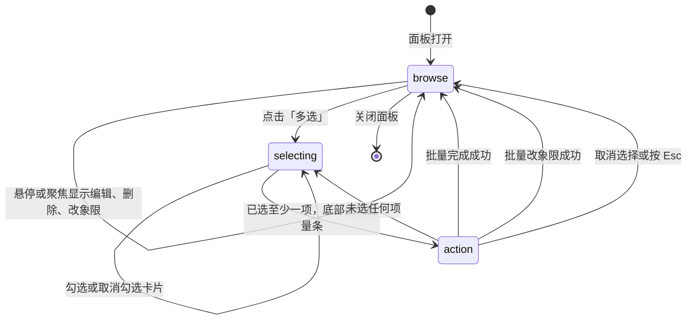

# 待办中心页面布局与样式基础规范

| 项 | 内容 |
| --- | --- |
| 文档版本 | 1.0（下一版本方案） |
| 日期 | 2026-11-03 |
| 负责角色 | design-ux-architect |
| 覆盖范围 | 页面骨架、四象限栅格、方格滚动、卡片密度、主题令牌映射、键盘操作、可直接使用的 CSS |
| 不在范围 | 四象限配色的最终取值与角标尺寸（design-ui-designer）、样式表挂载位置（engineering-software-architect）、验收结论裁决（chief-product-officer） |
| 依赖文件 | `lib/client.js`（当前实现）、`docs/PRD.md`、`docs/architecture.md` |

本文所有令牌取值均从已安装的 DSH 客户端读取，取自 `D:\Workspace\node-v24\node-v24.19.0-win-x64\node_modules\@deepseek-ai\dsh\node_modules\@deepseek-ai\dsh-client-ui-theme\lib\client.js`。对比度数值由 WCAG 相对亮度公式计算得出，计算时把 `color-mix(in srgb, A p%, B)` 按 sRGB 编码值做分量插值，与 Chromium 的实际计算方式相同。

## 1 平台事实与排版基准

| 事实 | 取值 | 出处 |
| --- | --- | --- |
| 页面内容列 | `max-width:960px;margin:0 auto;padding:0 clamp(24px,4vw,48px) 48px` | `dsh-client-ui-schedule/lib/client.js:2433`（`.t-XoWW_pageContent`）、`dsh-client-ui-plugin-manager/lib/client.js:1913`（`.X_2TxG_page>*{max-width:960px}`） |
| 页头 | `padding-top:28px;margin-bottom:24px;gap:16px` | `dsh-client-ui-schedule/lib/client.js:2493`、`dsh-client-ui-plugin-manager/lib/client.js:2012` |
| 页面标题 | `font-size:20px;font-weight:500;line-height:28px` | 同上（`.t-XoWW_pageHeading h1`、`.X_2TxG_pageTitle`） |
| 页面正文字号 | `font-size:14px;line-height:1.6` | `dsh-client-ui-schedule/lib/client.js:2433`（`.t-XoWW_page`） |
| 说明文字 | `font-size:13px;line-height:20px;color:var(--dsw-alias-label-secondary)` | `dsh-client-ui-plugin-manager/lib/client.js:1913`（`.X_2TxG_pageIntro`） |
| 列表行分隔 | `border-bottom:.5px solid var(--dsw-alias-border-l2)`；行内边距 `12px 2px` | `dsh-client-ui-plugin-manager/lib/client.js:2029`（`.X_2TxG_row`） |
| 列表行标题 | `font-size:13.5px;font-weight:500;line-height:20px` | `dsh-client-ui-plugin-manager/lib/client.js:2029`（`.X_2TxG_rowId`） |
| 列表行状态文字 | `font-size:12.5px;line-height:18px` | 同上（`.X_2TxG_rowState`） |
| 卡片型列表行 | `padding:8px;border-radius:12px;gap:12px`；列表间距 `gap:2px` | `dsh-client-ui-schedule/lib/client.js:2433`（`.t-XoWW_row`、`.t-XoWW_listRows`） |
| 圆角令牌 | `--dsw-radius-xs:4px`、`--dsw-radius-sm:8px`、`--dsw-radius-md:12px` | `dsh-client-ui-theme/lib/client.js:1413` |
| 字号令牌 | `--dsw-font-l-20` = `500 20px/28px` | `dsh-client-ui-theme/lib/client.js:1413` |
| 顶部让位变量 | `html[data-platform=darwin]{--dsh-frame-top-clearance:48px}`；页头写作 `calc(28px + var(--dsh-frame-top-clearance,0px))` | `dsh-client-ui-layout/lib/client.js`、`dsh-client-ui-schedule/lib/client.js:2493` |
| 滚动条 | 全局宽度 5px，滑块取 `--dsw-alias-scrollbar-bg-l1` 与 `--dsw-alias-scrollbar-hover-l1` | `dsh-client-ui-theme/lib/client.js:1422` |
| 焦点环 | `:focus-visible` 使用 `--dsw-focus-ring-color`（默认 `--dsw-alias-state-business-primary`），指针操作时隐藏 | `dsh-client-ui-theme/lib/client.js:1416` |
| 明暗判定 | 深色主题标记在 `body[data-ds-dark-theme]` | `dsh-client-ui-theme/lib/client.js:1419` |
| 样式表挂载先例 | 全局主题在 `document.head` 插入 `<style>`，并带 `data-plugin` 与 `data-plugin-css` 属性，随插件生命周期释放 | `dsh-client-ui-theme/lib/client.js:1446-1458` |
| `color-mix` 可用 | 平台自身样式使用 `color-mix(in srgb, var(--dsw-alias-bg-layer-1) 75%, transparent)` | `dsh-client-ui-theme/lib/client.js:1133` |
| 侧栏图标容器 | 展开态面板行按钮 `width:36px;height:36px`，图标边长由侧栏传入 16 或 18 | `dsh-client-ui-sidebar/lib/client.js:115`、`:226-227` |

本插件页面不改动上述任何全局规则，只复用 960px 内容列、28px 页头顶部间距、20/28 标题、13.5/20 行标题、0.5px 分隔线、5px 滚动条与平台焦点环。

### 1.1 与 PRD 的对应关系

PRD 已更新到 v1.1，本文直接按下列条目执行，不重复定义：13 视觉与非功能要求（`docs/PRD.md:351`，规定只用主题令牌、需要淡色底时用 `color-mix`、文字对比度 4.5:1、非文字元素 3:1、排版沿用 DSH 列表页）；14.5 页面组成（`docs/PRD.md:408`，规定 `PanelIcon` 自带样式装载）；15.7 新增验收 28 至 37（`docs/PRD.md:471-480`）。逐条落在本文的位置见下表。

| PRD 条目 | 本文位置 |
| --- | --- |
| 15.7-28 角标在面板关闭状态下位置不变 | 第 12 节 R1、第 13 节交接 |
| 15.7-29 方格按象限着色与对比度 | 第 6 节全部 |
| 15.7-30 添加面板默认 0 行子待办 | 第 8 节 |
| 15.7-31 卡片上同时只出现一个复选框 | 第 7 节 |
| 15.7-32 键盘改象限并在重启后保持 | 第 9 节「改象限」行 |
| 15.7-35 Esc 分层关闭与点击面板外关闭 | 第 9 节、第 4 节补充说明 |
| 15.7-37 无固定颜色字面量 | 第 2 节、第 12 节 R7、第 11 节 L10 |

## 2 表面层级与主题令牌映射

### 2.1 令牌实测取值

| 用途 | 令牌 | 浅色主题 | 深色主题 |
| --- | --- | --- | --- |
| 页面底 | `--dsw-alias-bg-base` | `#ffffff` | `#151517` |
| 方格底基准层 | `--dsw-alias-bg-layer-1` | `#ffffff` | `#232324` |
| 卡片底 | `--dsw-alias-bg-layer-2` | `#ffffff` | `#2c2c2e` |
| 浮层与编辑面板底 | `--dsw-alias-bg-overlay` | `#e9ecf2` | `#61666b` |
| 遮罩 | `--dsw-alias-bg-mask-1` | `#0000003d` | `#00000080` |
| 一级边界 | `--dsw-alias-border-l1` | `#0000000a` | `#ffffff0f` |
| 常规边界 | `--dsw-alias-border-l2` | `#0000001a` | `#ffffff1f` |
| 强调边界与悬停 | `--dsw-alias-border-l3` | `#0000001f` | `#ffffff29` |
| 悬停填充 | `--dsw-alias-interactive-bg-hover` | `#2631480f` | `#ffffff14` |
| 主色 | `--dsw-alias-brand-primary` | `#0f1115` | `#f9fafb` |
| 正文 | `--dsw-alias-label-primary` | `#0f1115` | `#f9fafb` |
| 次级文字 | `--dsw-alias-label-secondary` | `#61666b` | `#cfd3d6` |
| 错误与紧急 | `--dsw-alias-state-error-primary` | `#ec1313` | `#f25a5a` |
| 提醒与紧急不重要 | `--dsw-alias-state-warn-primary` | `#f59e0b` | `#f59e0b` |
| 业务色与重要不紧急 | `--dsw-alias-state-business-primary` | `#4176e6` | `#7aaaff` |
| 中性态与不重要不紧急 | `--dsw-alias-state-idle-primary` | `#d4d4d4` | `#545557` |
| 链接与行内操作 | `--dsw-alias-link` | `#4176e6` | `#7aaaff` |
| 主要按钮底 | `--dsw-alias-button-primary-fill` | 同 `brand-primary`（`#0f1115`） | 同 `brand-primary`（`#f9fafb`） |
| 主要按钮悬停底 | `--dsw-alias-button-primary-hover` | `#43454a` | `#ebeef2` |
| 主要按钮文字 | `--dsw-alias-label-primary-foreground` | `#ffffff` | `#0f1115` |
| 浮层阴影 | `--dsw-shadow-lv3` | `0 0 1px 0 #0003, 0 0 4px 0 #00000005, 0 12px 32px 0 #00000014` | 同左 |

### 2.2 表面层级的两个结论

1. 浅色主题下 `bg-base`、`bg-layer-1`、`bg-layer-2` 三者同为 `#ffffff`，方格与卡片之间没有任何明度差，方格边界只靠 `border-l1`（4% 黑）表达。用户描述的「四个象限方格看上去都是白底」由两部分构成：方格没有象限色，同时浅色主题没有可用的表面明度差。象限色解决方格的身份，方格与卡片之间的边界需要重新分配表面。
2. 深色主题三层分别为 `#151517`、`#232324`、`#2c2c2e`，层级本身成立。因此样式必须为明暗两套分别设定染色比例，用同一套比例会让深色主题里的一方格色显得更弱。

### 2.3 层级装配

| 层 | 组成 | 说明 |
| --- | --- | --- |
| 页面底 | `bg-base` | 全幅，不参与染色 |
| 方格底 | `bg-layer-1` 混入象限色 12%（浅）/ 16%（深） | 唯一带色度的表面 |
| 方格左强调条 | 象限色 42% 混入 `label-primary` | 3px 竖条，跨方格全高 |
| 卡片底 | `bg-layer-2`，不染色 | 保持中性，卡片永远读作「有色场地上的内容」 |
| 编辑面板与对话框 | `bg-overlay` + `border-l3` | 与方格底有明显明度差，浅色下为浅灰蓝 |
| 遮罩 | `bg-mask-1` | 替换现有 `rgba(0,0,0,.35)` |

## 3 页面骨架

结构为 `.tc-page`（全幅纵向）内嵌 `.tc-shell`（内容列），再依次放页头、错误行、标签、工具栏、方格、批量条。

| 元素 | 规格 | 令牌或依据 |
| --- | --- | --- |
| `.tc-page` | 纵向弹性、`height:100%`、`min-height:0`、`overflow:hidden`、14px/1.6 | 第 1 节页面正文 |
| `.tc-shell` | `max-width:960px`、居中、`padding:0 clamp(24px,4vw,48px) 24px`、`box-sizing:border-box` | 第 1 节内容列 |
| `.tc-header` | `padding-top:calc(28px + var(--dsh-frame-top-clearance,0px))`、下内边距 8px、间距 12px | 第 1 节页头与顶部让位 |
| `.tc-title` | `font:var(--dsw-font-l-20)`（500 20/28） | 第 1 节页面标题 |
| `.tc-tabs` | 间距 24px，底部 0.5px `border-l1` | 第 1 节列表行分隔 |
| `.tc-tab` | 14px/22px，内边距 `4px 0 8px`，选中 2px `brand-primary` 下划线 | `dsh-client-ui-schedule` 标签规格 |
| `.tc-toolbar` | 上下内边距 12px，间距 8px，换行 | 与页头节奏一致 |
| `.tc-grid` | 剩余高度、`gap:12px` | 第 4 节 |

内容列保持 960px，不放宽：960px 减去左右内边距（最小 24px×2）与 12px 中缝后，每个方格宽约 438–450px，能容纳单行标题、元信息与两个行内操作。四象限不需要更宽的内容区。

## 4 四象限栅格与方格滚动

| 要求 | 做法 |
| --- | --- |
| 四个方格同时展开，高度均分 | `grid-template-rows:minmax(0,1fr) minmax(0,1fr)`，`grid-template-columns:minmax(0,1fr) minmax(0,1fr)` |
| 不出现整页滚动 | `.tc-page{overflow:hidden}`，只有 `.tc-cell-body` 使用 `overflow:auto` |
| 方格内独立滚动 | `.tc-cell` 为纵向弹性容器且 `min-height:0`，`.tc-cell-body{flex:1 1 auto;min-height:0;overflow:auto}` |
| 长内容不撑破栏宽 | 两列使用 `minmax(0,1fr)`；卡片标题 `overflow:hidden;text-overflow:ellipsis;white-space:nowrap` |
| 滚动条外观 | 沿用全局 5px 规则，本节不写 `::-webkit-scrollbar` |
| 折叠后只保留标题行 | 折叠时不渲染 `.tc-cell-body`，并给方格加 `tc-cell-collapsed`，使方格盒 `align-self:start` 收缩到 40px 标题行高度；行轨道高度不变，相邻方格位置不动 |
| 折叠状态与计数 | 沿用现有 `collapsed[scopeKey][quadrantId]` 与 `items.length`，不因折叠改变 |
| 点击面板外关闭添加面板 | 在方格区与页面空白处监听按下事件，若命中目标不在 `.tc-editor` 内则关闭并丢弃已填内容（PRD 15.7-35）。现有实现只在弹层遮罩上做了关闭（`lib/client.js:996`），行内添加面板没有该行为，`.tc-cell-body` 的点击只在列表为空时触发新建（`lib/client.js:686`） |

当前实现缺少折叠态的收缩规则：四个方格是 `display:grid` 的两个 `1fr` 行，方格作为网格项默认 `align-self:stretch` 撑满行高，折叠后 `.tc-cell-body` 不渲染，但方格盒仍占满半屏，标题行下方留下整片空底色。叠加上象限色后这片空色块会更显眼，因此下一版本必须补 `tc-cell-collapsed`（依据：`lib/client.js:280` 的 `.tc-grid` 行定义、`:281` 的 `.tc-cell`、`:684` 的折叠分支）。

## 5 卡片密度

| 项 | 当前取值 | 规范取值 | 依据 |
| --- | --- | --- | --- |
| 卡片内边距 | `6px 8px` | `6px 8px` | 与 40px 单行卡高配合 |
| 卡片间距 | `margin-bottom:6px` | `margin-bottom:4px`，最后一张 0 | 列表紧凑度 |
| 圆角 | `8px` | `var(--dsw-radius-sm)` | 圆角令牌 |
| 边框 | `1px solid transparent` | `1px solid var(--dsw-alias-border-l2)` 常显 | 浅色主题下卡片与方格同为白色，透明边框让卡片失去边界 |
| 悬停边框 | `border-l2` | `border-l3` | 悬停可见 |
| 标题 | 继承 13px，无行高声明 | `13.5px/20px`，`font-weight:500` | 第 1 节列表行标题 |
| 元信息 | `12px`，无行高声明 | `12px/18px`，上外边距 2px | 第 1 节列表行状态文字 |
| 单行卡高度 | 约 32px | 34px（1px 上下边框 + 6px×2 内边距 + 20px 行高） | 计算值 |
| 带元信息卡高度 | 约 52px | 54px（34 + 2 + 18） | 计算值 |
| 方格标题行 | 内容高约 28px，上下内边距 8px | 固定 40px | 折叠后收缩基准 |
| 已完成清单行高 | `ROW_HEIGHT = 34` | 36px | `lib/client.js:13`、`:321` |
| 已完成表头 | 30px | 32px | `lib/client.js:318` |
| 已完成行分隔 | `1px solid var(--dsw-alias-border-l1)` | `0.5px solid var(--dsw-alias-border-l2)` | 第 1 节列表行分隔 |
| 已完成行悬停 | `background:var(--dsw-alias-bg-layer-1)` | `background:var(--dsw-alias-interactive-bg-hover)` | 浅色下 `bg-layer-1` 与页面底同为 `#ffffff`，当前悬停无任何可见变化（`lib/client.js:322`） |
| 表单控件高度 | 约 26px | 28px，圆角 `--dsw-radius-sm` | 平台工具按钮 28×28 |

## 6 方格带色的层级与对比度要求

### 6.1 染色配方

| 项 | 浅色主题 | 深色主题 |
| --- | --- | --- |
| 方格底 | 象限色 12% + `bg-layer-1` | 象限色 16% + `bg-layer-1` |
| 左强调条 | 象限色 42% + `label-primary` | 同式（`label-primary` 在深色为近白，结果自动变亮） |
| 标题行 | 与方格底同色，不叠第二层 | 同 |

不叠加第二层底色的原因：把标题行单独加深到 18%（浅）/ 22%（深）后，浅色红色的计数文字对比度降到 4.31:1，低于 12px 文字需要达到的 4.5:1。象限身份由「底色 + 3px 强调条 + 象限名称文字」三处共同承担，标题行不需要第四处。

### 6.2 对比度门槛与实测

门槛：正文与 13.5px 标题 ≥ 4.5:1；12px 计数与元信息 ≥ 4.5:1；3px 强调条对方格底 ≥ 3:1（非文字图形）；强调条不得改作文字色使用；四个方格两两可区分，三个有彩色象限的色度（最大通道减最小通道）≥ 12，中性象限允许色度为 0，靠强调条与方格边界识别。

浅色主题实测（12% 染色）：

| 象限 | 方格底 | 标题对比度 | 计数对比度 | 强调条对比度 |
| --- | --- | --- | --- | --- |
| 紧急且重要 | `#fde3e3` | 15.54:1 | 4.77:1 | 9.96:1 |
| 重要不紧急 | `#e8effc` | 16.36:1 | 5.02:1 | 9.46:1 |
| 紧急不重要 | `#fef3e2` | 17.22:1 | 5.28:1 | 7.01:1 |
| 不重要不紧急 | `#fafafa` | 18.10:1 | 5.56:1 | 5.76:1 |

深色主题实测（16% 染色）：

| 象限 | 方格底 | 标题对比度 | 计数对比度 | 强调条对比度 |
| --- | --- | --- | --- | --- |
| 紧急且重要 | `#442c2d` | 12.22:1 | 8.48:1 | 7.53:1 |
| 重要不紧急 | `#313947` | 11.12:1 | 7.72:1 | 8.07:1 |
| 紧急不重要 | `#453720` | 11.04:1 | 7.66:1 | 8.08:1 |
| 不重要不紧急 | `#2b2b2c` | 13.54:1 | 9.39:1 | 6.89:1 |

实测值按默认强调色映射计算，即错误色、业务色、提醒色、中性态色。配色角色调整强调色之后，数值需要按同一公式重算，门槛不变。

### 6.3 方格边界的判定口径与实测

PRD 15.7-29 要求「方格边界与相邻方格」的非文字对比度不低于 3:1。淡色底加 0.5px 边框达不到这个数值，三组实测可以说明：方格边框 `border-l2` 叠在白底上约为 `#e6e6e6`，与红色方格底 `#fde3e3` 的对比度只有 1.03:1；按「强调色混入 `bg-layer-1`」的配方，染色比例的上界是纯强调色，提醒色 `#f59e0b` 对白色页面底只有 2.15:1、中性态色 `#d4d4d4` 只有 1.48:1，这两个象限无论染到多少都到不了 3:1；要让方格底自身达到 3:1，错误色需要染到约 75%（`#f14e4e`，3.54:1），四个方格会成为中深色块，卡片与次级文字需要整体重算。

因此「方格边界」由 3px 强调条承担，判定对象是强调条与相邻方格底。实测最小值：

| 象限 | 强调条对相邻三个方格底的最小对比度（浅色） | 同项（深色） |
| --- | --- | --- |
| 紧急且重要 | 10.48:1 | 6.80:1 |
| 重要不紧急 | 8.99:1 | 8.01:1 |
| 紧急不重要 | 6.33:1 | 8.14:1 |
| 不重要不紧急 | 4.95:1 | 5.62:1 |

全部高于 3:1。若把 29 读作「方格底自身对页面底达到 3:1」，需要更换提醒色与中性态色的取值（这两色自身达不到），并把错误色与业务色染到 70% 以上，四个方格成为中深色块，卡片、次级文字与逾期标记都要重新计算对比度；这一读法需要 CPO 与配色角色一并裁定，本文按强调条口径实现。

### 6.4 卡片与方格的分界

卡片保持 `bg-layer-2` 不染色，靠三件事与方格底分开：色度差（浅色主题下为白色卡片位于带色场地上）、1px `border-l2`、悬停时 `border-l3`。实测卡片底与方格底的明度比只有 1.01–1.22，因此边框必须常显，不能保留透明。

### 6.5 逾期卡片在红色方格里的区分

「紧急且重要」方格的强调色是错误色，逾期标记也是错误色，两者会同色。要求逾期卡片同时具备三个信号：1px `state-error-primary` 边框、卡片内部左侧 2px 错误色窄条、元信息里错误色的「已逾期 X」文字。方格强调条在方格左缘，逾期窄条在卡片内部，位置不同，叠加后仍可分辨。逾期表现的具体视觉取值由 design-ui-designer 定稿。

## 7 卡片上「完成」与「多选」的交互方案

### 7.1 方案：多选模式开关

卡片左侧只保留一个控件位，同一时刻只存在一个控件。多选由页面工具栏的「多选」按钮开启，不再依赖悬停出现第二个复选框。



| 项 | 规格 |
| --- | --- |
| 控件位位置 | 卡片左侧，20×20 命中格，垂直中心与标题首行中心相同（标题 20px 行高） |
| 控件尺寸 | 复选框 15×15，命中区 20×20，不用 `opacity` 隐藏 |
| 浏览态 | 控件位放完成复选框，常显；卡片可展开、可拖拽、显示编辑/删除/改象限 |
| 多选态 | 控件位换为选择复选框，同尺寸同位置，切换不产生位移；不渲染完成复选框 |
| 多选态下的卡片 | 不展开、不拖拽、不显示操作按钮，每张卡只有一个 Tab 停靠点 |
| 多选开关 | 工具栏按钮，`aria-pressed` 反映状态，文案在「多选」与「退出多选」之间切换 |
| 批量条 | 已选数量 ≥ 1 时出现在内容列底部，含「已选 N 项」「取消选择」「批量完成」「批量改象限」 |
| 退出条件 | 批量操作完成、取消选择、按 Esc、切换标签、关闭面板 |
| 键盘 | Tab 到控件位后 Space 切换；多选开关按 Space 或 Enter 切换；Esc 先退出多选态 |
| 快照可读性 | 选择复选框带 `aria-label="选择 标题"`，完成复选框带 `aria-label="完成 标题"` |

### 7.2 与现有实现的差异

| 现状 | 位置 | 后果 |
| --- | --- | --- |
| 卡片同时渲染两个复选框，选择框 `opacity:0`，仅 `:hover` 与 `:card-selected` 时显现 | `lib/client.js:298-299`、`:788-803` | 悬停时左侧并排出现两个方框，第一个还是半透明出现，用户无法区分用途 |
| 选择框的显现条件里没有 `:focus-within` | `lib/client.js:299` | Tab 键会停在完全透明的复选框上，键盘用户看不到焦点位置 |
| 完成复选框是卡片内独立子元素，不在控件位内 | `lib/client.js:797-803` | 换成单控件位时，完成框要移入 `.tc-check-slot` |

PRD 6.8 现写「卡片左侧悬停出现多选框」，本方案改为工具栏模式开关（见第 13 节）。PRD 15.7-31 的三项要求（卡片上同时只出现一个复选框、未悬停时完成动作可见可识别、多选入口获得键盘焦点时可见）本方案逐项满足：浏览态只有完成框且常显，多选态只有选择框，多选入口是常显的工具栏按钮，任何时刻都不存在第二个复选框。6.8 的措辞与 31 的判定口径不一致，需要 CPO 在 6.8 内同步改写。

## 8 添加面板默认折叠子待办的布局

### 8.1 字段顺序与默认态

自上而下：标题、计划截止日期与具体时间、描述、子待办区、操作行。

| 状态 | 子待办区内容 |
| --- | --- |
| 默认（无子待办） | 一行文字按钮「添加子待办」，右侧或下方说明「保存后也可以在卡片中继续添加」 |
| 点击一次 | 插入一行输入框并自动聚焦，按钮文案改为「再添加一行」，行尾出现「移除」 |
| 已有多行 | 每行一个输入框与「移除」，最后一行下方保留「再添加一行」 |

默认态不创建任何子待办输入框：`useEditorFields` 的初始值由 `children: initial?.children ?? ['']` 改为 `?? []`（`lib/client.js:880`），渲染处按数组长度决定是否出现输入行（`lib/client.js:952-971`）。

### 8.2 垂直空间核算

窗口高度 900px 时：页头顶部 28 + 标题行 28 + 页头下内边距 8 + 标签 32 + 工具栏 52 + 内容列底部 24 = 172px，方格区高 728px，每行 352px，减方格标题行 40px 后列表区约 312px。

默认态编辑面板高度：标题 50 + 日期行 50 + 描述 86 + 子待办按钮 28 与说明 18 + 操作行 28 + 块间距 40 + 内边距 24 = 324px，略高于 312px。带一行子待办再增 34px。

因此面板必须满足两条：`max-height:100%` 与内部滚动；「保存」「取消」放在面板底部粘滞行，滚动时始终可见。这样默认态与带行状态都能完成保存，不会出现保存按钮处于可视区之外。

### 8.3 键盘按键约定

| 场景 | 行为 |
| --- | --- |
| 面板打开 | 焦点进入标题输入框 |
| 标题输入框按 Enter | 保存 |
| 子待办输入框按 Enter | 新增一行，焦点移到新行 |
| 日期、时间、描述内按 Enter | 不保存（现状会对任意 `input` 的回车触发保存，见 `lib/client.js:947`） |
| 描述内 Enter | 换行 |
| 移除某行 | 焦点回到「添加子待办」按钮 |
| Esc | 关闭面板，不保留已填内容，焦点回到添加按钮 |

## 9 键盘操作与焦点管理

| 场景 | 规格 | 现状与位置 |
| --- | --- | --- |
| Tab 顺序 | 页头（工作区、关闭）→ 标签 → 工具栏 → 多选开关 → 各方格标题行（收起、添加）→ 卡片控件位 → 标题展开按钮 → 编辑 → 删除 | 卡片标题展开是 `div` 的点击，键盘不可达（`lib/client.js:804`） |
| 展开卡片 | 由真实 `button` 承载，带 `aria-expanded` 与 `aria-controls`，Enter 与 Space 均可 | 同上 |
| Esc 逐层关闭 | 对话框 → 行内编辑面板 → 多选态 → 关闭面板回到对话 | 对话框没有 Esc 处理，只有弹层编辑面板在自身 `onKeyDown` 里处理（`lib/client.js:999-1001`）；确认对话框 `lib/client.js:1014-1024` 没有；页面层没有全局 Esc |
| 点击面板外 | 添加面板与弹层都支持点击外部关闭，已填内容不保留（PRD 15.7-35） | 弹层遮罩已支持（`lib/client.js:996`），行内添加面板不支持 |
| 焦点可见 | 不写 `outline:none`，由平台 `:focus-visible` 提供焦点环 | `.tc-input` 设了 `outline:none`（`lib/client.js:267`），键盘聚焦输入框时看不到焦点 |
| 对话框 | `role="dialog"`、`aria-modal="true"`、打开时聚焦首个按钮、Tab 在对话框内循环、关闭后焦点回到触发控件 | 只有 `role` 与 `aria-modal`，没有初始焦点、没有焦点循环（`lib/client.js:1015-1016`） |
| 空方格 | 「暂无任务，点击添加」用 `button` 承载，可聚焦、可回车 | 是 `div` 的 `onClick`（`lib/client.js:686`），键盘不可达 |
| 改象限 | 卡片操作里补「改象限」，与「编辑」「删除」并列，作为拖拽的键盘替代 | PRD 6.5 要求三项，实现只有两项（`lib/client.js:866-869`） |
| 折叠按钮 | 已有 `aria-expanded` 与动态 `aria-label`，补 `aria-controls` 指向列表区 | `lib/client.js:676-681` |
| 拖拽 | 保留原生拖放，拖拽期间不影响键盘路径 | `lib/client.js:782-787`、`:658-668` |

## 10 可直接使用的 CSS

替换 `lib/client.js` 的 `STYLE_TEXT`（`lib/client.js:261-331`）。颜色只取 `--dsw-alias-*`；圆角与字号取 `--dsw-radius-*` 与 `--dsw-font-*`；顶部让位取平台变量 `--dsh-frame-top-clearance`。

需要配合的标记改动（CSS 无法单独完成）：

| 改动 | 位置 |
| --- | --- |
| 用 `.tc-shell` 包裹页头、错误行、标签、工具栏、方格、批量条 | `lib/client.js:544-647` |
| 方格 `section` 增加 `data-tc-quadrant={quadrant.id}` | `lib/client.js:656-670` |
| 折叠时给方格追加 `tc-cell-collapsed` | `lib/client.js:657` |
| 删除 `.tc-cell-dot` 元素与样式，位置由左强调条承担 | `lib/client.js:672`、`:284` |
| 完成复选框与选择复选框移入同一个 `.tc-check-slot`，按多选态二选一渲染 | `lib/client.js:788-803` |
| 卡片标题改为 `button.tc-card-title-button` | `lib/client.js:805` |
| 空方格改为 `button.tc-empty` | `lib/client.js:713-714` |
| 已完成行高常量 34 改为 36 | `lib/client.js:13` |

```css
/* 待办中心页面样式。颜色全部取 DSH 主题令牌，明暗两套各自成立。 */

/* 1 页面骨架 */
.tc-page{
  display:flex;flex-direction:column;height:100%;min-height:0;overflow:hidden;
  background:var(--dsw-alias-bg-base);color:var(--dsw-alias-label-primary);
  font-size:14px;line-height:1.6;
}
.tc-shell{
  display:flex;flex-direction:column;flex:1 1 auto;min-height:0;box-sizing:border-box;
  width:100%;max-width:960px;margin:0 auto;padding:0 clamp(24px,4vw,48px) 24px;
}
.tc-header{
  display:flex;align-items:center;gap:12px;flex:0 0 auto;
  padding-top:calc(28px + var(--dsh-frame-top-clearance,0px));padding-bottom:8px;
}
.tc-title{flex:0 0 auto;font:var(--dsw-font-l-20)}
.tc-spacer{flex:1 1 auto}

/* 2 控件：高度 28px，圆角取令牌，焦点交由平台 :focus-visible */
.tc-input,.tc-select,.tc-button{
  box-sizing:border-box;min-height:28px;padding:0 8px;
  border:.5px solid var(--dsw-alias-border-l2);border-radius:var(--dsw-radius-sm);
  background:var(--dsw-alias-bg-layer-1);color:var(--dsw-alias-label-primary);
  font:inherit;font-size:13px;
}
.tc-input:focus,.tc-select:focus{border-color:var(--dsw-alias-border-l3)}
.tc-textarea{min-height:64px;padding:6px 8px;resize:vertical;font-family:inherit}
.tc-select{max-width:220px}
.tc-button{white-space:nowrap;cursor:pointer}
.tc-button:hover{background:var(--dsw-alias-interactive-bg-hover)}
.tc-button:disabled{opacity:.45;cursor:default}
.tc-button-primary{
  background:var(--dsw-alias-button-primary-fill);border-color:var(--dsw-alias-button-primary-fill);
  color:var(--dsw-alias-label-primary-foreground);
}
.tc-button-primary:hover{background:var(--dsw-alias-button-primary-hover);border-color:var(--dsw-alias-button-primary-hover)}
.tc-link{
  background:none;border:0;padding:0;font:inherit;font-size:13px;
  color:var(--dsw-alias-link);cursor:pointer;
}

/* 3 标签与工具栏 */
.tc-tabs{
  display:flex;gap:24px;flex:0 0 auto;margin-top:8px;
  border-bottom:.5px solid var(--dsw-alias-border-l1);
}
.tc-tab{
  background:none;border:0;border-bottom:2px solid transparent;margin-bottom:-.5px;
  padding:4px 0 8px;font:inherit;font-size:14px;line-height:22px;
  color:var(--dsw-alias-label-secondary);cursor:pointer;
}
.tc-tab-active{border-bottom-color:var(--dsw-alias-brand-primary);color:var(--dsw-alias-label-primary)}
.tc-toolbar{display:flex;align-items:center;gap:8px;flex:0 0 auto;flex-wrap:wrap;padding:12px 0}
.tc-error{
  margin:8px 0 0;padding:6px 10px;border-radius:var(--dsw-radius-sm);
  background:var(--dsw-alias-bg-layer-1);border:.5px solid var(--dsw-alias-state-error-primary);
  color:var(--dsw-alias-state-error-primary);white-space:pre-wrap;
}

/* 4 四象限栅格 */
.tc-grid{
  flex:1 1 auto;min-height:0;display:grid;gap:12px;
  grid-template-columns:minmax(0,1fr) minmax(0,1fr);
  grid-template-rows:minmax(0,1fr) minmax(0,1fr);
}
.tc-cell{
  --tc-accent:var(--dsw-alias-state-idle-primary);
  --tc-cell-fill:color-mix(in srgb,var(--tc-accent) 12%,var(--dsw-alias-bg-layer-1));
  position:relative;display:flex;flex-direction:column;min-width:0;min-height:0;overflow:hidden;
  background:var(--tc-cell-fill);
  border:.5px solid var(--dsw-alias-border-l2);border-radius:var(--dsw-radius-md);
}
body[data-ds-dark-theme] .tc-cell{
  --tc-cell-fill:color-mix(in srgb,var(--tc-accent) 16%,var(--dsw-alias-bg-layer-1));
}
[data-tc-quadrant="urgent-important"]{--tc-accent:var(--dsw-alias-state-error-primary)}
[data-tc-quadrant="not-urgent-important"]{--tc-accent:var(--dsw-alias-state-business-primary)}
[data-tc-quadrant="urgent-not-important"]{--tc-accent:var(--dsw-alias-state-warn-primary)}
[data-tc-quadrant="not-urgent-not-important"]{--tc-accent:var(--dsw-alias-state-idle-primary)}
.tc-cell::before{
  content:"";position:absolute;left:0;top:0;bottom:0;width:3px;
  background:color-mix(in srgb,var(--tc-accent) 42%,var(--dsw-alias-label-primary));
}
.tc-cell-drop{border-color:var(--dsw-alias-state-business-primary);border-style:dashed}
.tc-cell-collapsed{align-self:start}
.tc-cell-head{
  display:flex;align-items:center;gap:8px;flex:0 0 auto;height:40px;
  padding:0 10px 0 13px;border-bottom:.5px solid var(--dsw-alias-border-l2);
}
.tc-cell-name{font-size:13.5px;line-height:20px;font-weight:500;white-space:nowrap}
.tc-cell-count{
  font-size:12px;line-height:18px;color:var(--dsw-alias-label-secondary);
  overflow:hidden;text-overflow:ellipsis;white-space:nowrap;
}
.tc-cell-body{flex:1 1 auto;min-height:0;overflow:auto;padding:8px 10px 8px 13px}

/* 5 卡片 */
.tc-card{
  display:flex;align-items:flex-start;gap:8px;padding:6px 8px;margin-bottom:4px;
  background:var(--dsw-alias-bg-layer-2);
  border:1px solid var(--dsw-alias-border-l2);border-radius:var(--dsw-radius-sm);
  cursor:pointer;
}
.tc-card:last-child{margin-bottom:0}
.tc-card:hover{border-color:var(--dsw-alias-border-l3)}
.tc-card-overdue,.tc-card-overdue:hover{border-color:var(--dsw-alias-state-error-primary)}
.tc-card-selected,.tc-card-selected:hover{
  border-color:var(--dsw-alias-brand-primary);
  background:color-mix(in srgb,var(--dsw-alias-state-business-primary) 8%,var(--dsw-alias-bg-layer-2));
}
.tc-check-slot{
  flex:0 0 auto;display:flex;align-items:center;justify-content:center;width:20px;height:20px;
}
.tc-check{width:15px;height:15px;margin:0;cursor:pointer;accent-color:var(--dsw-alias-brand-primary)}
.tc-card-main{flex:1 1 auto;min-width:0}
.tc-card-title-button{
  display:block;width:100%;padding:0;border:0;background:none;color:inherit;
  font:inherit;font-size:13.5px;line-height:20px;font-weight:500;text-align:left;cursor:pointer;
  overflow:hidden;text-overflow:ellipsis;white-space:nowrap;
}
.tc-card-title-done{text-decoration:line-through;color:var(--dsw-alias-label-secondary)}
.tc-card-meta{
  display:flex;align-items:center;gap:8px;flex-wrap:wrap;margin-top:2px;
  font-size:12px;line-height:18px;color:var(--dsw-alias-label-secondary);
}
.tc-warn{color:var(--dsw-alias-state-error-primary)}
.tc-mark{
  padding:0 6px;border:.5px solid var(--dsw-alias-border-l2);border-radius:var(--dsw-radius-xs);
  font-size:11px;line-height:16px;color:var(--dsw-alias-label-secondary);
}
.tc-card-actions{display:flex;align-items:center;gap:4px;flex:0 0 auto}
@media (hover:hover){
  .tc-card-actions{opacity:0;transition:opacity .12s}
  .tc-card:hover .tc-card-actions,.tc-card:focus-within .tc-card-actions{opacity:1}
}
.tc-expand{margin-top:6px;padding-top:6px;border-top:.5px dashed var(--dsw-alias-border-l2)}
.tc-desc{margin-bottom:6px;font-size:13px;color:var(--dsw-alias-label-secondary);white-space:pre-wrap}
.tc-child{display:flex;align-items:center;gap:6px;padding:2px 0}
.tc-child-title{flex:1 1 auto;min-width:0}
.tc-empty{
  display:block;box-sizing:border-box;width:100%;padding:16px 8px;
  background:none;border:0;border-radius:var(--dsw-radius-sm);
  font:inherit;color:var(--dsw-alias-label-secondary);text-align:center;cursor:pointer;
}
.tc-empty:hover{background:var(--dsw-alias-interactive-bg-hover);color:var(--dsw-alias-label-primary)}

/* 6 添加与编辑面板 */
.tc-editor{
  display:flex;flex-direction:column;gap:10px;box-sizing:border-box;
  max-height:100%;overflow:auto;margin:0 0 8px;padding:12px;
  background:var(--dsw-alias-bg-overlay);
  border:.5px solid var(--dsw-alias-border-l3);border-radius:var(--dsw-radius-md);
}
.tc-editor-head{font-size:13.5px;line-height:20px;font-weight:500}
.tc-editor-actions{
  position:sticky;bottom:0;z-index:1;display:flex;align-items:center;gap:8px;
  margin:0 -12px -12px;padding:8px 12px 12px;
  background:var(--dsw-alias-bg-overlay);border-top:.5px solid var(--dsw-alias-border-l2);
}
.tc-row{display:flex;align-items:center;gap:8px}
.tc-row-wrap{display:flex;align-items:center;gap:8px;flex-wrap:wrap}
.tc-field{display:flex;flex-direction:column;gap:4px;flex:1 1 0;min-width:0}
.tc-field-name{font-size:12px;line-height:18px;color:var(--dsw-alias-label-secondary)}
.tc-children{display:flex;flex-direction:column;gap:6px}
.tc-children-hint{font-size:12px;line-height:18px;color:var(--dsw-alias-label-secondary)}

/* 7 对话框 */
.tc-modal-mask{
  position:fixed;inset:0;z-index:40;display:flex;align-items:center;justify-content:center;
  background:var(--dsw-alias-bg-mask-1);
}
.tc-modal{
  display:flex;flex-direction:column;gap:10px;box-sizing:border-box;
  min-width:320px;max-width:560px;padding:16px;
  background:var(--dsw-alias-bg-overlay);
  border:.5px solid var(--dsw-alias-border-l2);border-radius:var(--dsw-radius-md);
  box-shadow:var(--dsw-shadow-lv3);
}
.tc-modal-text{white-space:pre-wrap}

/* 8 批量条 */
.tc-batchbar{
  display:flex;align-items:center;gap:8px;flex:0 0 auto;margin-top:12px;padding:8px 12px;
  background:var(--dsw-alias-bg-layer-1);
  border:.5px solid var(--dsw-alias-border-l2);border-radius:var(--dsw-radius-md);
}

/* 9 已完成清单 */
.tc-list{display:flex;flex-direction:column;flex:1 1 auto;min-height:0}
.tc-list-head,.tc-list-row{
  display:grid;align-items:center;gap:12px;padding:0 8px;
  grid-template-columns:minmax(140px,2fr) 88px 120px 120px 120px 84px 128px;
}
.tc-list-head{
  flex:0 0 auto;height:32px;font-size:12px;line-height:18px;
  color:var(--dsw-alias-label-secondary);border-bottom:.5px solid var(--dsw-alias-border-l2);
}
.tc-list-view{position:relative;flex:1 1 auto;min-height:0;overflow:auto}
.tc-list-canvas{position:relative}
.tc-list-row{
  position:absolute;left:0;right:0;height:36px;font-size:13px;
  border-bottom:.5px solid var(--dsw-alias-border-l2);
}
.tc-list-row:hover{background:var(--dsw-alias-interactive-bg-hover)}
.tc-ellipsis{overflow:hidden;text-overflow:ellipsis;white-space:nowrap}

/* 10 输入框上方的待确认提示条 */
.tc-dock{
  display:flex;align-items:center;gap:8px;max-width:760px;margin:0 auto 6px;padding:6px 12px;
  background:var(--dsw-alias-bg-layer-1);
  border:.5px solid var(--dsw-alias-border-l2);border-radius:var(--dsw-radius-sm);
  color:var(--dsw-alias-label-primary);font-size:12px;
}
.tc-dock-text{flex:0 0 auto;font-weight:600}
.tc-dock-note{overflow:hidden;text-overflow:ellipsis;white-space:nowrap;color:var(--dsw-alias-label-secondary)}
.tc-dock-error{min-width:0;color:var(--dsw-alias-state-error-primary);white-space:pre-wrap}

/* 11 侧栏图标容器。角标取值由 design-ui-designer 定稿，本段只保证容器不依赖面板。 */
.tc-icon-wrap{position:relative;display:inline-flex;align-items:center;justify-content:center}
.tc-badge{
  position:absolute;top:-5px;right:-7px;min-width:15px;height:15px;padding:0 4px;
  border-radius:8px;font-size:10px;line-height:15px;text-align:center;
  background:var(--dsw-alias-brand-primary);color:var(--dsw-alias-label-primary-foreground);
}
.tc-badge-alert{background:var(--dsw-alias-state-error-primary)}
```

说明两点：样式块只写了逾期卡片的边框色，卡片内部那 2px 窄条的具体几何由 design-ui-designer 按第 6.5 节的三层信号要求给出；`.tc-icon-wrap` 与 `.tc-badge` 与面板共用同一份样式表，样式表移出面板之后这两条规则才对侧栏图标生效（见第 12 节 R1）。

## 11 验收办法

每条给出可观察证据与判定方法。全部在运行实例 http://127.0.0.1:3080 上操作，浅色与深色主题各做一次。

| 编号 | 验收项 | 可观察证据 | 判定 |
| --- | --- | --- | --- |
| L1 | 方格带色，深浅两套成立 | 取 `.tc-cell` 的 `getComputedStyle(...).backgroundColor`，浅色主题四个方格为 `rgb(253,227,227)`、`rgb(232,239,252)`、`rgb(254,243,226)`、`rgb(250,250,250)`；深色主题为 `rgb(68,44,45)`、`rgb(49,57,71)`、`rgb(69,55,32)`、`rgb(43,43,44)` | 四个值两两不同，且都不同于 `.tc-page` 背景值 |
| L2 | 强调条存在且可分辨 | `.tc-cell::before` 的 `width` 为 3px，`background-color` 与方格底不同 | 取值与第 6.2 节表一致（误差 ±2/通道） |
| L3 | 文字对比度 | 按第 6.2 节数值复算；配色角色改动强调色后按同一公式重算 | 标题 ≥4.5、计数 ≥4.5、强调条 ≥3 |
| L4 | 折叠方格只保留标题行 | 折叠一个方格后 `section.tc-cell` 的 `getBoundingClientRect().height` 为 40px | 同排另一方格高度与折叠前一致（差值为 0） |
| L5 | 方格独立滚动 | 单格内容超出时 `.tc-cell-body` 的 `scrollHeight > clientHeight`，且 `document.scrollingElement.scrollHeight === document.scrollingElement.clientHeight` | 页面不出现滚动条 |
| L6 | 卡片密度 | 单行卡 `getBoundingClientRect().height` 为 34，带元信息为 54；已完成行 36，表头 32 | 误差为 0 |
| L7 | 完成与多选不再同时出现 | 每张卡内 `input[type=checkbox]` 数量在浏览态与多选态都为 1；两种状态下该控件 `getBoundingClientRect().left` 相同 | 数量为 1，横向位置差 ≤1px |
| L8 | 键盘可完成全部操作 | 从工具栏开始逐次 Tab，记录 `document.activeElement` 顺序与第 9 节表格一致；用键盘完成建单、完成、展开、改象限、删除、切标签 | 每一项都能到达并生效 |
| L9 | 焦点可见 | 键盘 Tab 到 `.tc-input` 时 `getComputedStyle(el).outlineStyle` 不为 `none` | 焦点环可见 |
| L10 | 无固定颜色 | 在样式文本内检索 `rgba(` 与十六进制颜色 | 命中数为 0（当前命中 2 处：`lib/client.js:312`、`:313`） |
| L11 | 添加面板默认无子待办行 | 打开添加面板，子待办区无 `input`，只有「添加子待办」按钮；点击后出现 1 行并处于聚焦 | DOM 查询结果与聚焦元素吻合 |
| L12 | 折叠状态与滚动互不影响 | 折叠两个方格后，剩余方格不重排、页面不出现滚动条 | 与 L4、L5 同次检查 |
| L13 | 方格边界可分辨 | `.tc-cell::before` 的 `background-color` 与相邻方格 `.tc-cell` 的 `background-color` 逐对比较 | 每对都 ≥3:1（第 6.3 节数值） |
| L14 | 浮层关闭路径 | 打开确认对话框按 Esc 关闭；打开添加面板后点击面板外区域，面板关闭且再打开时字段为空 | 两条都成立（PRD 15.7-35） |

L1 至 L6、L10、L13 在样式与标记改动到位后即可判定；L7、L8、L11、L14 需要多选模式、表单与浮层改动到位；L9 需要移除 `outline:none`。未通过的项不得记为通过。

## 12 风险与前置条件

| 编号 | 位置 | 触发 | 影响 | 验证方法 | 类型 |
| --- | --- | --- | --- | --- | --- |
| R1 | 样式表在面板组件内（`lib/client.js:333-335`、`:545`、`:1247`），`PanelIcon` 自身没有装载样式（`lib/client.js:339-371`），与 PRD 14.5「`PanelIcon` 自带样式装载」不一致（`docs/PRD.md:408`） | 面板卸载 | `styleCount` 为 0，侧栏图标与角标丢失全部样式，角标退化为静态定位 | 关闭面板后查询 `document.querySelectorAll('style')` 数量与角标 `getComputedStyle` | 已实测（用户提供：关闭后 7.5×19、静态定位，打开后 23×15、绝对定位） |
| R2 | 浅色主题三表面同色（令牌取值见 2.1） | 浅色主题 | 方格与卡片没有明度差，加色之前整页是一张白纸 | 采样 `bg-base`、`bg-layer-1`、`bg-layer-2` 的计算值 | 代码与令牌证据 |
| R3 | 折叠方格仍占半屏（`lib/client.js:280-281`、`:684`） | 折叠任一方格 | 标题行下方留下整片空底色，加色后更显眼 | 折叠后量 `section.tc-cell` 高度 | 代码证据，未在实例中量测 |
| R4 | 选择复选框 `opacity:0` 且显现条件没有 `:focus-within`（`lib/client.js:298-299`） | 键盘 Tab | 焦点停在不可见控件上 | Tab 后读 `document.activeElement` 与其 `opacity` | 代码证据 |
| R5 | 确认对话框无 Esc、无初始焦点、无焦点循环（`lib/client.js:1014-1024`） | 打开删除确认 | 键盘用户无法用 Esc 退出，焦点留在背景 | 打开对话框后按 Esc | 代码证据 |
| R6 | 任意 `input` 回车即保存（`lib/client.js:947`） | 在日期或时间输入框按 Enter | 表单在未填标题时提前提交并报错 | 在日期框按 Enter | 代码证据 |
| R7 | 两处固定颜色（`lib/client.js:312`、`:313`） | 任何主题 | 违反 PRD 13「不写固定颜色值」 | 样式文本检索 | 代码证据 |
| R8 | 已完成行悬停无可见变化（`lib/client.js:322`） | 浅色主题悬停 | 悬停反馈缺失 | 悬停前后采样 `background-color` | 代码与令牌证据 |
| R9 | 侧栏收起时面板列表整块隐藏（`dsh-client-ui-sidebar/lib/client.js:115` 中 `[data-windows-titlebar] .hHd-Xa_collapsed .hHd-Xa_panelList{display:none}`） | Windows 桌面形态下收起侧栏 | 与 PRD 5.1「收成窄条时只显示图标」不一致，图标与角标一起消失 | 桌面端收起侧栏后查询面板列表 `display` | 代码证据，运行实例为浏览器形态，未验证 |
| R10 | 方格内渲染全部卡片（`lib/client.js:715-724`） | 单格接近 1000 条 | 滚动与拖拽可能掉帧，PRD 13 要求 1000 条下流畅 | 造 1000 条后测量滚动帧时间 | 未验证 |
| R11 | 角标逾期判定只在数据变化时执行（`lib/client.js:347-349`） | 待办到点但无任何写操作 | 角标颜色可能长时间不变为强调色 | 造一条即将到期的待办，等待跨过截止时间后观察角标 | 代码证据，未验证 |
| R12 | `--dsw-alias-brand-primary` 为单色（浅 `#0f1115`、深 `#f9fafb`） | 把「重要不紧急」按 architecture.md 映射到该令牌 | 该象限染出来是灰白，显示不出象限差别 | 采样该方格背景色 | 代码与令牌证据 |

每个阻断项的最小修法与回归用例：

| 编号 | 最小修法 | 回归用例 |
| --- | --- | --- |
| R1 | 样式表改为随插件注册生命周期挂载（结构角色定稿位置），面板与图标都只引用类名 | 关闭面板后 `styleCount` ≥1，角标 `position` 为 `absolute`、尺寸 23×15 |
| R2 | 方格底加象限色混合，卡片保持 `bg-layer-2` 并常显 `border-l2` | L1、L3、L6 |
| R3 | 折叠时追加 `tc-cell-collapsed`，方格盒 `align-self:start` | L4、L12 |
| R4 | 选择控件只在多选态渲染，浏览态不渲染 | L7、L8 |
| R5 | 补 Esc、初始焦点、焦点循环与焦点归还 | L8 |
| R6 | 只在标题输入框的回车触发保存，子待办输入框回车新增一行 | L11 与第 8.3 节逐条走查 |
| R7 | 遮罩改 `--dsw-alias-bg-mask-1`，阴影改 `--dsw-shadow-lv3` | L10 |
| R8 | 悬停改 `--dsw-alias-interactive-bg-hover` | L6 附带检查 |
| R9 | 交 CPO 判定 PRD 5.1 的表述是否需要改为「收起时隐藏面板列表」 | 桌面端收起/展开各一次 |
| R10 | 方格内按可视区渲染，与已完成清单共用行高常量 | 1000 条滚动帧时间 |
| R11 | 角标所在组件加一分钟定时器，与面板的判定节奏一致 | 跨过截止时间后角标变强调色 |
| R12 | 「重要不紧急」改用 `--dsw-alias-state-business-primary`，由配色角色确认 | L1、L3 |

### 12.1 交付后的状态

| 编号 | 交付结果 | 证据 |
| --- | --- | --- |
| R1 | 已修复。样式表由 `apply` 的 `ctx.effect` 插入 `document.head` 并在插件禁用时移除，三个挂载点只使用类名 | 面板关闭、面板打开、再次关闭三种状态下带 `data-dsh-todo-center` 的样式元素都是 1 个；角标 `position` 为 `absolute`、`top` 为 -5 像素、`right` 为 -7 像素、尺寸 23×15，三种状态完全一致；侧栏入口按钮的文本不含样式文本 |
| R2 | 已修复。方格底为象限色 12% 混入 `bg-layer-1`，左缘 3 像素强调条为 42% 混入 `label-primary`，卡片常显 `border-l1` | 四个方格的 `backgroundColor` 互不相同且都不是纯白，左缘宽度都是 3 像素 |
| R3 | 已修复。折叠方格追加 `tc-cell-collapsed` 并 `align-self:start`；同一行两格都折叠时该行轨道改为 `auto` | 折叠后方格高度不超过 48 像素、列表区不再渲染，同一行另一格仍高于 100 像素；同一行两格都折叠时该行轨道为 `auto` |
| R4 | 已修复。卡片只有一个 20×20 控件位，浏览态放完成框，多选态换为选择框 | 浏览态与多选态都只有 1 个复选框，`tc-check-slot` 的 `opacity` 为 1；多选态下卡片不渲染行内操作按钮 |
| R5 | 已修复。确认对话框补 Esc、初始焦点与 Tab 循环 | 代码确认；本轮的自动检查未覆盖对话框焦点，列入手工走查 |
| R6 | 已修复。只有标题输入框的回车触发保存，子待办输入框的回车新增一行 | 代码确认；自动检查覆盖了子待办行数为 0 与新增一行后聚焦 |
| R7 | 已修复。遮罩改 `bg-mask-1`，阴影改 `bg-mask-2` | 样式文本内固定颜色命中数为 0 |
| R8 | 未修复。已完成清单的行悬停仍无底色变化 | 本轮未改动该规则，列入下一版本 |
| R9 | 未修复。Windows 桌面形态下侧栏收起时面板列表整块隐藏，图标与角标一起消失 | 运行实例为浏览器形态，无法复现；需在桌面端验证 |
| R10 | 未修复。方格内仍渲染全部卡片，未按可视区渲染 | 代码确认，列入下一版本 |
| R11 | 未修复。角标的逾期判定仍只在数据变化时执行 | 代码确认，列入下一版本 |
| R12 | 已修复。「重要不紧急」改用 `state-business-primary` | 四个方格底色互不相同即为该项的观察证据 |

第 10 节给出的完整 CSS 是设计稿。交付实现保留既有基础规则（13 像素字号、10/16 像素内边距、1 像素边框、34 像素行高），只替换了着色、单控件位、折叠、焦点环、弹层配色与编辑器粘滞操作行这些规则，共 26 条。完整规则以 `lib/client.js` 的 `STYLE_TEXT` 为准。

## 13 与其他角色的交接

| 接收方 | 事项 |
| --- | --- |
| engineering-software-architect | 样式表挂载位置与生命周期（R1）。本文假定的做法是随插件注册作用域在 `document.head` 插入带 `data-plugin` 的 `<style>`，与 `dsh-client-ui-theme/lib/client.js:1446-1458` 的先例一致；最终位置由其定稿。另需确认第 10 节列出的 8 处标记改动在 `client.js` 中的位置，以及是否把样式常量改为独立文件 |
| design-ui-designer | 三个约束交由其定稿：四象限强调色的令牌选择（R12 指出 `brand-primary` 为单色，本文默认用 `state-business-primary` 承担「重要不紧急」）、侧栏角标尺寸与位置、逾期卡片在红色方格中的区分（第 6.5 节已给出三层信号要求） |
| chief-product-officer | 四项裁定：6.8 的「卡片左侧悬停出现多选框」改写为工具栏模式开关，与 15.7-31 的判定口径一致；15.7-29 的「方格边界」按 3px 强调条判定，按方格底自身判定的代价见第 6.3 节；PRD 缺一条「折叠后方格盒收缩到标题行」的验收，建议补入 15.7；5.1 的「收成窄条时只显示图标」与客户端实际行为不一致（R9） |
| engineering-backend-architect | 无接口改动。仅提示方格内不做按可视区渲染时，单格全量渲染的上限与 PRD 12.4 的 1000 条对应 |
| testing-reality-checker | 第 11 节 L1 至 L14 作为新增验收项，并与 PRD 15.7 的 28 至 38 对照：L1/L2/L13 对应 29，L7 对应 31，L8 部分对应 32，L11 对应 30，L14 对应 35，L10 对应 37；交付后的实测结果见 12.1 节，L4、L7、L8、L9、L11、L14 的自动检查已执行，对话框焦点与侧栏收起两项仍需手工走查 |

未覆盖范围：英文语言资源下的文案长度对按钮与标签宽度的影响未实测；窄窗口（小于 900px 高或 960px 宽）下的表现未定义；拖拽过程的视觉反馈只沿用现有边框样式，未重新设计；单元格内键盘方向键导航不在本期范围。
